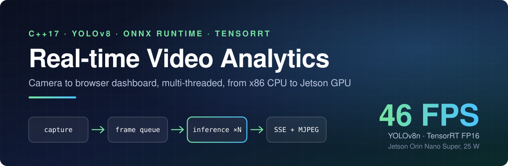
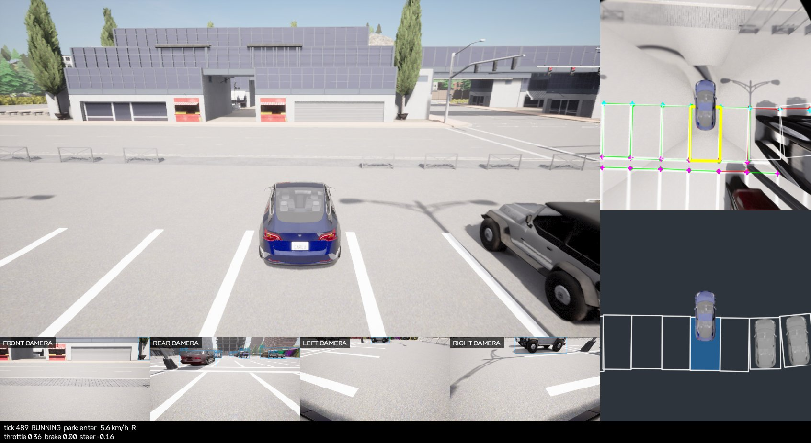
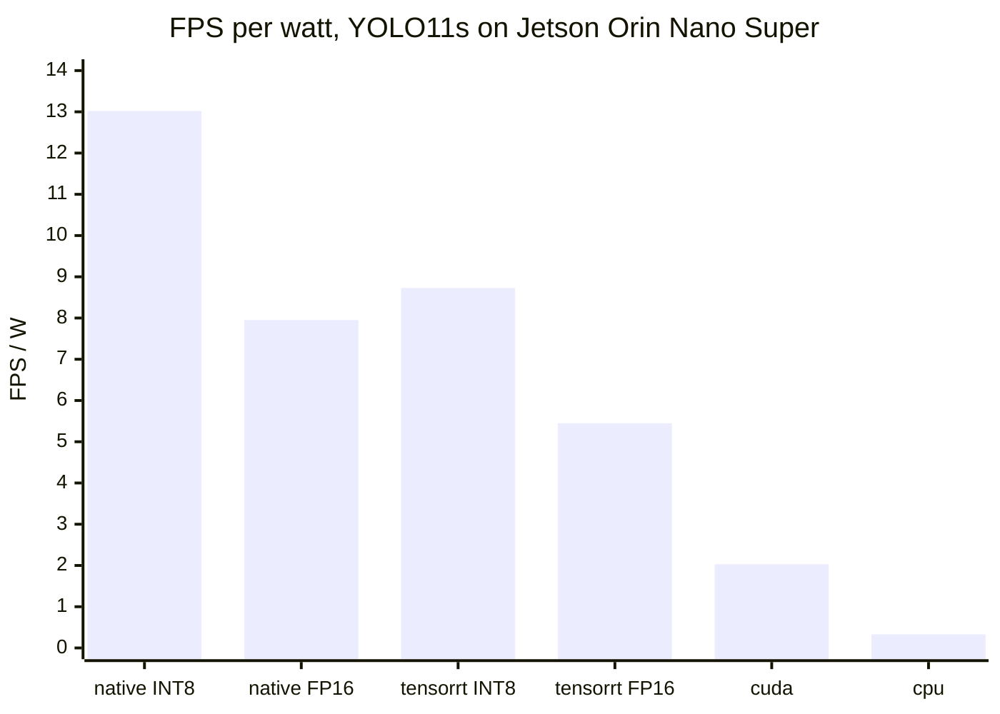
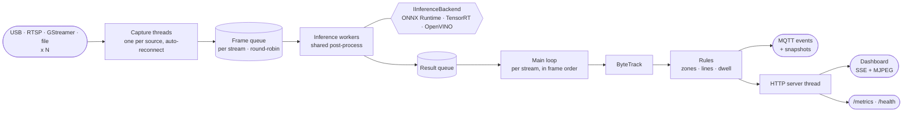
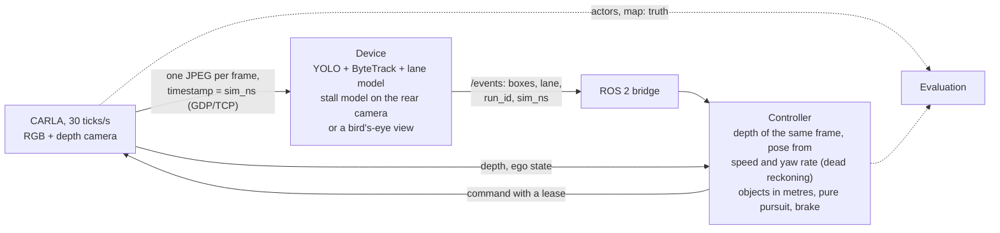
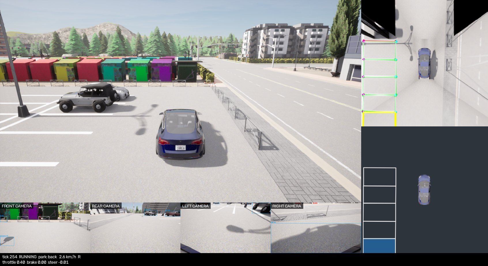
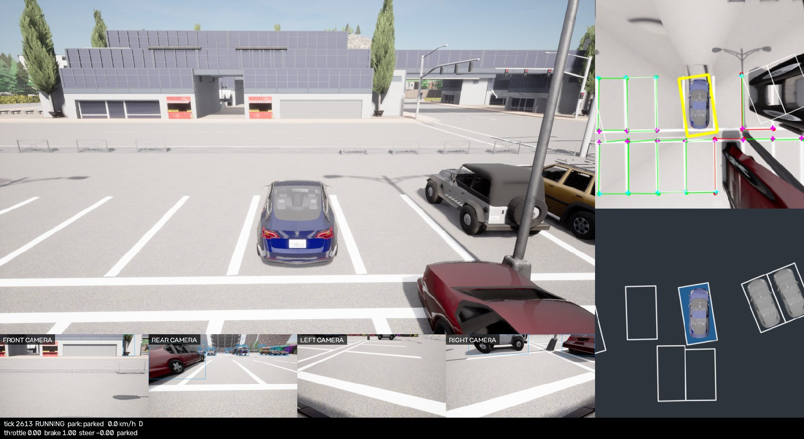

<div align="center">



<br/>

[](https://github.com/lehunghieu1503/cpp-realtime-video-analytics/actions/workflows/build.yml)


**[Quick start](#quick-start)** ·
**[Performance](#performance)** ·
**[Architecture](#architecture)** ·
**[Configuration](#configuration)** ·
**[Deploy to a Jetson](#deploy-to-a-jetson)** ·
**[Docs](#documentation)**

</div>

---

A C++17 perception stack for the edge, from cameras to a car that drives and
parks itself. The device reads any number of video sources, runs **object
detection** (YOLO with TensorRT FP16 or INT8, or FP8 from a pre-quantized model, ONNX
Runtime or OpenVINO),
tracks the objects with ByteTrack, finds the **lane** (UFLD) and, from a
**bird's-eye view** stitched on the GPU out of four cameras, the **parking
stalls**. In the [CARLA simulation](#carla-simulation) a ROS 2 controller
uses only those results, joined with the depth of the same frame and the
pose it reckons from its own speed and yaw rate, to keep the lane, brake for obstacles, overtake and back into
a free stall; on a Jetson Orin Nano Super the device runs hardware in the
loop.



<sub>`simulation/run.sh --scenario show_park_bev --arm --gui`: the vehicle backs
into the stall it chose (yellow in the bird's-eye view, top right; blue in
the controller's map below it). It ended 0.17 m along and 0.06 m beside the
stall's axis, 1.0° off, with no collision.</sub>

The same pipeline works as a video analytics service: it raises events when
objects cross a line or enter, leave or linger in a zone, publishes them over
**MQTT** (video never leaves the device), and comes with a browser
dashboard, Prometheus metrics and a Grafana board.

```bash
build/src/video_analytics --model models/yolo11s.onnx --backend cpu --rtsp rtsp://CAMERA/stream
# then open http://localhost:9001; deploy/config/config.yaml is the full
# setup (zones, MQTT, snapshots) for the Docker stack
```

## Highlights

<table>
<tr>
<td width="33%" valign="top">

### One pipeline, many accelerators
`--backend cpu | cuda | tensorrt | tensorrt-native | openvino:CPU | openvino:GPU | openvino:NPU`.
Post-processing and NMS are shared, so comparisons are fair. A missing
backend fails loudly at startup; it never falls back to CPU.

</td>
<td width="33%" valign="top">

### Tracking, zones and lines
ByteTrack gives every object an id. Zones and lines defined in YAML turn
tracks into `line_cross`, `zone_enter`, `zone_exit` and `dwell_time` events,
each with a snapshot of the frame when `snapshots.dir` is set.

</td>
<td width="33%" valign="top">

### Any number of sources
USB cameras, RTSP streams, video files and GStreamer pipelines, several at
once. Frames are served round-robin, so with more cameras than the hardware
can serve they all slow down equally instead of some starving.

</td>
</tr>
<tr>
<td valign="top">

### Measured, not claimed
A benchmark mode reports FPS, p50/p95/p99 latency, time per stage, power and
FPS per watt; an evaluation mode measures COCO mAP for the same backend.
Every number in this README came out of them.

</td>
<td valign="top">

### Zero-copy on the Jetson
A frame goes from the hardware decoder to the network input without touching
system memory: the CUDA kernel that resizes and normalises it reads the
decoder's buffer in place. Same detections, a third of the CPU.

</td>
<td valign="top">

### Runs unattended
A lost camera is reopened with exponential backoff. A watchdog exits when
results stop, so the restart policy brings up a fresh process. `/health`
and `/metrics` tell a supervisor how it is doing.

</td>
</tr>
<tr>
<td valign="top">

### Secured when asked
`SECURE=1` puts the dashboard behind HTTPS and a password, MQTT behind TLS
and a password, and Grafana behind a login. Certificates and passwords are
generated on the PC; the CA key never leaves it.

</td>
<td valign="top">

### Built on a PC, run on the board
`scripts/deploy-jetson.sh` builds the arm64 image with `docker buildx`,
sends only the layers the board lacks, copies the config and starts the
stack. The board needs no internet and builds nothing.

</td>
<td valign="top">

### ROS 2 ready
A [bridge node](#ros-2) publishes each source's detections as
`vision_msgs/Detection2DArray` and the events as a topic, so the core stays
free of ROS.

### Drives and parks a simulated car
With [CARLA](#carla-simulation) on a PC and inference on the Jetson or the
same PC, a lane model and a stall model on a bird's-eye view feed a ROS 2
controller that keeps the lane, brakes, overtakes and backs into a free
stall, every frame joined by the simulator's own timestamp.

</td>
</tr>
</table>

## Performance

### Jetson Orin Nano Super 8GB

YOLO11s at 640x640, 640x480 video, inside the `Dockerfile.jetson` container,
MAXN SUPER power mode. Latency is the time inside `detect()`: pre-process,
inference and post-process. Power is the whole board (INA3221 input rail).
mAP is on the first 500 images of COCO val2017; the INT8 rows were calibrated
on the same images, so their mAP may read slightly high.

| Backend | Precision | FPS | Latency p50 | p95 | Power | FPS/W | mAP50-95 |
|:--------|:----------|----:|------------:|----:|------:|------:|---------:|
| `tensorrt-native` | INT8 | **182.3** | **5.5 ms** | 5.5 ms | 14.0 W | **13.02** | 0.455 |
| `tensorrt-native` | FP16 | 135.2 | 7.4 ms | 7.4 ms | 17.0 W | 7.95 | 0.469 |
| `tensorrt` | INT8 | 107.4 | 9.5 ms | 9.5 ms | 12.3 W | 8.73 | 0.459 |
| `tensorrt` | FP16 | 68.7 | 14.6 ms | 14.9 ms | 12.6 W | 5.45 | **0.470** |
| `cuda` | FP32 | 31.9 | 31.4 ms | 31.5 ms | 15.8 W | 2.03 | 0.470 |
| `cpu` (2 workers) | FP32 | 3.6 | 556.6 ms | 559.2 ms | 10.8 W | 0.33 | 0.469 |



`tensorrt` runs TensorRT through ONNX Runtime's execution provider;
`tensorrt-native` talks to TensorRT itself and pre-processes on the GPU.
Native INT8 is 51x faster than the CPU at 1/39 of the energy per frame, for
0.014 mAP. The video has 250 frames, so each run measures 190 frames after a
60-frame warm-up: long enough for a rate, too short to show thermal
throttling.

Where the 2x between the two TensorRT backends comes from, FP16:

| Step | FPS | Latency p50 | Pre-process | Inference |
|:-----|----:|------------:|------------:|----------:|
| `tensorrt` (ONNX Runtime execution provider) | 68.3 | 14.7 ms | 5.20 ms | 8.93 ms |
| `tensorrt-native`, pre-processing on the CPU | 92.9 | 10.6 ms | 2.59 ms | 7.67 ms |
| `tensorrt-native`, pre-processing in a CUDA kernel | 135.2 | 7.4 ms | 0.27 ms | 6.63 ms |

`--profile-layers` then says where the remaining 6.6 ms go, layer by layer,
and the engine's layers and their precisions are saved as JSON next to it:
FP16 gives 192 FP16 and 17 FP32 layers, INT8 gives 126 INT8, 30 FP16 and
17 FP32.

### Zero-copy from the hardware decoder

1080p H.264 decoded by `nvv4l2decoder` as fast as it goes, YOLO11s FP16.
"Copy" converts each frame to BGRx in system memory and uploads it;
"zero-copy" leaves it in the decoder's buffer (NVMM), which CUDA reads in
place.

| | Copy to CPU | Zero-copy |
|:--|-----------:|----------:|
| CPU use of the process | 209% | **70%** |
| Frames decoded per second | 241 | 250 |
| Frames inferred per second | 114 | 119 |
| Board power | 19.3 W | 17.9 W |

Both give the same detections. The frame is copied to the CPU only when
somebody watches the stream or an event needs a snapshot.

### How many cameras fit

Same board and model, each camera a 960x540 MJPEG stream decoded in software,
tracking on. A row holds when the slowest camera still gets the source rate.

| Configuration | Cameras at 25 FPS | Cameras at 15 FPS |
|:--------------|:------------------|:------------------|
| `tensorrt-native` FP16, 1 worker | 4 (15.1 W) | 6 (14.6 W) |
| `tensorrt-native` FP16, 2 workers | 6 (20.1 W) | 10 (20.4 W) |
| `tensorrt-native` INT8, 2 workers | 10 at 24.3 FPS (18.6 W) | 14 (17.5 W) |
| `tensorrt` FP16, 2 workers | 4 (16.7 W) | 8 (18.6 W) |

Past the limit every camera slows together: 8 cameras at 25 FPS on native
FP16 with 2 workers each get 19 FPS. The second worker helps because
post-processing then runs in parallel while the GPU serves both.

### Laptop (Intel Core Ultra 9 275HX, RTX 5060)

Same model, video and images, built from source. Power is not reported: RAPL
is readable only by root on this machine, and the laptop's power mode was not
controlled.

| Backend | Model | FPS | Latency p50 | mAP50-95 |
|:--------|:------|----:|------------:|---------:|
| `tensorrt-native` (RTX 5060, TensorRT 11.4) | FP32 ONNX | **262.8** | **3.5 ms** | 0.469 |
| same, pre-processing on the CPU | FP32 ONNX | 203.6 | 4.9 ms | 0.470 |
| `openvino:NPU` | FP32 ONNX | 59.7 | 16.4 ms | 0.469 |
| `openvino:NPU` | INT8 (NNCF) | 40.7 | 24.1 ms | 0.367 |
| `openvino:CPU` | INT8 (NNCF) | 34.7 | 27.9 ms | 0.397 |
| `cpu` (ONNX Runtime, 2 workers) | FP32 ONNX | 18.2 | 108.9 ms | 0.470 |
| `openvino:GPU` (Arc iGPU) | FP32 ONNX | 14.2 | 70.5 ms | 0.470 |
| `openvino:CPU` | FP32 ONNX | 14.1 | 69.8 ms | 0.470 |
| `openvino:GPU` (Arc iGPU) | INT8 (NNCF) | 11.8 | 84.6 ms | 0.400 |

TensorRT 11 no longer has precision flags: it builds what the model file
says, so FP16 there means converting the model first
(`scripts/quantize-fp16.py`).

Two things the table says that a guess would get wrong: with the FP32 model
the NPU is about 4x faster than the CPU or the iGPU through OpenVINO, and
the default NNCF INT8 quantization makes the NPU *slower* while costing
0.10 mAP. On this hardware the FP32 model on the
NPU is the one to use. Each worker uses 4 threads.

<details>
<summary><b>What the pipeline optimizations bought, measured one at a time</b></summary>

<br/>

| Change | Before | After | Measured on |
|:-------|-------:|------:|:------------|
| Talk to TensorRT directly and pre-process in a CUDA kernel | 68.3 FPS | 135.2 FPS | Jetson, YOLO11s FP16 |
| Read the decoder's buffer in place instead of copying it out | 209% CPU | 70% CPU | Jetson, 1080p H.264 |
| Stitch the bird's-eye view on the GPU from the frames the detector uploaded, and run the stall model on it there | 7.8 ms | 3.8 ms | per view (4 cameras 1280x720 to 800x800 + stall model), laptop RTX 5060 beside CARLA |
| Serve streams round-robin instead of one shared queue | slowest camera: 0.7 FPS | every camera: 13.5 FPS | Jetson, 6 cameras at 25 FPS, 1 worker |
| Cap ONNX Runtime threads to the available cores | 22.6 FPS | 30.8 FPS | x86 pinned to 6 cores, 2 workers |
| Size the live frame queue to the worker count | 343 ms | 147 ms | capture-to-result delay, inference at 20 FPS |
| Build the input blob with `cv::dnn::blobFromImage` | 5.8 ms | 3.8 ms | preprocess per frame, one x86 core |
| Scan class scores in memory order | 0.55 ms | 0.45 ms | postprocess per frame, one x86 core |
| Skip drawing and the JPEG encode with no viewer | every frame | none | headless deployments |

</details>

> [!TIP]
> Run the comparison on your own hardware:
> `scripts/benchmark.sh video.avi cpu openvino:NPU tensorrt@fp16 tensorrt@int8`

## Architecture



| Design choice | Why |
|:--------------|:----|
| Backends run the tensor; post-process and NMS are shared | A benchmark compares the accelerators and nothing else. A backend may pre-process on its own device, and a test holds it to the CPU's detections. |
| Frames may stay in device memory | A capture can hand over the decoder's buffer instead of pixels; a CPU copy is made only when a frame is drawn. |
| One backend instance per worker | Sessions are never shared, so workers need no locking around inference. |
| A queue slot per stream, served round-robin | A slow consumer can never grow memory, what you see stays recent, and no camera can starve another. |
| Results are consumed in frame order per stream | Workers finish out of order; the tracker needs frames in order, so a stale result is dropped rather than buffered. |
| Workers default to 1 on an accelerator | A second session duplicates the model in memory. Use `--workers 2` when several cameras share the device. |
| Thread count follows the CPU affinity mask | Workers x intra-op threads never exceed the cores, including under `taskset` or `docker --cpuset-cpus`. |
| Latest-value broadcast instead of per-client queues | A stalled browser cannot back-pressure the pipeline. |

The threading model, data lifecycle and queue mechanics are covered in
[docs/ARCHITECTURE.md](docs/ARCHITECTURE.md).

## Quick start

**1. Get the model** (not stored in the repo):

```bash
git clone https://github.com/lehunghieu1503/cpp-realtime-video-analytics.git
cd cpp-realtime-video-analytics
pip install ultralytics
scripts/download-model.sh            # writes models/yolov8n.onnx
scripts/download-model.sh yolo11s    # or any other Ultralytics detector
```

**2. Pick how to run it:**

<details open>
<summary><b>Build from source on x86-64</b></summary>

<br/>

Needs Ubuntu 22.04+, GCC 11+, CMake 3.20+.

```bash
sudo apt install -y build-essential cmake git wget \
  libopencv-dev libeigen3-dev libmosquitto-dev libssl-dev \
  libgstreamer1.0-dev libgstreamer-plugins-base1.0-dev

# ONNX Runtime 1.20.1 (CPU)
wget https://github.com/microsoft/onnxruntime/releases/download/v1.20.1/onnxruntime-linux-x64-1.20.1.tgz
tar xzf onnxruntime-linux-x64-1.20.1.tgz
sudo cp -r onnxruntime-linux-x64-1.20.1/lib/* /usr/local/lib/
sudo cp -r onnxruntime-linux-x64-1.20.1/include/* /usr/local/include/
sudo ldconfig

cmake -B build -DCMAKE_BUILD_TYPE=Release
cmake --build build --parallel $(nproc)

build/src/video_analytics --device 0
```

Always pass `-DCMAKE_BUILD_TYPE=Release`; without it the build is unoptimized.
To keep ONNX Runtime out of `/usr/local`, unpack it anywhere and add
`-DONNXRUNTIME_ROOT=/path/to/onnxruntime`.

For the OpenVINO backends, install the
[OpenVINO archive](https://docs.openvino.ai/latest/get-started/install-openvino.html)
and add `-DOpenVINO_DIR=/path/to/openvino/runtime/cmake`. CMake prints
`OpenVINO backend: ON` when it is found. The other optional parts are found
the same way and reported at configure time: MQTT (`libmosquitto-dev`),
the native GStreamer capture, and `tensorrt-native` (TensorRT headers and
the CUDA compiler). HTTPS is enabled whenever OpenSSL (`libssl-dev`) is
found; nothing reports it, and a build without it fails at startup when
`tls` is set.

On an NVIDIA GPU whose driver is older than the CUDA toolkit, compile the
pre-processing kernel for the GPU's architecture so that the driver does
not have to: `-DCMAKE_CUDA_ARCHITECTURES=120-real` for an RTX 50 card.
Without it the backend stops with "the provided PTX was compiled with an
unsupported toolchain".

</details>

<details>
<summary><b>Docker on x86-64 (CPU)</b></summary>

<br/>

```bash
docker build -t video-analytics .
docker run --rm --device /dev/video0 -v "$(pwd)/models:/app/models:ro" \
  -p 127.0.0.1:9001:9001 video-analytics
```

</details>

<details>
<summary><b>Whole stack in Docker on an x86 laptop (Intel NPU)</b></summary>

<br/>

```bash
scripts/download-model.sh        # yolov8n, the model laptop.yaml names
scripts/run-laptop.sh            # build, then docker compose up
scripts/run-laptop.sh down
```

Runs the analytics on the NPU together with Mosquitto, Prometheus and
Grafana, all bound to `127.0.0.1` (MQTT on port 1884). Sources and backend
are set in [deploy/config/laptop.yaml](deploy/config/laptop.yaml); it expects
test frames under `data/videos/`. With yolov8n the NPU holds 4 cameras at 25
FPS; YOLO11s (change `model:` there) ran at 49.8 FPS on the NPU. `openvino:GPU` does not work in the image on Core Ultra: the
Ubuntu 22.04 OpenCL driver does not detect Arc graphics.

</details>

<details>
<summary><b>Jetson Orin</b></summary>

<br/>

```bash
scripts/deploy-jetson.sh USER@BOARD
```

See [Deploy to a Jetson](#deploy-to-a-jetson).

</details>

**3. Open the dashboard** at [http://localhost:9001](http://localhost:9001).

> [!WARNING]
> By default nothing asks for a password. From source the dashboard listens
> on `127.0.0.1` only. The Docker images listen on `0.0.0.0`, and the
> deployed stack also opens MQTT (1883), Prometheus (9090) and Grafana (3000,
> anonymous read-only, `admin`/`admin` to edit). Either keep those ports
> inside a network you trust, or deploy with `SECURE=1`
> ([Deploy to a Jetson](#deploy-to-a-jetson)).

## Configuration

Everything can be set in a YAML file passed with `--config`; command-line
flags override it. [deploy/config/config.yaml](deploy/config/config.yaml) is
a commented example.

```yaml
model: models/yolo11s.onnx
backend: tensorrt            # cpu | cuda | tensorrt | tensorrt-native | openvino:CPU|GPU|NPU
precision: fp16              # tensorrt only: fp32 | fp16 | int8
classes: [person]            # keep only these COCO classes
dwell_seconds: 5

sources:
  - id: entrance
    rtsp: rtsp://192.168.1.20:554/stream1
    zones:
      - name: door
        points: [[300, 200], [660, 200], [660, 440], [300, 440]]
    lines:
      - name: gate
        a: [0, 300]
        b: [960, 300]
  - id: yard
    device: 0                # or  file: clip.mp4  or  gst: "... ! appsink"

mqtt:
  host: mosquitto
  topic: video-analytics     # events go to <topic>/<source id>/<event type>
snapshots:
  dir: snapshots
  keep: 200
```

Passwords and certificates go in `auth`, `tls` and `mqtt`
(`username`, `password`, `ca_file`), or better in the environment, where the
`VA_HTTP_*`, `VA_TLS_*` and `VA_MQTT_*` variables override the file.

An object is located by the bottom centre of its box. Crossing a line from
the right of `a → b` to its left counts as `in`, the other way as `out`,
with left and right taken with y up: for a line drawn left to right on the
image, `in` is moving down the image.

## What the server exposes

| Endpoint | Content |
|:---------|:--------|
| `/` | The dashboard: one card per source, live counters, event log |
| `/video?stream=N` | MJPEG of source N with boxes, track ids, zones and lines drawn in |
| `/events` | Server-Sent Events: the latest JSON object of each source whenever it changes. A reader slower than the source misses frames; a reader that reconnects gets the latest one again |
| `/streams` | Source ids with their zone and line names |
| `/metrics` | Prometheus metrics: FPS, latency, events, occupancy, power, memory |
| `/health` | `200 {"status":"ok"}` while results flow, `503` otherwise |

```json
{
  "stream": "entrance", "frame_id": 42, "fps": 25.0, "latency_ms": 29.7,
  "detections": [
    { "class": "person", "confidence": 0.94, "track_id": 7,
      "bbox": { "x": 100, "y": 50, "w": 200, "h": 300 } }
  ],
  "zones": [2], "lines_in": [14], "lines_out": [9],
  "events": [
    { "type": "line_cross", "stream": "entrance", "name": "gate",
      "track_id": 7, "class": "person", "direction": "in",
      "timestamp": 1760000000.25, "snapshot": "snapshots/..._line_cross_7.jpg" }
  ]
}
```

Every result also carries `"image": {"width": W, "height": H}`, the size of
the source frame the boxes are in. Three more blocks appear only when asked
for in the configuration:

- `simulation: {enabled: true}`: `"simulation": {"run_id": ..., "sim_ns": ...}`,
  the run and the frame's own timestamp in nanoseconds, exactly as the
  source sent it. A frame without a timestamp stops the pipeline.
- `lane: true` on a source: `"lane"` with the lane boundaries either side
  of the vehicle and its centreline in metres, the lateral error, heading
  and curvature, and `valid: false` with a reason and `null` values when
  there is no usable lane. See [CARLA simulation](#carla-simulation).
- `stall: true` on a source: `"stalls"`, each stall's class (empty or
  occupied), confidence, box and corners, and `"stall_points"`, the ends of
  the stall dividers the model found.

The objects under `events` are what MQTT subscribers receive, one message
each, at QoS 1:

```bash
mosquitto_sub -h BOARD -t 'video-analytics/#' -v
```

## CLI reference

```text
video_analytics [OPTIONS]                  Live mode
video_analytics --benchmark OPTIONS        Benchmark mode
video_analytics --eval-coco DIR OPTIONS    Detections for mAP
```

| Flag | Description | Default |
|:-----|:------------|:--------|
| `--config FILE` | YAML configuration | none |
| `--device N` | V4L2 (USB) camera index | `0` |
| `--rtsp URL` | RTSP or HTTP stream, decoded by FFmpeg | none |
| `--gst PIPELINE` | GStreamer pipeline ending in `appsink` | none |
| `--streams N` | Open the command-line source N times (capacity tests) | `1` |
| `--model PATH` | ONNX model, or OpenVINO IR (`.xml`) for an OpenVINO backend | `models/yolov8n.onnx` |
| `--backend NAME` | `cpu`, `cuda`, `tensorrt`, `tensorrt-native`, `openvino:CPU`, `openvino:GPU`, `openvino:NPU` | `cpu` |
| `--precision P` | TensorRT backends: `fp32`, `fp16`, `int8` | `fp16` |
| `--cpu-preprocess` | Pre-process on the CPU even when the backend can on the GPU | off |
| `--conf X` | Confidence threshold | `0.5` |
| `--workers N` | Inference worker threads, 1 to 16 | `2`, or `1` on an accelerator |
| `--port N` | Dashboard port | `9001` |
| `--bind ADDR` | Listen address | `127.0.0.1` |
| `--headless` | No local window, dashboard only | off |
| `--no-dashboard` | No page and no video on the port: results (`/events`), `/health` and `/metrics` only. `dashboard: false` in the config does the same | off |
| `--benchmark` | Benchmark a video file instead of running live | off |
| `--input FILE` | Benchmark input video | required |
| `--frames N` | Frames to measure | `300` |
| `--warmup N` | Frames to skip first | `30` |
| `--output FILE` | Write the benchmark report as Markdown | none |
| `--csv FILE` | Append the results as one CSV line | none |
| `--profile-layers` | Add the time per layer to the report (`tensorrt-native`) | off |
| `--eval-coco DIR` | Run the detector over a directory of `.jpg` images | none |
| `--eval-out FILE` | Where to write those detections | `detections.json` |

`--provider` still works as an alias of `--backend`.

```bash
# Two RTSP cameras with zones, from a config file
build/src/video_analytics --config site.yaml --headless --bind 0.0.0.0

# Intel NPU
build/src/video_analytics --model models/yolo11s.onnx --backend openvino:NPU

# Benchmark, then mAP, for one backend
build/src/video_analytics --benchmark --input test.avi --backend tensorrt --output report.md
build/src/video_analytics --eval-coco data/coco/val2017 --backend tensorrt
scripts/eval-map.py detections.json
```

> [!NOTE]
> Run the binary from the repository root: the dashboard is read from `web/`
> relative to the working directory.

### INT8

```bash
scripts/coco-subset.sh 500                                   # calibration and mAP images
scripts/calibrate-int8.py models/yolo11s.onnx data/coco/val2017      # TensorRT
scripts/quantize-openvino.py models/yolo11s.onnx data/coco/val2017   # OpenVINO
```

The first writes `models/yolo11s.calibration` and
`models/yolo11s.calibration.cache`; `deploy-jetson.sh` ships them and
`precision: int8` uses them (TensorRT 10; TensorRT 11 takes INT8 only from a
model with quantize/dequantize nodes). The second writes `models/yolo11s_int8.xml`,
to be passed as `--model`.

TensorRT 11 builds INT8 only from such a model:

```bash
scripts/quantize-int8.py models/yolo11s.onnx IMAGES          # models/yolo11s_int8.onnx
scripts/quantize-int8.py --exclude '^/model\.2/' \
    models/stall-bev-town05.onnx data/stalls-bev/images/train
scripts/quantize-int8.py --fp8 models/yolo11s.onnx IMAGES    # _fp8.onnx, with ModelOpt
simulation/run.sh --scenario show_park_bev --arm --int8     # or --fp8, --fp16
```

They run with `precision: fp16`; the file says which layers are INT8 or FP8.
`IMAGES` must not be the images the model is then measured on. INT8 everywhere
makes the bird's-eye-view stall model take empty stalls for occupied ones;
keeping `/model.2/` out of INT8 brings it back to FP32's classes. FP8 needs
Ada, Hopper or Blackwell, not a Jetson.

## Deploy to a Jetson

Source, scripts and configuration stay on the PC. The board only runs.

```bash
scripts/download-model.sh yolo11s        # the model named in deploy/config/config.yaml
scripts/deploy-jetson.sh USER@BOARD      # build, ship, start
```

The script builds `Dockerfile.jetson` for arm64 with `docker buildx` (QEMU),
pulls the arm64 Mosquitto, Prometheus and Grafana images, sends each image
over SSH without the layers the board already has, copies `deploy/` and the
model, and runs `docker compose up -d` there. After the first run a code
change ships as a few megabytes instead of the 11 GB image.

| On the board | |
|:--|:--|
| Dashboard | `http://BOARD:9001` |
| Grafana | `http://BOARD:3000` |
| Prometheus | `http://BOARD:9090` |
| MQTT | `BOARD:1883` |

To change cameras, zones or the model, edit
[deploy/config/config.yaml](deploy/config/config.yaml) and run the script
again. A second argument, `scripts/deploy-jetson.sh USER@BOARD REMOTE_DIR`,
changes the directory on the board (default `~/video-analytics`).
`VIDEO_DIR=/path/on/board` mounts a directory of test videos at
`/data/videos` (default `REMOTE_DIR/videos`).

| Option | Effect |
|:-------|:-------|
| `SECURE=1` | HTTPS and a password on the dashboard and `/metrics`, TLS and a password on MQTT (port 8883, no anonymous access), a Grafana login, Prometheus reachable only from the board. `scripts/make-secrets.sh` creates a CA, a server certificate and random passwords under `deploy/secrets/` on the PC; the CA key is not shipped. The script prints where each password is. |
| `SIM=1` | Adds an RTSP server that loops video files as H.264 and H.265 cameras, read with `rtspsrc`, the hardware decoder and zero-copy frames ([deploy/config/rtsp-sim.yaml](deploy/config/rtsp-sim.yaml)). Needs `walk-1080p-h264.mp4` and `walk-1080p-h265.mp4` in `VIDEO_DIR`. |
| `SKIP_BUILD=1` | Ships the image already built; for configuration-only changes. |
| `IMAGE_ONLY=1` | Builds and ships the application image and stops: nothing on the board is changed or restarted (`simulation/run.sh` starts its own container). |

Requirements: on the PC, Docker with buildx and QEMU (`qemu-user-static`,
`binfmt-support`), `rsync` and Python 3. On the board, JetPack 6 (L4T r36.x)
with Docker, the compose plugin and the NVIDIA container runtime.

<details>
<summary><b>GStreamer pipelines: hardware decode and CSI cameras</b></summary>

<br/>

Any pipeline works as long as it ends in `appsink` and delivers BGR,
BGRx/BGRA or RGBx/RGBA frames (RGBA in NVMM memory in a `WITH_NVMM` build,
such as the Jetson image).

```yaml
# H.264 RTSP camera, hardware decoder, zero-copy: the frame stays in the
# decoder's memory (needs backend: tensorrt-native)
gst: "rtspsrc location=rtsp://CAMERA/stream protocols=tcp latency=100 ! rtph264depay ! h264parse ! nvv4l2decoder ! nvvidconv ! video/x-raw(memory:NVMM),format=RGBA ! appsink max-buffers=2 drop=true"

# The same camera copied out to system memory, for any backend
gst: "rtspsrc location=rtsp://CAMERA/stream latency=100 ! rtph264depay ! h264parse ! nvv4l2decoder ! nvvidconv ! video/x-raw,format=BGRx ! appsink drop=true max-buffers=1"

# CSI sensor
gst: "nvarguscamerasrc ! video/x-raw(memory:NVMM),width=1280,height=720,framerate=30/1 ! nvvidconv ! video/x-raw,format=BGRx ! videoconvert ! video/x-raw,format=BGR ! appsink drop=true max-buffers=1"

# No camera at hand: loop a directory of JPEG frames at 25 FPS
gst: "multifilesrc location=/data/videos/clip/f%05d.jpg start-index=1 loop=true caps=image/jpeg,framerate=25/1 ! jpegdec ! videoconvert ! video/x-raw,format=BGR ! appsink"
```

For H.265 use `rtph265depay ! h265parse`. Hardware decoding and the
zero-copy path were tested in the container with H.264 and H.265 over RTSP
from the simulator and with an H.264 file. The CSI pipeline has not been
tested with a sensor.

</details>

Things worth knowing on a Jetson:

- The first start with a new model or precision builds a TensorRT engine,
  which takes 6 to 10 minutes. It is cached in `models/trt-cache/`.
- `tensorrt-native` names its engines after the TensorRT version. The
  `tensorrt` backend does not: delete its files in `models/trt-cache/` after
  switching between a native build and the container.
- The GPU shares the system memory, and CUDA counts only free pages:
  memory held by the page cache looks taken. `tensorrt-native` evicts page
  cache before it builds an engine when free memory is low; with `tensorrt`, a build that fails with
  "Could not find any implementation for node" wants
  `sudo sh -c 'echo 3 > /proc/sys/vm/drop_caches'`.
- Use the top power mode for real runs: `sudo nvpmodel -m 2 && sudo jetson_clocks`
  (MAXN SUPER on JetPack 6.2).
- A soak test is the deployed stack left running:
  `scripts/soak-report.sh USER@BOARD [DIR] [HOURS]` summarises the current
  run from Prometheus: memory growth, lowest FPS, reconnects, GPU load.

## ROS 2

[ros2/video_analytics_bridge](ros2/video_analytics_bridge) is a ROS 2
package with one node. It reads a device's `/events` stream and publishes

| Topic | Type | Content |
|:------|:-----|:--------|
| `/video_analytics/<source>/detections` | `vision_msgs/Detection2DArray` | One message per frame; `Detection2D.id` is the track id |
| `/video_analytics/events` | `std_msgs/String` | One JSON object per rule event |

```bash
cp -r ros2/video_analytics_bridge ~/ros2_ws/src/ && cd ~/ros2_ws
colcon build --packages-select video_analytics_bridge && source install/setup.bash
ros2 run video_analytics_bridge bridge --ros-args -p url:=http://BOARD:9001

# a secured device
ros2 run video_analytics_bridge bridge --ros-args -p url:=https://BOARD:9001 \
  -p password:="$(cat deploy/secrets/run/http.password)" \
  -p ca_file:=$PWD/deploy/secrets/run/ca.crt
```

Checked on ROS 2 Humble: 25 Hz per source. The core has no ROS dependency;
the bridge runs wherever ROS 2 does and reconnects when the device restarts.

A frame of a simulation is stamped with its own time (`sim_ns`), not with
the time it was received, and is also published whole:

| Topic | Type | Content |
|:------|:-----|:--------|
| `/simulation/<run_id>/<source>/perception` | `std_msgs/String` | The device's JSON for the frame, unchanged |
| `/simulation/<run_id>/<source>/lane` | `std_msgs/String` | The same identity and image size, with the lane only |

The device keeps only its latest result per source, so these are not every
frame: a consumer joins them with other data by `(run_id, source, sim_ns)`
and treats a missing frame as missing.

[simulation](simulation) holds the CARLA adapter and the controller that use them.

## CARLA simulation

CARLA 0.9.16 runs on a PC; the device runs the detector, the tracker, a lane
model and, for parking, a stall model; a ROS 2 controller on the PC steers
and brakes the simulated car. [docs/SIMULATION.md](docs/SIMULATION.md) has the design, the run book
and every measurement (Vietnamese).



```bash
# once: the lane model, trained on the simulator's own images
simulation/lane-dataset.py --out data/lanes/town04 --count 8000   # needs CARLA
scripts/train-lane-model.py --data data/lanes/town04 --output models/lane-town04.onnx
# once: the image on the board
IMAGE_ONLY=1 scripts/deploy-jetson.sh user@board

# one scenario; --arm lets the car drive
simulation/run.sh --scenario brake_person --arm \
    --device user@board --remote-dir video-analytics-carla
```

Each run gets a new run id and a directory with everything it produced;
`simulation/evaluate.py` turns that into `summary.md` and a verdict.
Measured with the Jetson Orin Nano Super over a relayed VPN link (120 ms
round trip, about 10 Mbit/s), 1280x720 source, YOLO11s and the lane model
both FP16:

| What | Measured |
|:-----|:---------|
| Frame identity | 0 results naming a frame that was not sent, in every run |
| Device, both models | detector 8.0 ms from capture to result, lane 3.5 + 3.9 + 0.3 ms; 29.6 results/s; 11.3 W |
| Tick to result / to command applied | 216 / 237 ms median, 233 / 273 ms at P95 (64 / 100 ms with both on one PC) |
| Car recall by distance, 0-30 / 30-60 / 60-90 / 90-120 m | 1.00 / 0.99 / 0.99 / 0.00 |
| Person recall, same bins | 0.35 / 0.34 / 0.00 / 0.00 |
| Range from depth at 5 to 20 m | within 0.04 m |
| Velocity of a car at 3 m/s; accelerating at 1.5 m/s² | RMSE 0.07 m/s; 0.31 m/s and 0.28 m/s² |
| Lane centre against the map | RMSE 0.02 to 0.05 m, valid in 100 % of frames |
| Lane keeping at 9 km/h, straight and gentle curves | 0.01 to 0.05 m RMSE from the lane centre |
| Braking for a car, a truck, a person, a cut-in | stopped 3.9 to 11.3 m short in 12 runs, no collision |
| Data lost or controller killed | braked within the budget: 500 ms, 303 ms |

Scenarios on one PC show it driving and parking. `--gui` opens one window:
the vehicle seen from behind, its cameras and the view from above, with what
the device finds in them; the CARLA server stays off-screen. `--web` serves the device's dashboard as well
(`http://127.0.0.1:9011`); without it the device draws and encodes nothing
for a browser. A scenario says what the vehicle may do (`overtake: true`,
`park: true`), never when or where: it overtakes after 10 s behind a slower
car, on the side its camera shows free.

```bash
simulation/run.sh --scenario show_drive --arm --gui   # Town04, up to 50 km/h
simulation/run.sh --scenario show_park --arm --gui    # Town05's car park
```

To park, the vehicle has a rear camera and a third model on the device: it
finds the stalls in that camera's image, as the ends of their dividers and
as empty or occupied. The scenario says where the vehicle starts, never
where a stall is. The model is trained on images CARLA labels by itself:

```bash
simulation/stall-dataset.py make --out data/stalls    # 4400 images, needs CARLA
scripts/train-stall-model.py --data data/stalls --output models/stall-town05.onnx
```

| Show | Measured |
|:-----|:---------|
| `show_drive`, 4 runs | follows a car at 30 km/h, 37 m behind, decides after 10 s to overtake on the left, changes lane in 2.1 s, speeds up to 50 km/h, stops 13 m before a person stepping out, drives on; no collision |
| Lane keeping and braking at 50 km/h, 20 scenarios, 19 passed | 0.05 to 0.07 m RMSE from the lane centre on the straight and the curves; stopped 6.4 to 11.5 m from a car, a truck, a person |
| Lane model, 845 validation images of Town04 | a lane in 97 % of the images whose labels give one (83 % with the authors' TuSimple weights), its centre 0.007 m off at the median; 90 % on a map it was not trained on (78 %) |
| `show_park`, 3 runs | passes two parked cars, takes the first stall it may, backs in: 0.07 to 0.08 m beside its axis, 1.2 degree off, parking brake set (CARLA's pose); with dead reckoning: 0.08 m along, 0.01 m beside, 2.0 degree off |
| `show_park_next`, 2 runs | a car in that stall: it takes the next one |
| `show_park_occupied`, 2 runs | no stall left that it may take: gives up at the end of the search without going backwards |
| Stall model, 440 validation images | 87 % of the stalls found, 99 % of them with the right class; divider ends 3 to 9 m away: 98 % found, 1.8 pixels off at the median |

Scenarios ending in `_bev` (`show_park_bev`) look for the stalls in a
bird's-eye view instead: two more cameras under the mirrors, and the device
puts the rear, mirror and front images on the ground as one and runs a stall
model trained on such views. With dead reckoning it parked in 5 runs of 5,
0.13 to 0.19 m along and 0.04 to 0.06 m beside the stall's axis, up to 1.3
degree off; see `docs/SIMULATION.md`.

| Searching | Backing in | Parked |
|:---:|:---:|:---:|
|  |  |  |

<sub>One `show_park_bev --gui` run on the laptop (RTX 5060, CARLA and the
device on the same GPU): the chase camera, the four vehicle cameras with the
detector's boxes, the bird's-eye view with the stalls found (the chosen one
in yellow), and the controller's map of the stalls.</sub>

The lane model is trained the same way, on 8000 images of Town04 with the
lane sides its map gives; the input and output are those of the authors'
TuSimple weights, which are no longer used. It has seen only CARLA's roads.
The stall model has seen only this car park. After ARM the vehicle knows its
place between frames only by integrating its speed and yaw rate, with a fixed
scale error, bias and noise (`control.odometry` in
`simulation/config/carla.yaml`); CARLA's true pose only grades the run. The
park shows the chain from pixels to a parked car, not parking in general.

The numbers of the first table are from runs at 9 km/h; since 2026-10-13
the scenarios drive at 50 km/h unless they say otherwise.

A brake for an obstacle is now released when the path is clear again, which
includes the depth image showing nothing standing on it; old
perception, a lost pose or a lane lost for five results still stop the car
for the rest of the run. The script exits with the evaluation's code.

Targets that were not met: 200 ms end to end needs a better link than this
one (the budgets in `simulation/config/carla.yaml` are set for it, and say so);
the simulation ran at 29.7 ticks a second, not 30; nothing is detected
beyond 90 m at this resolution; and in 5 of the 12 braking runs the lane
model lost the lane behind the obstacle before the obstacle rule fired,
which stops the car too. See the document for these and the other limits.

## Project layout

```text
src/
├── main.cpp          CLI, live loop, benchmark and evaluation modes
├── capture/          OpenCV capture, native GStreamer capture, NVMM frames
├── inference/        Shared pre-process and post-process + NMS; the lane
│                     model's and the stall model's own engines
│   └── backends/     ONNX Runtime (CPU/CUDA/TensorRT), native TensorRT with
│                     a CUDA pre-processing kernel, OpenVINO
├── pipeline/         Capture threads, per-stream queue, inference workers
├── analytics/        ByteTrack wrapper, zone and line rules, events, lane
│                     geometry, bird's-eye-view stitching (CPU and CUDA)
├── config/           YAML configuration
├── output/           MQTT publisher
├── server/           HTTP server: SSE, MJPEG, metrics, JSON serializer
├── benchmark/        Latency percentiles, power meter, reports
└── utils/            FPS tracker
web/                  Dashboard (plain HTML, CSS, JS)
deploy/               docker compose stack and overlays (Jetson, laptop,
                      secured, RTSP simulator, CARLA device), Grafana board
simulation/           CARLA adapter, controller, scenarios, run and evaluation
ros2/                 ROS 2 bridge from the device's events to topics
tests/                Ten test binaries, no framework needed
scripts/              Deploy, secrets, benchmark, mAP, INT8, sanitizers, soak,
                      model training and export
models/               ONNX models (not committed) and the TensorRT cache
docs/                 Guides, simulation design and measurements, images
cmake/                CMake helpers
.github/              CI workflow
Dockerfile            x86-64: CPU and OpenVINO (Intel NPU)
Dockerfile.jetson     JetPack 6: TensorRT, CUDA, hardware decode, zero-copy
```

## Testing

```bash
build/tests/test_pipeline         # queues, drop policy, fairness, threading
build/tests/test_inference        # model load, detection, postprocess, backend parity
build/tests/test_rules            # line crossing, zones, dwell, tracker ids, YAML config
build/tests/test_serializer       # JSON payload and rounding
build/tests/test_latency_tracker  # p50 / p95 / p99 math
build/tests/test_sse_server       # SSE delivery, MJPEG stream, shutdown, auth, TLS
build/tests/test_capture_timestamps  # a frame's timestamp through GDP and the JPEG decoder
build/tests/test_lane             # lane decoder and geometry against the Python reference
build/tests/test_stall            # stall model decoder: stalls, divider ends, NMS, JSON
build/tests/test_bev              # bird's-eye view stitching against the Python reference

# the simulation's Python code; no simulator, ROS or device needed
python3 -m unittest discover -s simulation/test -p 'test_*.py'
python3 -m unittest discover -s ros2/video_analytics_bridge/test -p 'test_*.py'
```

Each exits non-zero on a failure. `test_inference` checks that every backend
available on the machine returns the same detections as the CPU on
`tests/test-image.jpg`, on the GPU pre-processing path and on the CPU one.
`test_capture_timestamps` skips, saying so, when the GStreamer GDP or JPEG
elements are not installed, and `test_lane` skips its model check without
`models/lane-town04.onnx`. CI builds and runs all of these on every
push.

### Sanitizers

```bash
VIDEO=clip.avi scripts/sanitize.sh        # ASAN, then TSAN
```

builds with each sanitizer, runs the test binaries and then the whole
pipeline (two sources, two workers, tracking and rules) on the video.
Neither sanitizer reports anything in this code; CI runs both on every push.
The suppression files in `tests/` cover what they report in code that is
not instrumented: a 384-byte start-up leak in ONNX Runtime, 16 KB that GLib
allocates before `main()`, ONNX Runtime's and TBB's thread pools, and a
lock-order inversion inside GDAL. ThreadSanitizer runs with
`ignore_noninstrumented_modules=1`: GStreamer hands frames between threads
under locks it cannot see. ThreadSanitizer needs
GCC 12 or newer: GCC 11's runtime reports a double lock in any program that
uses `condition_variable::wait_for`.

## Troubleshooting

| Symptom | Fix |
|:--------|:----|
| `Backend '...' failed to load ... File doesn't exist` | Run `scripts/download-model.sh`, or check the `models` mount. |
| `Backend 'cuda' failed to load ... libonnxruntime_providers_cuda.so` | This ONNX Runtime build is CPU only. On a Jetson use the `video-analytics:jetson` image. |
| `Backend 'openvino:NPU' needs a build with -DWITH_OPENVINO=ON` | Rebuild with `-DOpenVINO_DIR=...`; see Quick start. |
| `TensorRT EP could not deserialize engine from cache` | The cached engine came from another TensorRT version. Delete `models/trt-cache/`. |
| First `tensorrt` start sits silent for minutes | It is building the engine. Later starts are fast. |
| `Pipeline: cam0 not available, retry in N s` | The source cannot be opened yet; it is retried every 1 to 30 seconds. Check the URL, device or pipeline. |
| `Watchdog: no result for 60 s, exiting` | A source is connected but inference produced nothing. The restart policy starts a new process; look at the lines before it. |
| `MQTT: this build has no MQTT support` | `libmosquitto-dev` was missing at build time. |
| `Could not find any implementation for node` while building an engine | CUDA sees too little free memory; see the Jetson notes above. |
| `the provided PTX was compiled with an unsupported toolchain` | The CUDA toolkit is newer than the driver: configure with `-DCMAKE_CUDA_ARCHITECTURES=<your GPU>-real`. |
| `GStreamer: <element>: <reason>` | The named element of the pipeline failed for that reason, read from the pipeline's bus. |
| Browser warns about the certificate with `SECURE=1` | Import `deploy/secrets/run/ca.crt`, or accept the warning. |
| Benchmark reports power as `n/a` on x86 | `sudo chmod a+r /sys/class/powercap/intel-rapl:0/energy_uj` |
| Dashboard shows `Not found` | Start the binary from the repository root so it can find `web/`. |
| Dashboard unreachable from another machine | Add `--bind 0.0.0.0` and publish the port. |

More cases, including offline builds, are in the step-by-step guide below.

## Documentation

| Document | What is inside |
|:---------|:---------------|
| [docs/GUIDE.md](docs/GUIDE.md) | Step-by-step build and usage guide (Vietnamese) |
| [docs/ARCHITECTURE.md](docs/ARCHITECTURE.md) | Threading model, data lifecycle, queue mechanics |
| [docs/DEVELOPMENT.md](docs/DEVELOPMENT.md) | Tooling, Docker details, profiling, sanitizers |
| [docs/SIMULATION.md](docs/SIMULATION.md) | CARLA: design, run book, scenarios and measurements (Vietnamese) |

## Dependencies

| Library | Version | Used for |
|:--------|:--------|:---------|
| [OpenCV](https://opencv.org/) | 4.5+ | Capture, image processing, NMS, JPEG encoding |
| [ONNX Runtime](https://onnxruntime.ai/) | 1.20 (1.18+ for TensorRT 10) | CPU, CUDA and TensorRT backends |
| [TensorRT](https://developer.nvidia.com/tensorrt) + CUDA | 10 or 11, optional | `tensorrt-native` backend and its pre-processing kernel |
| [OpenVINO](https://docs.openvino.ai/) | 2025.x, optional | Intel CPU, iGPU and NPU backends |
| [GStreamer](https://gstreamer.freedesktop.org/) | 1.20, optional | Native capture; hardware decode and zero-copy on a Jetson |
| [OpenSSL](https://www.openssl.org/) | 3.0, optional | HTTPS for the dashboard |
| [ByteTrack-cpp](https://github.com/Vertical-Beach/ByteTrack-cpp) | pinned commit | Multi-object tracking, fetched by CMake |
| [Eigen](https://eigen.tuxfamily.org/) | 3.3+ | Needed by ByteTrack |
| [yaml-cpp](https://github.com/jbeder/yaml-cpp) | 0.8.0 | Configuration file, fetched by CMake |
| [libmosquitto](https://mosquitto.org/) | 2.0, optional | MQTT client |
| [nlohmann/json](https://github.com/nlohmann/json) | 3.11.3 | JSON serialization, fetched by CMake |
| [cpp-httplib](https://github.com/yhirose/cpp-httplib) | 0.18.7 | HTTP, SSE and MJPEG server, fetched by CMake |

<div align="center">
<br/>
<sub>C++17 · YOLO · ONNX Runtime · TensorRT · OpenVINO</sub>
</div>
