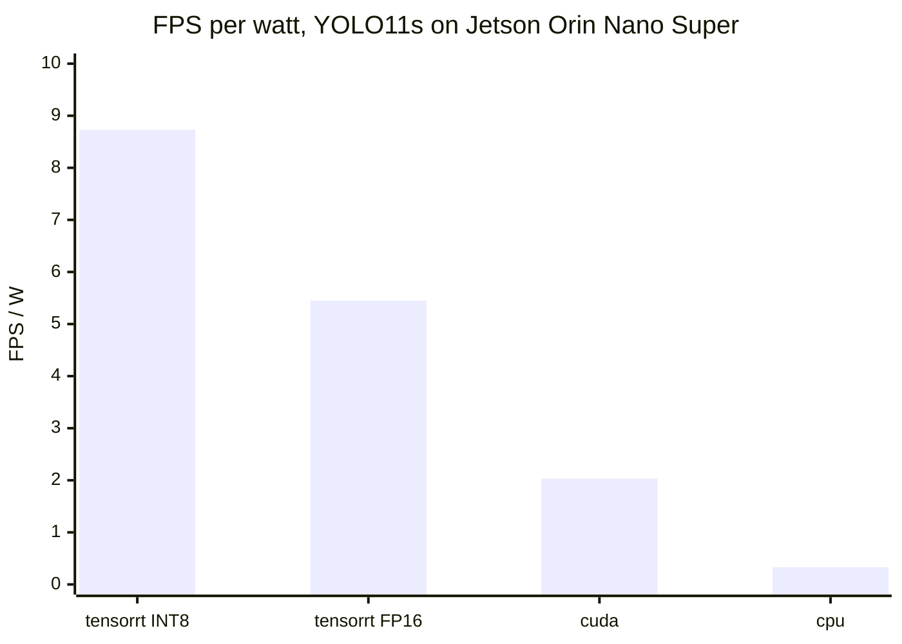
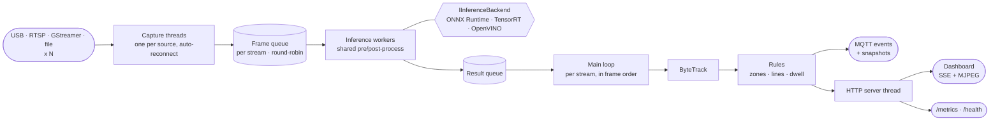

<div align="center">


<br/>

[](https://github.com/lehunghieu1503/cpp-realtime-video-analytics/actions/workflows/build.yml)


**[Quick start](#quick-start)** ·
**[Performance](#performance)** ·
**[Architecture](#architecture)** ·
**[Configuration](#configuration)** ·
**[Deploy to a Jetson](#deploy-to-a-jetson)** ·
**[Docs](#documentation)**

</div>

---

Cameras go in; events come out. The pipeline reads any number of video
sources, runs **YOLO** on a CPU, GPU or NPU, tracks the objects, and raises
events when they cross a line or enter, leave or linger in a zone. Events
are published over **MQTT**; video never leaves the device. A browser
dashboard, Prometheus metrics and a Grafana board come with it.

```bash
build/src/video_analytics --config deploy/config/config.yaml
# then open http://localhost:9001
```

## Highlights

<table>
<tr>
<td width="33%" valign="top">

### One pipeline, many accelerators
`--backend cpu | cuda | tensorrt | openvino:CPU | openvino:GPU | openvino:NPU`.
Backends only run the tensor; pre-processing, post-processing and NMS are
shared, so comparisons are fair. A missing backend fails loudly at startup;
it never falls back to CPU.

</td>
<td width="33%" valign="top">

### Tracking, zones and lines
ByteTrack gives every object an id. Zones and lines defined in YAML turn
tracks into `line_cross`, `zone_enter`, `zone_exit` and `dwell_time` events,
each with a snapshot of the frame.

</td>
<td width="33%" valign="top">

### Any number of sources
USB cameras, RTSP streams, video files and GStreamer pipelines, several at
once. Frames are served round-robin, so with more cameras than the hardware
can serve they all slow down equally instead of some starving.

</td>
</tr>
<tr>
<td valign="top">

### Measured, not claimed
A benchmark mode reports FPS, p50/p95/p99 latency, time per stage, power and
FPS per watt; an evaluation mode measures COCO mAP for the same backend.
Every number in this README came out of them.

</td>
<td valign="top">

### Runs unattended
A lost camera is reopened with exponential backoff. A watchdog exits when
results stop, so the restart policy brings up a fresh process. `/health`
and `/metrics` tell a supervisor how it is doing.

</td>
<td valign="top">

### Built on a PC, run on the board
`scripts/deploy-jetson.sh` builds the arm64 image with `docker buildx`,
sends only the layers the board lacks, copies the config and starts the
stack. The board needs no internet and builds nothing.

</td>
</tr>
</table>

## Performance

### Jetson Orin Nano Super 8GB

YOLO11s at 640x640, 640x480 video, inside the `Dockerfile.jetson` container,
MAXN SUPER power mode. Latency is the time inside `detect()`: pre-process,
inference and post-process. Power is the whole board (INA3221 input rail).
mAP is on the first 500 images of COCO val2017.

| Backend | Precision | FPS | Latency p50 | p95 | Power | FPS/W | mAP50-95 |
|:--------|:----------|----:|------------:|----:|------:|------:|---------:|
| `tensorrt` | INT8 | **107.4** | **9.5 ms** | 9.5 ms | 12.3 W | **8.73** | 0.459 |
| `tensorrt` | FP16 | 68.7 | 14.6 ms | 14.9 ms | 12.6 W | 5.45 | **0.470** |
| `cuda` | FP32 | 31.9 | 31.4 ms | 31.5 ms | 15.8 W | 2.03 | 0.470 |
| `cpu` (2 workers) | FP32 | 3.6 | 556.6 ms | 559.2 ms | 10.8 W | 0.33 | 0.469 |



TensorRT INT8 is 30x faster than the CPU at 1/26 of the energy per frame, for
0.011 mAP. The video has 250 frames, so each run measures 190 frames after a
60-frame warm-up: long enough for a rate, too short to show thermal
throttling.

### How many cameras fit

Same board and model, each camera a 960x540 MJPEG stream decoded in software,
tracking on. A row holds when the slowest camera still gets the source rate.

| Configuration | Cameras at 25 FPS | Cameras at 15 FPS |
|:--------------|:------------------|:------------------|
| TensorRT FP16, 1 worker | 3 (13.8 W) | 4 (12.6 W) |
| TensorRT FP16, 2 workers | 4 (16.7 W) | 8 (18.6 W) |
| TensorRT INT8, 2 workers | 5 at 24.4 FPS (14.3 W) | 10 at 14.6 FPS (15.4 W) |

Past the limit every camera slows together: 6 cameras at 25 FPS on FP16 with
2 workers each get 20 FPS. The second worker helps because pre-processing
and post-processing then run in parallel while the GPU serves both.

### Laptop (Intel Core Ultra 9 275HX)

Same model, video and images, built from source. Power is not reported: RAPL
is readable only by root on this machine, and the laptop's power mode was not
controlled.

| Backend | Model | FPS | Latency p50 | mAP50-95 |
|:--------|:------|----:|------------:|---------:|
| `openvino:NPU` | FP32 ONNX | **59.7** | **16.4 ms** | 0.469 |
| `openvino:NPU` | INT8 (NNCF) | 40.7 | 24.1 ms | 0.367 |
| `openvino:CPU` | INT8 (NNCF) | 34.7 | 27.9 ms | 0.397 |
| `cpu` (ONNX Runtime, 2 workers) | FP32 ONNX | 18.2 | 108.9 ms | 0.470 |
| `openvino:GPU` (Arc iGPU) | FP32 ONNX | 14.2 | 70.5 ms | 0.470 |
| `openvino:CPU` | FP32 ONNX | 14.1 | 69.8 ms | 0.470 |
| `openvino:GPU` (Arc iGPU) | INT8 (NNCF) | 11.8 | 84.6 ms | 0.400 |

Two things the table says that a guess would get wrong: with the FP32 model
the NPU is about 4x faster than the CPU or the iGPU through OpenVINO, and
the default NNCF INT8 quantization makes the NPU *slower* while costing
0.10 mAP. On this hardware the FP32 model on the
NPU is the one to use. Each worker uses 4 threads.

<details>
<summary><b>What the pipeline optimizations bought, measured one at a time</b></summary>

<br/>

| Change | Before | After | Measured on |
|:-------|-------:|------:|:------------|
| Serve streams round-robin instead of one shared queue | slowest camera: 0.7 FPS | every camera: 13.5 FPS | Jetson, 6 cameras at 25 FPS, 1 worker |
| Cap ONNX Runtime threads to the available cores | 22.6 FPS | 30.8 FPS | x86 pinned to 6 cores, 2 workers |
| Size the live frame queue to the worker count | 343 ms | 147 ms | capture-to-result delay, inference at 20 FPS |
| Build the input blob with `cv::dnn::blobFromImage` | 5.8 ms | 3.8 ms | preprocess per frame, one x86 core |
| Scan class scores in memory order | 0.55 ms | 0.45 ms | postprocess per frame, one x86 core |
| Skip drawing and the JPEG encode with no viewer | every frame | none | headless deployments |

</details>

> [!TIP]
> Run the comparison on your own hardware:
> `scripts/benchmark.sh video.avi cpu openvino:NPU tensorrt@fp16 tensorrt@int8`

## Architecture



| Design choice | Why |
|:--------------|:----|
| Backends run only the tensor | Pre-process, post-process and NMS are identical for every backend, so a benchmark compares the accelerators and nothing else. |
| One backend instance per worker | Sessions are never shared, so workers need no locking around inference. |
| A queue slot per stream, served round-robin | A slow consumer can never grow memory, what you see stays recent, and no camera can starve another. |
| Results are consumed in frame order per stream | Workers finish out of order; the tracker needs frames in order, so a stale result is dropped rather than buffered. |
| Workers default to 1 on an accelerator | A second session duplicates the model in memory. Use `--workers 2` when several cameras share the device. |
| Thread count follows the CPU affinity mask | Workers x intra-op threads never exceed the cores, including under `taskset` or `docker --cpuset-cpus`. |
| Latest-value broadcast instead of per-client queues | A stalled browser cannot back-pressure the pipeline. |

The threading model, data lifecycle and queue mechanics are covered in
[docs/ARCHITECTURE.md](docs/ARCHITECTURE.md).

## Quick start

**1. Get the model** (not stored in the repo):

```bash
git clone https://github.com/lehunghieu1503/cpp-realtime-video-analytics.git
cd cpp-realtime-video-analytics
pip install ultralytics
scripts/download-model.sh            # writes models/yolov8n.onnx
scripts/download-model.sh yolo11s    # or any other Ultralytics detector
```

**2. Pick how to run it:**

<details open>
<summary><b>Build from source on x86-64</b></summary>

<br/>

Needs Ubuntu 22.04+, GCC 11+, CMake 3.20+.

```bash
sudo apt install -y build-essential cmake git wget \
  libopencv-dev libeigen3-dev libmosquitto-dev

# ONNX Runtime 1.20.1 (CPU)
wget https://github.com/microsoft/onnxruntime/releases/download/v1.20.1/onnxruntime-linux-x64-1.20.1.tgz
tar xzf onnxruntime-linux-x64-1.20.1.tgz
sudo cp -r onnxruntime-linux-x64-1.20.1/lib/* /usr/local/lib/
sudo cp -r onnxruntime-linux-x64-1.20.1/include/* /usr/local/include/
sudo ldconfig

cmake -B build -DCMAKE_BUILD_TYPE=Release
cmake --build build --parallel $(nproc)

build/src/video_analytics --device 0
```

Always pass `-DCMAKE_BUILD_TYPE=Release`; without it the build is unoptimized.
To keep ONNX Runtime out of `/usr/local`, unpack it anywhere and add
`-DONNXRUNTIME_ROOT=/path/to/onnxruntime`.

For the OpenVINO backends, install the
[OpenVINO archive](https://docs.openvino.ai/latest/get-started/install-openvino.html)
and add `-DOpenVINO_DIR=/path/to/openvino/runtime/cmake`. CMake prints
`OpenVINO backend: ON` when it is found. `libmosquitto-dev` is optional too:
without it the build has no MQTT.

</details>

<details>
<summary><b>Docker on x86-64 (CPU)</b></summary>

<br/>

```bash
docker build -t video-analytics .
docker run --rm --device /dev/video0 -v "$(pwd)/models:/app/models:ro" \
  -p 127.0.0.1:9001:9001 video-analytics
```

</details>

<details>
<summary><b>Jetson Orin</b></summary>

<br/>

```bash
scripts/deploy-jetson.sh USER@BOARD
```

See [Deploy to a Jetson](#deploy-to-a-jetson).

</details>

**3. Open the dashboard** at [http://localhost:9001](http://localhost:9001).

> [!WARNING]
> Nothing here has authentication. From source the dashboard listens on
> `127.0.0.1` only. The Docker images listen on `0.0.0.0`, and the deployed
> stack also opens MQTT (1883), Prometheus (9090) and Grafana (3000, anonymous
> read-only, `admin`/`admin` to edit). Keep those ports inside a network you
> trust.

## Configuration

Everything can be set in a YAML file passed with `--config`; command-line
flags override it. [deploy/config/config.yaml](deploy/config/config.yaml) is
a commented example.

```yaml
model: models/yolo11s.onnx
backend: tensorrt            # cpu | cuda | tensorrt | openvino:CPU|GPU|NPU
precision: fp16              # tensorrt only: fp32 | fp16 | int8
classes: [person]            # keep only these COCO classes
dwell_seconds: 5

sources:
  - id: entrance
    rtsp: rtsp://192.168.1.20:554/stream1
    zones:
      - name: door
        points: [[300, 200], [660, 200], [660, 440], [300, 440]]
    lines:
      - name: gate
        a: [0, 300]
        b: [960, 300]
  - id: yard
    device: 0                # or  file: clip.mp4  or  gst: "... ! appsink"

mqtt:
  host: mosquitto
  topic: video-analytics     # events go to <topic>/<source id>/<event type>
snapshots:
  dir: snapshots
  keep: 200
```

An object is located by the bottom centre of its box. Crossing a line from
the right of `a → b` to its left counts as `in`, the other way as `out`.

## What the server exposes

| Endpoint | Content |
|:---------|:--------|
| `/` | The dashboard: one card per source, live counters, event log |
| `/video?stream=N` | MJPEG of source N with boxes, track ids, zones and lines drawn in |
| `/events` | Server-Sent Events, one JSON object per frame per source |
| `/streams` | Source ids with their zone and line names |
| `/metrics` | Prometheus metrics: FPS, latency, events, occupancy, power, memory |
| `/health` | `200 {"status":"ok"}` while results flow, `503` otherwise |

```json
{
  "stream": "entrance", "frame_id": 42, "fps": 25.0, "latency_ms": 29.7,
  "detections": [
    { "class": "person", "confidence": 0.94, "track_id": 7,
      "bbox": { "x": 100, "y": 50, "w": 200, "h": 300 } }
  ],
  "zones": [2], "lines_in": [14], "lines_out": [9],
  "events": [
    { "type": "line_cross", "stream": "entrance", "name": "gate",
      "track_id": 7, "class": "person", "direction": "in",
      "timestamp": 1760000000.25, "snapshot": "snapshots/..._line_cross_7.jpg" }
  ]
}
```

The objects under `events` are what MQTT subscribers receive, one message
each, at QoS 1:

```bash
mosquitto_sub -h BOARD -t 'video-analytics/#' -v
```

## CLI reference

```text
video_analytics [OPTIONS]                  Live mode
video_analytics --benchmark OPTIONS        Benchmark mode
video_analytics --eval-coco DIR OPTIONS    Detections for mAP
```

| Flag | Description | Default |
|:-----|:------------|:--------|
| `--config FILE` | YAML configuration | none |
| `--device N` | V4L2 (USB) camera index | `0` |
| `--rtsp URL` | RTSP or HTTP stream, decoded by FFmpeg | none |
| `--gst PIPELINE` | GStreamer pipeline ending in `appsink` | none |
| `--streams N` | Open the command-line source N times (capacity tests) | `1` |
| `--model PATH` | ONNX model, or OpenVINO IR (`.xml`) for an OpenVINO backend | `models/yolov8n.onnx` |
| `--backend NAME` | `cpu`, `cuda`, `tensorrt`, `openvino:CPU`, `openvino:GPU`, `openvino:NPU` | `cpu` |
| `--precision P` | `tensorrt` only: `fp32`, `fp16`, `int8` | `fp16` |
| `--conf X` | Confidence threshold | `0.5` |
| `--workers N` | Inference worker threads, 1 to 16 | `2`, or `1` on an accelerator |
| `--port N` | Dashboard port | `9001` |
| `--bind ADDR` | Listen address | `127.0.0.1` |
| `--headless` | No local window, dashboard only | off |
| `--benchmark` | Benchmark a video file instead of running live | off |
| `--input FILE` | Benchmark input video | required |
| `--frames N` | Frames to measure | `300` |
| `--warmup N` | Frames to skip first | `30` |
| `--output FILE` | Write the benchmark report as Markdown | none |
| `--csv FILE` | Append the results as one CSV line | none |
| `--eval-coco DIR` | Run the detector over a directory of `.jpg` images | none |
| `--eval-out FILE` | Where to write those detections | `detections.json` |

`--provider` still works as an alias of `--backend`.

```bash
# Two RTSP cameras with zones, from a config file
build/src/video_analytics --config site.yaml --headless --bind 0.0.0.0

# Intel NPU
build/src/video_analytics --model models/yolo11s.onnx --backend openvino:NPU

# Benchmark, then mAP, for one backend
build/src/video_analytics --benchmark --input test.avi --backend tensorrt --output report.md
build/src/video_analytics --eval-coco data/coco/val2017 --backend tensorrt
scripts/eval-map.py detections.json
```

> [!NOTE]
> Run the binary from the repository root: the dashboard is read from `web/`
> relative to the working directory.

### INT8

```bash
scripts/coco-subset.sh 500                                   # calibration and mAP images
scripts/calibrate-int8.py models/yolo11s.onnx data/coco/val2017      # TensorRT
scripts/quantize-openvino.py models/yolo11s.onnx data/coco/val2017   # OpenVINO
```

The first writes `models/yolo11s.calibration`; `deploy-jetson.sh` ships it
and `precision: int8` uses it. The second writes `models/yolo11s_int8.xml`,
to be passed as `--model`.

## Deploy to a Jetson

Source, scripts and configuration stay on the PC. The board only runs.

```bash
scripts/download-model.sh yolo11s        # the model named in deploy/config/config.yaml
scripts/deploy-jetson.sh USER@BOARD      # build, ship, start
```

The script builds `Dockerfile.jetson` for arm64 with `docker buildx` (QEMU),
pulls the arm64 Mosquitto, Prometheus and Grafana images, sends each image
over SSH without the layers the board already has, copies `deploy/` and the
model, and runs `docker compose up -d` there. After the first run a code
change ships as a few megabytes instead of the 11 GB image.

| On the board | |
|:--|:--|
| Dashboard | `http://BOARD:9001` |
| Grafana | `http://BOARD:3000` |
| Prometheus | `http://BOARD:9090` |
| MQTT | `BOARD:1883` |

To change cameras, zones or the model, edit
[deploy/config/config.yaml](deploy/config/config.yaml) and run the script
again. `VIDEO_DIR=/path/on/board` mounts a directory of test videos at
`/data/videos`.

Requirements: on the PC, Docker with buildx and QEMU (`qemu-user-static`,
`binfmt-support`), `rsync` and Python 3. On the board, JetPack 6 (L4T r36.x)
with Docker, the compose plugin and the NVIDIA container runtime.

<details>
<summary><b>GStreamer pipelines: hardware decode and CSI cameras</b></summary>

<br/>

Any pipeline works as long as it ends in `appsink` and delivers BGR frames.

```yaml
# H.264 RTSP camera decoded by the Jetson's hardware decoder
gst: "rtspsrc location=rtsp://CAMERA/stream latency=100 ! rtph264depay ! h264parse ! nvv4l2decoder ! nvvidconv ! video/x-raw,format=BGRx ! videoconvert ! video/x-raw,format=BGR ! appsink drop=true max-buffers=1"

# CSI sensor
gst: "nvarguscamerasrc ! video/x-raw(memory:NVMM),width=1280,height=720,framerate=30/1 ! nvvidconv ! video/x-raw,format=BGRx ! videoconvert ! video/x-raw,format=BGR ! appsink drop=true max-buffers=1"

# No camera at hand: loop a directory of JPEG frames at 25 FPS
gst: "multifilesrc location=/data/videos/clip/f%05d.jpg start-index=1 loop=true caps=image/jpeg,framerate=25/1 ! jpegdec ! videoconvert ! video/x-raw,format=BGR ! appsink"
```

`nvv4l2decoder` was tested in the container on an H.264 file. The CSI
pipeline has not been tested with a sensor.

</details>

Things worth knowing on a Jetson:

- The first start with a new model or precision builds a TensorRT engine,
  which takes 6 to 10 minutes. It is cached in `models/trt-cache/`.
- An engine only loads with the TensorRT version that built it. Delete
  `models/trt-cache/` after switching between a native build and the container.
- Use the top power mode for real runs: `sudo nvpmodel -m 2 && sudo jetson_clocks`
  (MAXN SUPER on JetPack 6.2).
- A soak test is the deployed stack left running:
  `scripts/soak-report.sh BOARD 24` summarises memory growth, lowest FPS and
  reconnects from Prometheus.

## Project layout

```text
src/
├── main.cpp          CLI, live loop, benchmark and evaluation modes
├── capture/          Camera, RTSP, GStreamer and video file input (OpenCV)
├── inference/        Shared pre-process and post-process + NMS
│   └── backends/     IInferenceBackend: ONNX Runtime (CPU/CUDA/TensorRT), OpenVINO
├── pipeline/         Capture threads, per-stream queue, inference workers
├── analytics/        ByteTrack wrapper, zone and line rules, events
├── config/           YAML configuration
├── output/           MQTT publisher
├── server/           HTTP server: SSE, MJPEG, metrics, JSON serializer
├── benchmark/        Latency percentiles, power meter, reports
└── utils/            FPS tracker
web/                  Dashboard (plain HTML, CSS, JS)
deploy/               docker compose stack, configuration, Grafana board
tests/                Six test binaries, no framework needed
scripts/              Deploy, benchmark, mAP, INT8, model export
Dockerfile            x86-64, CPU
Dockerfile.jetson     JetPack 6, CUDA + TensorRT
```

## Testing

```bash
build/tests/test_pipeline         # queues, drop policy, fairness, threading
build/tests/test_inference        # model load, detection, postprocess, backend parity
build/tests/test_rules            # line crossing, zones, dwell, tracker ids, YAML config
build/tests/test_serializer       # JSON payload and rounding
build/tests/test_latency_tracker  # p50 / p95 / p99 math
build/tests/test_sse_server       # SSE delivery, MJPEG stream, shutdown
```

Each exits non-zero on a failure. `test_inference` checks that every backend
available on the machine returns the same detections as the CPU on
`tests/test-image.jpg`. CI builds and runs all six on every push, plus a
ThreadSanitizer build of the pipeline tests.

<details>
<summary><b>Sanitizer builds</b></summary>

<br/>

```bash
cmake -B build-tsan -DCMAKE_BUILD_TYPE=Debug -DENABLE_TSAN=ON   # data races
cmake -B build-asan -DCMAKE_BUILD_TYPE=Debug -DENABLE_ASAN=ON   # memory errors
```

</details>

## Troubleshooting

| Symptom | Fix |
|:--------|:----|
| `Backend '...' failed to load ... File doesn't exist` | Run `scripts/download-model.sh`, or check the `models` mount. |
| `Backend 'cuda' failed to load ... libonnxruntime_providers_cuda.so` | This ONNX Runtime build is CPU only. On a Jetson use the `video-analytics:jetson` image. |
| `Backend 'openvino:NPU' needs a build with -DWITH_OPENVINO=ON` | Rebuild with `-DOpenVINO_DIR=...`; see Quick start. |
| `TensorRT EP could not deserialize engine from cache` | The cached engine came from another TensorRT version. Delete `models/trt-cache/`. |
| First `tensorrt` start sits silent for minutes | It is building the engine. Later starts are fast. |
| `Pipeline: cam0 not available, retry in N s` | The source cannot be opened yet; it is retried every 1 to 30 seconds. Check the URL, device or pipeline. |
| `Watchdog: no result for 60 s, exiting` | A source is connected but inference produced nothing. The restart policy starts a new process; look at the lines before it. |
| `MQTT: this build has no MQTT support` | `libmosquitto-dev` was missing at build time. |
| Benchmark reports power as `n/a` on x86 | `sudo chmod a+r /sys/class/powercap/intel-rapl:0/energy_uj` |
| Dashboard shows `Not found` | Start the binary from the repository root so it can find `web/`. |
| Dashboard unreachable from another machine | Add `--bind 0.0.0.0` and publish the port. |

More cases, including offline builds, are in the step-by-step guide below.

## Documentation

| Document | What is inside |
|:---------|:---------------|
| [docs/GUIDE.md](docs/GUIDE.md) | Step-by-step build and usage guide (Vietnamese) |
| [docs/ARCHITECTURE.md](docs/ARCHITECTURE.md) | Threading model, data lifecycle, queue mechanics |
| [docs/DEVELOPMENT.md](docs/DEVELOPMENT.md) | Tooling, Docker details, profiling, sanitizers |

## Dependencies

| Library | Version | Used for |
|:--------|:--------|:---------|
| [OpenCV](https://opencv.org/) | 4.5+ | Capture, image processing, NMS, JPEG encoding |
| [ONNX Runtime](https://onnxruntime.ai/) | 1.20 (1.18+ for TensorRT 10) | CPU, CUDA and TensorRT backends |
| [OpenVINO](https://docs.openvino.ai/) | 2025.x, optional | Intel CPU, iGPU and NPU backends |
| [ByteTrack-cpp](https://github.com/Vertical-Beach/ByteTrack-cpp) | pinned commit | Multi-object tracking, fetched by CMake |
| [Eigen](https://eigen.tuxfamily.org/) | 3.3+ | Needed by ByteTrack |
| [yaml-cpp](https://github.com/jbeder/yaml-cpp) | 0.8.0 | Configuration file, fetched by CMake |
| [libmosquitto](https://mosquitto.org/) | 2.0, optional | MQTT client |
| [nlohmann/json](https://github.com/nlohmann/json) | 3.11.3 | JSON serialization, fetched by CMake |
| [cpp-httplib](https://github.com/yhirose/cpp-httplib) | 0.18.7 | HTTP, SSE and MJPEG server, fetched by CMake |

<div align="center">
<br/>
<sub>C++17 · YOLO · ONNX Runtime · TensorRT · OpenVINO</sub>
</div>
