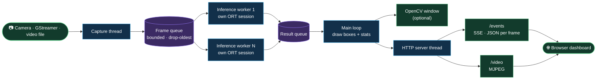

<div align="center">


<br/>

[](https://github.com/lehunghieu1503/cpp-realtime-video-analytics/actions/workflows/build.yml)


**[Quick start](#-quick-start)** ·
**[Performance](#-performance)** ·
**[Architecture](#-architecture)** ·
**[CLI](#-cli-reference)** ·
**[Jetson](#-jetson-orin)** ·
**[Docs](#-documentation)**

</div>

---

A camera goes in, a live browser dashboard comes out. The pipeline captures
frames, runs **YOLOv8** through **ONNX Runtime** on worker threads, and streams
annotated video and per-frame JSON over plain HTTP. The same binary runs on a
laptop CPU and on a Jetson GPU: one flag picks the execution provider.

```bash
build/src/video_analytics --device 0 --provider tensorrt
# then open http://localhost:9001
```

## ✨ Highlights

<table>
<tr>
<td width="33%" valign="top">

### 🧵 Built for throughput
Capture, inference and HTTP serving each run on their own threads. Bounded
queues drop the oldest frame, so memory and delay stay flat when inference
falls behind the camera.

</td>
<td width="33%" valign="top">

### ⚡ CPU, CUDA or TensorRT
`--provider cpu | cuda | tensorrt`. TensorRT builds an FP16 engine once and
caches it. A provider that is missing fails loudly at startup; it never
silently falls back to CPU.

</td>
<td width="33%" valign="top">

### 🌐 Zero-install dashboard
Server-Sent Events for detections, MJPEG for video, served by the binary
itself. Any browser on the network is a client. No JavaScript build step.

</td>
</tr>
<tr>
<td valign="top">

### 📷 Any video source
USB cameras by index, CSI cameras and anything else through a GStreamer
pipeline (`--gst`), video files for benchmarking.

</td>
<td valign="top">

### 📊 Honest benchmarks
A benchmark mode that processes every frame and reports FPS with p50, p95
and p99 latency as Markdown. Every number in this README came out of it.

</td>
<td valign="top">

### 🐳 Two Docker images
`Dockerfile` for x86-64 CPU, `Dockerfile.jetson` for JetPack 6 with CUDA and
TensorRT. Both run as a non-root user.

</td>
</tr>
</table>

## 📊 Performance

Measured with `--benchmark` on a **Jetson Orin Nano Super 8GB**, inside the
`Dockerfile.jetson` container, 25 W power mode, 640x480 video, YOLOv8n at
640x640. Latency is the time inside `detect()`: preprocess, inference and
postprocess.

| Provider | Throughput | | Latency p50 | Latency p95 |
|:---------|-----------:|:--|------------:|------------:|
| `tensorrt` (FP16) | **46.0 FPS** | `███████████████████████` | **21.6 ms** | 22.4 ms |
| `cuda` | 29.4 FPS | `███████████████` | 28.0 ms | 41.5 ms |
| `cpu` (2 workers) | 6.4 FPS | `███` | 314.3 ms | 317.0 ms |

TensorRT is **7x faster than CPU** on this board. The first `tensorrt` start
spends about 8 minutes building the engine; later starts take seconds.

<details>
<summary><b>What the pipeline optimizations bought, measured one at a time</b></summary>

<br/>

| Change | Before | After | Measured on |
|:-------|-------:|------:|:------------|
| Cap ONNX Runtime threads to the available cores | 22.6 FPS | 30.8 FPS | x86 pinned to 6 cores, 2 workers |
| Size the live frame queue to the worker count | 343 ms | 147 ms | capture-to-result delay, inference at 20 FPS |
| Build the input blob with `cv::dnn::blobFromImage` | 5.8 ms | 3.8 ms | preprocess per frame, one x86 core |
| Scan class scores in memory order | 0.55 ms | 0.45 ms | postprocess per frame, one x86 core |
| Skip the JPEG encode with no `/video` viewer | every frame | none | headless deployments |

</details>

> [!TIP]
> Run it on your own hardware:
> `build/src/video_analytics --benchmark --input video.avi --provider tensorrt --output report.md`

## 🏗 Architecture



| Design choice | Why |
|:--------------|:----|
| One ONNX Runtime session per worker | Sessions are never shared, so workers need no locking around inference. |
| Bounded queues that drop the oldest frame | A slow consumer can never grow memory, and what you see stays recent. |
| Workers default to 1 on a GPU | A second session duplicates the engine in memory while the GPU still runs them one after the other. |
| Thread count follows the CPU affinity mask | Workers x intra-op threads never exceed the cores, including under `taskset` or `docker --cpuset-cpus`. |
| Latest-value broadcast instead of per-client queues | A stalled browser cannot back-pressure the pipeline. |

The threading model, data lifecycle and queue mechanics are covered in
[docs/ARCHITECTURE.md](docs/ARCHITECTURE.md).

## 🚀 Quick start

**1. Get the model** (not stored in the repo):

```bash
git clone https://github.com/lehunghieu1503/cpp-realtime-video-analytics.git
cd cpp-realtime-video-analytics
pip install ultralytics
scripts/download-model.sh        # writes models/yolov8n.onnx
```

**2. Pick how to run it:**

<details open>
<summary><b>🐳 Docker on x86-64 (CPU)</b></summary>

<br/>

```bash
docker build -t video-analytics .
docker run --rm --device /dev/video0 -v "$(pwd)/models:/app/models:ro" \
  -p 127.0.0.1:9001:9001 video-analytics
```

</details>

<details>
<summary><b>🛠 Build from source on x86-64</b></summary>

<br/>

Needs Ubuntu 22.04+, GCC 11+, CMake 3.20+.

```bash
sudo apt install -y build-essential cmake git wget libopencv-dev

# ONNX Runtime 1.17.0 (CPU)
wget https://github.com/microsoft/onnxruntime/releases/download/v1.17.0/onnxruntime-linux-x64-1.17.0.tgz
tar xzf onnxruntime-linux-x64-1.17.0.tgz
sudo cp onnxruntime-linux-x64-1.17.0/lib/* /usr/local/lib/
sudo cp -r onnxruntime-linux-x64-1.17.0/include/* /usr/local/include/
sudo ldconfig

cmake -B build -DCMAKE_BUILD_TYPE=Release
cmake --build build --parallel $(nproc)

build/src/video_analytics --device 0
```

Always pass `-DCMAKE_BUILD_TYPE=Release`; without it the build is unoptimized.
To keep ONNX Runtime out of `/usr/local`, unpack it anywhere and add
`-DONNXRUNTIME_ROOT=/path/to/onnxruntime`.

</details>

<details>
<summary><b>🟢 Docker on Jetson Orin (GPU)</b></summary>

<br/>

```bash
docker build -f Dockerfile.jetson -t video-analytics:jetson .

docker run -d --name video-analytics --restart unless-stopped --runtime nvidia \
  --device /dev/video0 -p 9001:9001 \
  -v "$(pwd)/models:/app/models" \
  video-analytics:jetson --provider tensorrt
```

See [Jetson Orin](#-jetson-orin) for boards without internet access and for
CSI cameras.

</details>

**3. Open the dashboard** at [http://localhost:9001](http://localhost:9001).

> [!WARNING]
> The dashboard has no authentication. From source it listens on `127.0.0.1`
> only. The Docker images listen on `0.0.0.0`, so publish the port with
> `-p 127.0.0.1:9001:9001` unless you trust the network.

## 🖥 What the server exposes

| Endpoint | Content |
|:---------|:--------|
| `/` | The dashboard |
| `/video` | MJPEG stream with boxes and stats drawn in |
| `/events` | Server-Sent Events, one JSON object per frame |
| `/health` | `{"status":"ok"}` |

```json
{
  "frame_id": 42,
  "fps": 21.5,
  "latency_ms": 35.2,
  "detections": [
    { "class": "person", "confidence": 0.94,
      "bbox": { "x": 100, "y": 50, "w": 200, "h": 300 } }
  ]
}
```

`latency_ms` is capture to inference done. Classes are the 80 COCO names.
The bundled dashboard consumes the stream in three lines:

```js
new EventSource('/events').onmessage = (e) => {
  console.log(JSON.parse(e.data).detections);
};
```

## ⌨ CLI reference

```text
video_analytics [OPTIONS]                  Live camera mode
video_analytics --benchmark OPTIONS        Benchmark mode
```

| Flag | Description | Default |
|:-----|:------------|:--------|
| `--device N` | V4L2 (USB) camera index | `0` |
| `--gst PIPELINE` | GStreamer pipeline ending in `appsink`, used instead of `--device` | none |
| `--model PATH` | ONNX model file | `models/yolov8n.onnx` |
| `--provider NAME` | Execution provider: `cpu`, `cuda`, `tensorrt` | `cpu` |
| `--workers N` | Inference worker threads, 1 to 16 | `2`, or `1` with a GPU provider |
| `--port N` | Dashboard port | `9001` |
| `--bind ADDR` | Listen address | `127.0.0.1` |
| `--headless` | No local window, dashboard only | off |
| `--benchmark` | Benchmark a video file instead of running live | off |
| `--input FILE` | Benchmark input video | required |
| `--frames N` | Benchmark frame count | `300` |
| `--output FILE` | Write the benchmark report as Markdown | none |

```bash
# Headless on a server, reachable from the network
build/src/video_analytics --device 0 --headless --bind 0.0.0.0

# A bigger model on the GPU
build/src/video_analytics --model models/yolov8s.onnx --provider cuda

# Benchmark 500 frames and keep the report
build/src/video_analytics --benchmark --input test.avi --frames 500 --output report.md
```

> [!NOTE]
> Run the binary from the repository root: the dashboard is read from `web/`
> relative to the working directory.

## 🟢 Jetson Orin

`Dockerfile.jetson` targets JetPack 6 (L4T r36.x). Its base image brings
CUDA 12.6, TensorRT 10 and ONNX Runtime 1.20.2 built with the CUDA and
TensorRT providers.

<details>
<summary><b>Board without internet: build on a PC, ship over SSH</b></summary>

<br/>

```bash
# On an x86 PC with Docker buildx and QEMU (qemu-user-static, binfmt-support)
docker build --platform linux/arm64 -f Dockerfile.jetson -t video-analytics:jetson .
docker save video-analytics:jetson | ssh USER@BOARD 'docker load'
scp models/yolov8n.onnx USER@BOARD:~/video-analytics/models/
```

</details>

<details>
<summary><b>CSI cameras through GStreamer</b></summary>

<br/>

`--device` opens USB cameras. A CSI sensor needs a pipeline:

```bash
build/src/video_analytics --headless --provider tensorrt --gst \
  "nvarguscamerasrc ! video/x-raw(memory:NVMM),width=1280,height=720,framerate=30/1 \
   ! nvvidconv ! video/x-raw,format=BGRx ! videoconvert ! video/x-raw,format=BGR \
   ! appsink drop=true max-buffers=1"
```

Any pipeline works as long as it ends in `appsink` and delivers BGR frames.
No camera at hand? Use a test source:

```bash
--gst "videotestsrc is-live=true ! video/x-raw,width=640,height=480,framerate=30/1 ! videoconvert ! video/x-raw,format=BGR ! appsink drop=true max-buffers=1"
```

</details>

Things worth knowing on a Jetson:

- Mount `models` writable when using `--provider tensorrt`: the engine is
  cached in `models/trt-cache/`.
- An engine only loads with the TensorRT version that built it. Delete
  `models/trt-cache/` after switching between a native build and the container.
- Use the top power mode for real runs: `sudo nvpmodel -m 2 && sudo jetson_clocks`
  (MAXN SUPER on JetPack 6.2).
- Known gap: inside the container `nvarguscamerasrc` does not load (`libEGL`
  is missing from the image), so CSI cameras currently need a native build.
  USB cameras work in the container.

## 📂 Project layout

```text
src/
├── main.cpp          CLI, live loop, benchmark loop
├── capture/          Camera, GStreamer and video file input (OpenCV)
├── inference/        ONNX Runtime session, preprocess, postprocess + NMS
├── pipeline/         Threads and bounded queues: capture → workers → results
├── server/           HTTP server: SSE, MJPEG, static files, JSON serializer
├── benchmark/        Latency percentiles and Markdown report
└── utils/            FPS tracker
web/                  Dashboard (plain HTML, CSS, JS)
tests/                Five test binaries, no framework needed
scripts/              Model download/export, FP16 conversion
Dockerfile            x86-64, CPU
Dockerfile.jetson     JetPack 6, CUDA + TensorRT
```

## 🧪 Testing

```bash
build/tests/test_pipeline         # bounded queue, drop policy, threading
build/tests/test_inference        # model load, detection, postprocess
build/tests/test_serializer       # JSON payload and rounding
build/tests/test_latency_tracker  # p50 / p95 / p99 math
build/tests/test_sse_server       # SSE delivery, MJPEG stream, shutdown
```

Each prints `Failed: 0` when it passes. CI builds and runs all five on every
push, plus a ThreadSanitizer build of the pipeline tests.

<details>
<summary><b>Sanitizer builds</b></summary>

<br/>

```bash
cmake -B build-tsan -DCMAKE_BUILD_TYPE=Debug -DENABLE_TSAN=ON   # data races
cmake -B build-asan -DCMAKE_BUILD_TYPE=Debug -DENABLE_ASAN=ON   # memory errors
```

</details>

## 🩺 Troubleshooting

| Symptom | Fix |
|:--------|:----|
| `Failed to load model ... File doesn't exist` | Run `scripts/download-model.sh`, or check the `-v ...:/app/models` mount. |
| `Failed to open camera 0` | No `/dev/video0`, or `--device /dev/video0` is missing from `docker run`. |
| `Execution provider 'cuda' not available` | This ONNX Runtime build is CPU only. On a Jetson use the `video-analytics:jetson` image. |
| `TensorRT EP could not deserialize engine from cache` | The cached engine came from another TensorRT version. Delete `models/trt-cache/`. |
| First `tensorrt` start sits silent for minutes | It is building the engine. Later starts are fast. |
| Dashboard shows `Not found` | Start the binary from the repository root so it can find `web/`. |
| Dashboard unreachable from another machine | Add `--bind 0.0.0.0` and publish the port. |

More cases, including offline builds, are in the step-by-step guide below.

## 📚 Documentation

| Document | What is inside |
|:---------|:---------------|
| [docs/GUIDE.md](docs/GUIDE.md) | Step-by-step build and usage guide (Vietnamese) |
| [docs/ARCHITECTURE.md](docs/ARCHITECTURE.md) | Threading model, data lifecycle, queue mechanics |
| [docs/DEVELOPMENT.md](docs/DEVELOPMENT.md) | Tooling, Docker details, profiling, sanitizers |

## 📦 Dependencies

| Library | Version | Used for |
|:--------|:--------|:---------|
| [OpenCV](https://opencv.org/) | 4.5+ | Capture, image processing, NMS, JPEG encoding |
| [ONNX Runtime](https://onnxruntime.ai/) | 1.17+ (1.18+ for TensorRT 10) | YOLOv8 inference through the C++ API |
| [nlohmann/json](https://github.com/nlohmann/json) | 3.11.3 | JSON serialization, fetched by CMake |
| [cpp-httplib](https://github.com/yhirose/cpp-httplib) | 0.18.7 | HTTP, SSE and MJPEG server, fetched by CMake |

<div align="center">
<br/>
<sub>C++17 · YOLOv8 · ONNX Runtime · TensorRT</sub>
</div>
