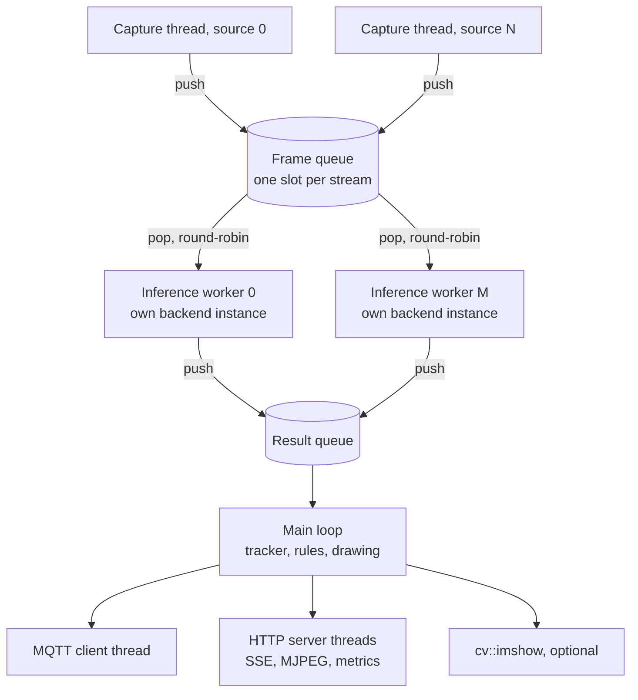
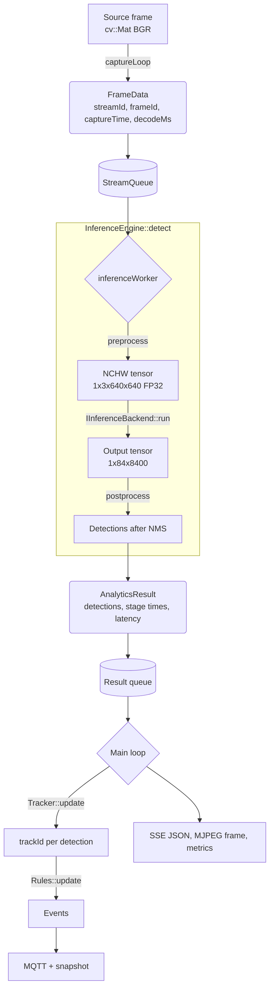

# System Architecture

How the pipeline is put together: its threads, the path a frame takes, the
queues between the stages, and what happens when something fails.

## Threads

Slow work (inference, network I/O) never blocks fast work (reading a camera).
Every stage runs on its own threads and hands data over through a bounded
queue.



| Thread | Code | Job |
|:-------|:-----|:----|
| Capture, one per source | `Pipeline::captureLoop()` | Reads frames, reopens a lost source, pushes `FrameData`. Never waits for inference. |
| Inference workers | `Pipeline::inferenceWorker()` | Pop a frame, run `InferenceEngine::detect()`, push an `AnalyticsResult`. |
| Main | `runLive()` in `main.cpp` | Consumes results per stream in frame order: class filter, tracker, rules, drawing, publishing. Runs the watchdog. |
| HTTP server | `SseServer` | Serves the dashboard, `/events`, `/video`, `/metrics`, `/health`. Handlers read the latest value; they never queue. |
| MQTT | libmosquitto | Connects, reconnects and sends on its own thread, so `publish()` never blocks on the network. |
| Power meter | `PowerMeter` | Samples the power sensor once a second. |

Each worker owns its backend instance (an ONNX Runtime session or an OpenVINO
infer request). Nothing is shared between workers, so inference needs no
locking.

## The path of a frame



### Backends

`IInferenceBackend` (`src/inference/backends/`) has one job: run an NCHW
float tensor and return the output tensor.

| Backend | `--backend` | Notes |
|:--------|:------------|:------|
| `OnnxBackend` | `cpu`, `cuda`, `tensorrt` | One class, three ONNX Runtime execution providers. TensorRT builds an engine at `--precision fp32/fp16/int8` and caches it in `trt-cache/` next to the model. |
| `OpenVinoBackend` | `openvino:CPU`, `openvino:GPU`, `openvino:NPU` | Reads ONNX or OpenVINO IR. Built only when OpenVINO is found (`WITH_OPENVINO`). |

Pre-processing, post-processing and NMS live in `InferenceEngine` and are the
same for every backend. That is what makes a benchmark between backends fair,
and what `test_inference` checks: every backend available on the machine must
return the same detections as the CPU on `tests/test-image.jpg`.

Adding a backend means one class implementing `inputShape()` and `run()`, and
one line in `backend-factory.cpp`.

### Tracking and rules

The main loop keeps one `Tracker` (ByteTrack) and one `Rules` object per
stream. Workers finish out of order, so a result older than the last one
processed for its stream is dropped; the tracker therefore always sees frames
in order without a reorder buffer.

`Rules` locates an object by the bottom centre of its box and keeps, per
track, the previous position and the time it entered each zone. From that it
raises `line_cross`, `zone_enter`, `zone_exit` and `dwell_time`. A track not
seen for two seconds is forgotten and leaves the zones it was in.

## Queues

### Frame queue: `StreamQueue`

One slot per stream, each holding that stream's newest frames, handed to the
workers round-robin.

A single shared drop-oldest queue was the first design, and it was unfair:
with more cameras than the workers could serve, whichever streams pushed last
evicted the others. Measured on a Jetson with 6 cameras, one stream ran at
0.7 FPS while others ran at full rate. With per-stream slots every camera
gets the same share (13.5 FPS each in that test), and each keeps only its
freshest frame.

### Result queue: `BoundedQueue`

A thread-safe FIFO that drops the oldest item when full.

```cpp
queue.push(item);                         // never blocks; evicts the oldest if full
auto item = queue.pop();                  // blocks until an item or stop()
auto item = queue.tryPopFor(timeout);     // timed wait
```

Dropping the oldest keeps memory bounded, keeps what is shown recent, and
never stalls a producer.

| Queue | Size | Why |
|:------|:-----|:----|
| Frame queue, live | `max(1, workers / streams)` per stream | Every queued frame adds one inference time of delay to what is shown. |
| Frame queue, benchmark | `2 x workers` | Dropping is off: capture waits for room, so every frame is processed. |
| Result queue | `max(16, 4 x streams)` | Absorbs jitter between inference and the main loop. |

## When things fail

| Situation | Behaviour |
|:----------|:----------|
| A live source cannot be opened | Retried after 1 s, doubling up to 30 s. The other sources keep running. |
| A live source stops delivering | After 30 failed reads it is closed, `va_stream_reconnects_total` is incremented, and it is reopened with the same backoff. |
| A video file ends | Its capture thread exits. When the last source has ended, the workers drain the queue and the result queue is stopped. |
| The model or backend fails to load | The pipeline does not start and the process exits with an error. There is no fallback to CPU. |
| Inference throws | The pipeline stops and the process exits non-zero, so a supervisor restarts it. |
| A source is connected but no result arrives for 60 s | The watchdog exits the process (`watchdog_seconds`). |
| The MQTT broker is away | The client keeps reconnecting; QoS 1 messages are queued by the client library meanwhile. |
| SIGINT or SIGTERM | The main loop ends, the server and the pipeline are stopped and every thread is joined. |

`/health` returns 200 only while the pipeline is running, at least one source
is connected and a result arrived in the last 10 seconds.

## HTTP routes

| Route | Content type | Description |
|:------|:-------------|:------------|
| `/` | `text/html` | Dashboard. |
| `/static/*` | CSS, JS | Dashboard assets from `web/`. |
| `/events` | `text/event-stream` | The latest JSON of each stream whenever it changes. |
| `/video?stream=N` | `multipart/x-mixed-replace` | MJPEG of stream N. Frames are drawn and encoded only while someone watches. |
| `/streams` | `application/json` | Source ids with their zone and line names. |
| `/metrics` | Prometheus text | Per-stream FPS, latency, frames, reconnects; events, zone occupancy, line crossings; stage times, power, resident memory. |
| `/health` | `application/json` | 200 or 503, see above. |
