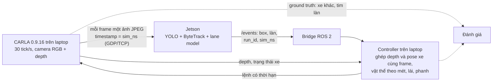

# Simulation cho hướng ADAS

Tóm tắt phần tìm hiểu ngày 2026-10-11: khi chưa có camera và chưa có xe, dùng
simulator nào để phát triển tiếp dự án theo hướng ADAS.

**Kết luận:** dùng CARLA nhánh 0.9.x. Autoware không phải simulator mà là một
stack lái tự động; chưa cần ở bước đầu. Việc cần làm trong source code nằm ở
mục 10.

## 1. Yêu cầu

Bài toán đặt ra: phát hiện vật thể ở khoảng cách tới 120 m, ổn định, 30 FPS,
trên chip 2 TOPS, kèm lane keeping.

Từ đó simulator cần có:

| # | Yêu cầu | Vì sao |
|---|---------|--------|
| 1 | Camera chỉnh được góc nhìn và độ phân giải | Bài toán 120 m do số pixel trên vật quyết định (mục 2) |
| 2 | Ground truth khung bao và khoảng cách của từng vật | Đo recall theo dải khoảng cách mà không phải gán nhãn tay |
| 3 | Ground truth làn đường | Làm đáp án cho model lane |
| 4 | Xe điều khiển được (ga, phanh, lái) | Thử lane keeping vòng kín |
| 5 | Bước thời gian cố định, lặp lại được | Chạy đúng 30 FPS và so sánh được trước/sau khi sửa |
| 6 | Thời tiết, ngày đêm | Các tình huống ADAS khó nhất |
| 7 | Đưa hình ra RTSP, GStreamer hoặc ROS 2 | Pipeline của dự án đọc sẵn ba nguồn này |
| 8 | Mã nguồn mở, chạy trên Ubuntu 22.04, ROS 2 Humble | Khớp môi trường đang dùng |
| 9 | Còn được bảo trì | Tránh công cụ đã dừng phát triển |

## 2. Vì sao camera ảo phải chỉnh được: bài toán pixel ở 120 m

Giả sử camera ngang 1920 px. Kích thước vật ở 120 m khi đưa vào mạng:

| Ống kính | Chiều ngang đưa vào mạng | Ô tô (1,8 m) | Người (0,5 × 1,7 m) |
|----------|--------------------------|--------------|---------------------|
| 52° | 640 px (cách dự án đang làm) | 9,8 px | 2,7 × 9,3 px |
| 52° | 1280 px | 19,7 px | 5,5 × 18,6 px |
| 52° | crop nguyên độ phân giải | 29,5 px | 8,2 × 27,9 px |
| 28° (tele) | 640 px | 19,3 px | 5,3 × 18,2 px |
| 100° (góc rộng) | crop nguyên độ phân giải | 12,1 px | 3,4 × 11,4 px |

Stride nhỏ nhất của YOLO là 8 px; theo kinh nghiệm chung vật cần khoảng 10–15 px
ở cạnh ngắn mới bắt ổn định. Simulator cho phép thử từng dòng của bảng này
trước khi mua camera.

Ngân sách tính toán ở 30 FPS (tính từ GFLOPs của model, chưa phải số đo trên
chip):

| Đầu vào | `yolov8n` | `yolo11s` |
|---------|-----------|-----------|
| 640×640 | 0,27 TOPS | 0,65 TOPS |
| 1280×736 cả khung | 0,61 TOPS | 1,50 TOPS |
| crop xa 960×384 + khung gần 640×384 | 0,40 TOPS | 0,98 TOPS |

## 3. Các lựa chọn đã xem

Tình trạng lấy từ GitHub ngày 2026-10-11.

| Tên | Là gì | Tình trạng | Hợp với bài toán? |
|-----|-------|------------|-------------------|
| CARLA | Simulator lái xe trên Unreal Engine, giấy phép MIT | Đang phát triển; bản mới nhất 0.9.16 (2025-09-16) | Có, nên chọn |
| Autoware | Stack lái tự động trên ROS 2: định vị, nhận thức, lập kế hoạch, điều khiển | Bản 1.9.0 (2026-07-16) | Tuỳ chọn, về sau |
| AWSIM (TIER IV) | Simulator trên Unity, làm riêng cho Autoware | Bản v2.0.1 (2025-10-31); asset chỉ cho phi thương mại | Chỉ khi đi theo Autoware |
| Isaac Sim | Simulator robot của NVIDIA, mã nguồn mở | Bản v6.1.0 (2026-09-10) | Không hợp: thiên về robot |
| MetaDrive | Simulator nhẹ, Apache 2.0 | Bản 0.4.3 (2024-12-06), repo vẫn hoạt động | Chỉ để thử vòng điều khiển; hình không giống thật |
| esmini | Trình chạy kịch bản OpenSCENARIO, đồ hoạ tối giản | Bản v3.9.0 (2026-10-06) | Bổ trợ khi cần kịch bản chuẩn |
| Gazebo | Simulator robot đa dụng | Đã cài sẵn trên laptop (Ignition, kèm ROS 2) | Chỉ để thử vòng điều khiển; hình không giống thật |

Không nên chọn:

- **LGSVL:** LG dừng phát triển từ 2022-01-01.
- **AWSIM Labs:** repo đã archived.
- **AirSim:** không có release nào từ 2022-07.

## 4. CARLA đối chiếu với yêu cầu

Các khả năng dưới đây là theo API của CARLA mà tôi biết; lần tìm hiểu này chỉ
kiểm tra lại phần phiên bản và cấu hình máy.

| # | Yêu cầu | CARLA |
|---|---------|-------|
| 1 | Camera chỉnh được | Đặt góc nhìn và độ phân giải tuỳ ý |
| 2 | Ground truth vật thể | Vị trí, khung bao, khoảng cách của mọi xe và người; có camera độ sâu và segmentation |
| 3 | Ground truth làn | Bản đồ OpenDRIVE cho tâm làn và loại vạch |
| 4 | Xe điều khiển được | Nhận lệnh ga, phanh, lái |
| 5 | Bước thời gian cố định | Chế độ đồng bộ với bước cố định |
| 6 | Thời tiết, ngày đêm | Chỉnh được |
| 7 | Đưa hình ra ngoài | ROS 2 có sẵn; RTSP/GStreamer cần một script cầu nối nhỏ |
| 8 | Mã nguồn mở, Ubuntu 22.04, Humble | MIT; Ubuntu 20.04 và 22.04 |
| 9 | Còn bảo trì | Có commit ngày 2026-10-10 |

### Chọn nhánh 0.9.x, không phải 0.10.0

- 0.9.16 (tháng 9/2025) mới hơn 0.10.0 (Unreal Engine 5, tháng 12/2024) và đang
  được GitHub đánh dấu là bản mới nhất.
- Nhẹ hơn nhiều (mục 6).
- Cầu nối chính thức của Autoware, `autoware_carla_interface`, viết cho
  Ubuntu 22.04, ROS 2 Humble và CARLA 0.9.15.

## 5. Autoware đặt ở đâu

Autoware sẽ thay pipeline của dự án chứ không kiểm thử nó. Thứ tự hợp lý:

1. Chạy CARLA với pipeline hiện tại và một bộ điều khiển lái đơn giản.
2. Chỉ đưa Autoware vào sau, nếu muốn chứng minh tích hợp được với một stack
   công nghiệp.

## 6. Cấu hình máy

| Phần mềm | Yêu cầu theo tài liệu |
|----------|-----------------------|
| CARLA 0.9.x | GPU cỡ RTX 2070 trở lên, từ 8 GB VRAM, khoảng 20 GB ổ đĩa, Ubuntu 20.04 hoặc 22.04 |
| CARLA 0.10.0 (UE5) | RTX 3000 trở lên với ít nhất 16 GB VRAM, Ubuntu 22.04, 130 GB ổ đĩa |
| Autoware (chạy kèm) | Tối thiểu CPU 8 nhân, 16 GB RAM, GPU NVIDIA 4 GB |
| Isaac Sim | Tối thiểu RTX 4080 |

Đề xuất cho máy mới: GPU từ 16 GB VRAM, RAM từ 32 GB, Ubuntu 22.04. Máy như vậy
chạy được cả hai nhánh CARLA và còn chỗ cho inference trên cùng máy.

Laptop hiện tại vừa đủ cho CARLA 0.9.x nhưng sát ngưỡng; chi tiết ở mục 11.

## 7. Ghép vào dự án

Giai đoạn 1 đã làm xong và chạy theo sơ đồ dưới đây. Cách chạy và số đo ở
[mục 14](#14-giai-đoạn-1-đã-làm-cách-chạy-và-kết-quả-đo).



- **Hình vào:** mỗi frame là một ảnh JPEG 1280×720 đi qua GStreamer
  (`appsrc ! gdppay ! tcpserversink` trên laptop, `tcpclientsrc ! gdpdepay !
  jpegdec` trên Jetson). Timestamp của buffer là thời gian mô phỏng của frame,
  tính bằng nano giây (`sim_ns`); pipeline đọc lại đúng số đó sau khi giải mã.
- **Định danh frame:** `(run_id, source, sim_ns)`. Không ghép theo thứ tự đến,
  bộ đếm cục bộ hay timestamp gần nhất. Mỗi lần chạy có `run_id` mới; Jetson
  được khởi động lại với `run_id` đó.
- **Depth không đi qua Jetson:** camera depth của CARLA ở lại laptop và được
  ghép với kết quả của đúng frame đó. Camera thật không có cảm biến này;
  xem mục 12.
- **Lệnh lái:** controller là một node ROS 2. Simulator chỉ áp lệnh khi lệnh
  còn hạn, đúng `run_id` và người vận hành đã ARM; ngoài ra nó phanh.
- **Đánh giá:** chỉ script đánh giá đọc vị trí thật của xe khác và tim làn
  của bản đồ. Controller không đọc các dữ liệu đó.

## 8. Sau detection: chuỗi perception của ADAS

2D detection chỉ là điểm bắt đầu. Giá trị của ADAS nằm ở chuỗi sau nó:
pixel → mét → quỹ đạo → vận tốc → thời gian tới va chạm. Chuỗi đó cần
calibration ở đầu và Kalman ở cuối.

| Mắt xích | Nghĩa là | Dự án hiện tại | Làm được trong CARLA? |
|----------|----------|----------------|-----------------------|
| ISP | Xử lý ảnh thô từ cảm biến: demosaic, cân bằng trắng, phơi sáng, khử nhiễu, HDR | Chưa có; nhận hình đã qua xử lý | Không: CARLA xuất thẳng ảnh RGB sạch |
| Calibration camera | Tìm intrinsics (tiêu cự, tâm ảnh, hệ số méo) và extrinsics (vị trí, góc gắn) | Chưa có | Được (mục 9) |
| LDC (lens distortion correction) | Nắn ảnh bị cong do ống kính | Chưa có | Một phần (mục 9) |
| Đầu vào mạng | RGB 640×640×3; ảnh ít kênh hơn thì tốn ít tính toán hơn | RGB 3 kênh, chưa thử ít kênh | Được |
| uv → XY | Đổi toạ độ pixel của khung bao sang mét trên mặt đường | Chưa có | Được, có khoảng cách thật để chấm |
| Tracking và động học | Theo dõi vật trong toạ độ mét, ước lượng vận tốc, gia tốc | Có tracking, nhưng trong toạ độ pixel và chưa có vận tốc | Được, có vận tốc thật để so |
| Mô hình tracking, tune Kalman | Chọn mô hình chuyển động, chỉnh nhiễu quá trình và nhiễu đo | Kalman của ByteTrack với tham số mặc định; box xuất ra vẫn là box thô | Được |

## 9. Calibration camera trong CARLA

CARLA cho biết chính xác thông số camera, nên có đáp án để chấm thuật toán
calibration. Phần nó không mô phỏng tốt là méo ống kính của camera thật. Các
chi tiết dưới đây là theo API CARLA 0.9.x mà tôi nhớ, chưa kiểm tra lại.

**Mô phỏng được**

| Thành phần | Trong CARLA |
|------------|-------------|
| Intrinsics | Suy ra chính xác từ góc nhìn và độ phân giải: `fx = W / (2·tan(fov/2))`, tâm ảnh ở `(W/2, H/2)` |
| Extrinsics | Vị trí và góc gắn camera trên xe là do mình đặt, nên biết chính xác |
| Sai lệch lắp đặt | Cố ý đặt lệch pitch, yaw hoặc độ cao, rồi xem thuật toán có tìm lại được không |
| Kiểm tra phép chiếu | Chiếu toạ độ 3D thật của xe khác lên ảnh và so với hình render |
| Calibration online | Ước lượng pitch từ điểm tụ của vạch làn khi xe chạy, rồi so với giá trị đã đặt |

Calibration online đáng làm nhất cho bài toán 120 m: ước lượng khoảng cách bằng
một camera rất nhạy với góc pitch, và trong simulator đo được sai 1° pitch làm
lệch bao nhiêu mét ở 120 m.

**Mô phỏng được một phần**

- Méo ống kính: camera RGB của CARLA có tham số méo, nhưng đó là hiệu ứng hậu
  kỳ, không phải mô hình hệ số `k1, k2, p1, p2` của OpenCV. Có ảnh méo để thử,
  không có đáp án đúng dạng để chấm kết quả `cv::calibrateCamera`.
- Bàn cờ calibration: tôi không nhớ CARLA có sẵn vật thể bàn cờ. Cách vòng là tự
  nhập một tấm bàn cờ vào bản đồ (cần Unreal Editor), hoặc dùng các điểm 3D đã
  biết (góc khung bao của xe, điểm trên vạch làn) rồi giải PnP.

**Không mô phỏng được**

- Dung sai chế tạo và độ lệch tâm của ống kính thật.
- Rolling shutter, mất nét, nhiệt độ làm trôi thông số.
- Rung và lệch dần của giá gắn camera theo thời gian.

## 10. Kế hoạch hai giai đoạn và việc cần làm trong source code

### Giai đoạn 1: kiểm thử pipeline hiện tại trên CARLA

Đã làm xong. Bảng dưới ghi mỗi việc nằm ở đâu trong source.

| Việc | Đã làm | Ở đâu |
|------|--------|-------|
| Nhận hình từ CARLA | JPEG qua GDP/TCP, timestamp của frame đi kèm; không dùng RTSP vì cần đúng timestamp từng frame | `ros2/video_analytics_simulation/.../simulator.py`, `src/capture/gst-capture.cpp` |
| Detect, track | Không đổi; kết quả có thêm `simulation` và `image` | `src/server/result-serializer.hpp` |
| Calibration và uv → XY | File thông số camera dùng chung cho Jetson và laptop; hàm đổi pixel sang mét trên mặt đường | `deploy/config/carla.yaml`, `calibration.py`, `src/analytics/lane-geometry.cpp` |
| Tracking trong toạ độ mét | Khoảng cách từ depth, Kalman theo từng track trong hệ toạ độ thế giới, xuất vận tốc và gia tốc | `metric_tracker.py` |
| Lane | Model UFLD ResNet-18 (TuSimple) làm engine thứ hai, tiền xử lý và giải mã riêng | `src/inference/lane-engine.cpp`, `scripts/export-lane-model.py` |
| Xuất làn ra ngoài | Làn theo mét trong JSON và topic ROS 2 | `src/server/result-serializer.hpp`, `ros2/video_analytics_bridge` |
| Điều khiển lái và phanh | Pure pursuit theo tim làn, PI tốc độ, phanh khi có vật cản trong đường đi | `controller.py` |
| Đánh giá | Recall theo dải khoảng cách, sai số khoảng cách, vận tốc, gia tốc, làn, độ trễ, kết luận theo kỳ vọng của scenario | `scripts/evaluate-carla.py` |
| Đồng bộ thời gian | CARLA chạy đồng bộ, bước 1/30 s, không chờ kết quả inference | `simulator.py` |
| Khởi chạy | Một script cho một scenario | `scripts/run-carla-simulation.sh` |

ISP và LDC để dành cho lúc có camera thật.

### Giai đoạn 2: tích hợp Autoware

Autoware thay pipeline của dự án, nên phần này hầu như không đụng tới source
code hiện tại:

- Cài Autoware và `autoware_carla_interface` (Ubuntu 22.04, Humble,
  CARLA 0.9.15).
- Viết lại script đánh giá để đọc kết quả từ topic của Autoware.
- Muốn giữ vai trò cho dự án thì hướng khả thi là đưa detection của pipeline
  vào Autoware qua ROS 2 thay cho module nhận thức của nó.

Cầu nối Autoware viết cho CARLA 0.9.15, còn bản mới nhất là 0.9.16. Nếu chắc
chắn sẽ làm giai đoạn 2 thì cài 0.9.15 ngay từ đầu để khỏi cài lại.

## 11. Laptop hiện tại có chạy được không

Đo ngày 2026-10-11.

| Hạng mục | Laptop | CARLA 0.9.x cần | Kết luận |
|----------|--------|-----------------|----------|
| GPU | RTX 5060, 8 GB VRAM (đang dùng 1,5 GB) | cỡ RTX 2070, từ 8 GB VRAM | Đủ, không dư |
| RAM | 30 GB, còn trống 13 GB | tài liệu không nêu | Đủ cho CARLA; chật khi thêm Autoware (tối thiểu 16 GB) |
| Ổ đĩa | trống 121 GB | khoảng 20 GB | Đủ |
| Hệ điều hành | Ubuntu 22.04.5 | 20.04 hoặc 22.04 | Khớp |
| Python | 3.10.12 | 3.7 đến 3.12 | Khớp |
| ROS 2 | Humble | Humble (cho cầu nối Autoware) | Khớp |

- **Giai đoạn 1:** đã chạy. CARLA 0.9.16 chiếm khoảng 6 GB VRAM và render
  hai camera 1280×720 ở 29,7 tick/giây; inference chạy trên Jetson. Chạy cả
  CARLA lẫn `tensorrt-native` trên cùng RTX 5060 thì hai bên tranh 8 GB VRAM:
  ảnh render có lúc cháy sáng ngả đỏ, rồi TensorRT báo hết bộ nhớ. Chỉ dùng
  cách đó để thử nhanh, không dùng để đo.
- **Giai đoạn 2:** CARLA, Autoware và các model của Autoware cùng cần GPU và
  RAM; nên dùng máy mạnh hơn.
- **Ổ đĩa:** CARLA 0.9.16 chiếm khoảng 20 GB tại `~/opt/carla-0.9.16`.

## 12. Simulation không thay được gì

- **Dữ liệu thật để train.** Model train chỉ bằng hình render thường kém trên
  hình thật và ngược lại. Train bằng dataset thật (BDD100K, KITTI, nuScenes;
  CULane, TuSimple cho làn); dùng simulator để kiểm thử hệ thống và đo.
- **Camera thật:** ISP, nhiễu cảm biến, méo ống kính và LDC, nhoè chuyển động,
  calibration bằng bàn cờ.
- **Đo khoảng cách bằng một camera:** giai đoạn 1 lấy khoảng cách từ camera
  depth của CARLA, chính xác tới vài cm. Camera thật không có cảm biến đó;
  khoảng cách khi ấy phải suy từ đáy khung bao và mặt đường (hàm `uv_to_ground`
  đã có) hoặc từ cảm biến khác, và sai số sẽ lớn hơn nhiều.
- **Chip đích:** tốc độ trên chip 2 TOPS vẫn phải đo trên chính chip.
- **An toàn chức năng:** kết quả là prototype perception, không phải sản phẩm
  ADAS; chưa có ISO 26262 và chưa thử trên xe.

## 13. Chưa xác minh được

- Cấu hình máy của AWSIM: trang tài liệu trả lỗi 404.
- Model lane đã qua bước kiểm tra trên đường cao tốc Town04 ban ngày. Chưa
  thử ban đêm, mưa, giao lộ, đường không vạch.
- Điều khoản sử dụng của checkpoint lane: mã nguồn UFLD theo giấy phép MIT,
  còn checkpoint do tác giả đăng trên Google Drive không ghi điều khoản. Vì
  vậy checkpoint và file ONNX không nằm trong repository.
- Tài liệu nêu yêu cầu cho CARLA 0.9.x đang viết cho bản 0.9.15, chưa cập nhật
  cho 0.9.16.
- Các tham số méo ống kính và việc thiếu vật thể bàn cờ trong CARLA là theo trí
  nhớ.
- Autoware nhận detection từ ngoài theo định dạng nào.
- Các chip lớp 2 TOPS (TI AM62A, NXP i.MX 8M Plus, Rockchip RV1126) là theo
  thông số nhà sản xuất mà tôi nhớ, chưa kiểm tra lại.

## 14. Giai đoạn 1: đã làm, cách chạy và kết quả đo

Đo ngày 2026-10-12. CARLA 0.9.16 trên laptop (RTX 5060), inference trên
Jetson Orin Nano Super 8GB (YOLO11s và lane model, cả hai FP16 qua
`tensorrt-native`). Hai máy nối qua VPN chuyển tiếp: ping 120 ms, thông lượng
khoảng 10 Mbit/s. Nguồn hình 1280×720, FOV ngang 52°, 30 FPS.

### Cách chạy

Cài một lần trên laptop:

```bash
# CARLA 0.9.16 và client Python của nó
mkdir -p ~/opt/carla-0.9.16 && cd ~/opt/carla-0.9.16
curl -LO https://carla-releases.s3.us-east-005.backblazeb2.com/Linux/CARLA_0.9.16.tar.gz
tar -xzf CARLA_0.9.16.tar.gz
python3 -m venv --system-site-packages venv && venv/bin/pip install carla==0.9.16

# Lane model: tác giả chỉ phát hành checkpoint PyTorch
git clone https://github.com/cfzd/Ultra-Fast-Lane-Detection ufld
# tải tusimple_18.pth theo link trong README của repository đó
scripts/export-lane-model.py --repo ufld --checkpoint tusimple_18.pth

# Image cho Jetson (chỉ gửi image, không đụng tới stack đang chạy)
IMAGE_ONLY=1 scripts/deploy-jetson.sh machineai@100.85.110.98
```

Chạy một scenario:

```bash
scripts/run-carla-simulation.sh --scenario brake_person --arm \
    --device machineai@100.85.110.98 --remote-dir hieule/carla-sim
```

- `--gui` mở cửa sổ CARLA với camera bám sau xe; không có thì server chạy
  off-screen. Server off-screen còn lại từ lần chạy trước sẽ bị tắt và mở lại.
- Không có `--arm` thì xe đứng yên, phanh suốt lần chạy, dù mọi điều kiện đã
  đạt. Có `--arm` mà điều kiện chưa đạt thì controller từ chối.
- `--device local` chạy inference ngay trên laptop; `--device none` cho các
  scenario chỉ đo xe và cảm biến.
- Mọi thứ script đặt lên Jetson nằm trong `--remote-dir`: config, model,
  engine TensorRT, compose file.
- Mỗi lần chạy tạo thư mục `.cache/carla/<run_id>/` với sổ frame, trạng thái
  xe, depth nén không mất dữ liệu, ground truth, lệnh đã áp, kết quả nhận
  được, `metrics.json` và `summary.md`.
- Danh sách scenario và kỳ vọng của từng cái ở
  `deploy/config/carla-scenarios.yaml`. Thông số camera, ngân sách thời gian
  và tham số điều khiển ở `deploy/config/carla.yaml`, dùng chung cho cả hai
  máy.

### Trạng thái của controller

| Trạng thái | Xe làm gì | Ra khỏi bằng cách nào |
|------------|-----------|-----------------------|
| `WAIT_DATA` | Phanh | Lệnh ARM đúng `run_id` khi mọi điều kiện đạt: có 3 frame mới liên tiếp với làn hợp lệ, dữ liệu còn mới hơn 60 % giới hạn tuổi, xe đứng yên, config của Jetson không lọc mất class nào trong sáu class cần phanh. Không tự ARM. |
| `RUNNING` | Giữ làn ở 9 km/h, phanh khi cần | Bất kỳ nghi ngờ nào: dữ liệu cũ, mất làn, thiếu depth hoặc pose, có vật cản |
| `STOP_LATCHED` | Phanh | Chỉ khi chạy lại với `run_id` mới |

Simulator kiểm tra độc lập với controller: lệnh sai `run_id`, sai kiểu, có
NaN, số thứ tự cũ, đến từ tương lai hoặc hết hạn đều bị từ chối và không kéo
dài thời hạn của lệnh trước. Không nhận được lệnh hợp lệ trong
`wall_lease_ms` thì simulator tự phanh, trong khi mô phỏng vẫn chạy tiếp.

### Kết quả

**Truyền hình và định danh frame**

| Hạng mục | Kết quả |
|----------|---------|
| Timestamp qua GDP và bộ giải mã JPEG | 310 frame thử trên laptop: 0 timestamp đổi, 0 frame lẫn pixel (`test_capture_timestamps`) |
| Kết quả mang timestamp không phải của frame đã gửi | 0 trong mọi lần chạy, kể cả lần 10 phút (17 976 kết quả) |
| Chạy 10 phút liên tục | 18 000 tick, 29,7 tick/giây; 99,9 % frame có kết quả quay về; 29,6 kết quả/giây |
| JPEG chất lượng 75 | 87 kB mỗi frame, 20 Mbit/s: chỉ 69 % frame có kết quả quay về |
| JPEG chất lượng 30 (đang dùng) | 35 đến 40 kB, 8 đến 9,5 Mbit/s: 99 % quay về |
| JPEG chất lượng 20 | 32 kB, nhưng recall xe ở 60–90 m rơi từ 0,99 xuống 0,35 |
| Độ trễ từ tick tới lúc có kết quả | trung vị 216 ms, P95 233 ms, lớn nhất 1 233 ms |
| Độ trễ từ tick tới lúc lệnh được áp | trung vị 237 ms, P95 273 ms, lớn nhất 472 ms |
| Cùng chuỗi đó khi cả hai chạy trên laptop | 64 ms tới kết quả, 100 ms tới lệnh |
| Jetson, hai model cùng chạy | detector 8,0 ms từ lúc nhận frame tới lúc có kết quả; lane 3,5 ms tiền xử lý, 3,9 ms inference, 0,3 ms giải mã; 29,6 kết quả/giây; 11,3 W; GPU 32 % |

**Detection theo khoảng cách** (YOLO11s, input 640, ảnh nguồn 1280×720 thu về
640; mỗi dải 135 mẫu, vật đứng một mình trên đường)

| Dải | Xe con | Người |
|-----|--------|-------|
| 0–30 m | 1,00 | 0,35 |
| 30–60 m | 0,99 | 0,34 |
| 60–90 m | 0,99 | 0,00 |
| 90–120 m | 0,00 | 0,00 |

Số trên tính trên các frame có kết quả quay về. Tính trên mọi frame camera
sinh ra, frame mất kết quả coi là trượt, thì dải 0–30 m của xe con còn 0,53
trong lần chạy đó vì 13 % frame đầu mất trên đường truyền. Bốn class còn lại
(xe tải, xe buýt, xe máy, xe đạp) ở 20 và 40 m: 0,33 và 0,41.

**Calibration và depth**

| Hạng mục | Kết quả |
|----------|---------|
| Depth của CARLA 0.9.16 đo theo | trục quang (Z), không phải theo tia: mặt đường dựng lại từ depth lệch 1,5 mm RMSE khi đọc theo trục quang, 94 mm khi đọc theo tia |
| Điểm đánh dấu ở vị trí 3D biết trước, chiếu lại lên ảnh | 108 điểm: trung vị 0,26 px, P95 0,75 px, lớn nhất 0,90 px |
| Khoảng cách tới đuôi xe ở 5, 10, 20 m (giữa và lệch trục) | sai lớn nhất 0,04 m |

**Tracking theo mét**

| Scenario | Vận tốc | Gia tốc |
|----------|---------|---------|
| Xe phía trước chạy đều 3 m/s, xe mình đứng | RMSE 0,07 m/s | 0,78 m/s² |
| Xe phía trước tăng tốc 1,5 m/s², xe mình đứng | 0,31 m/s | 0,28 m/s² |
| Xe đỗ ở làn bên, xe mình chạy qua | 0,49 m/s ở 0–30 m; 0,04 m/s ở 30–60 m | 0,54 m/s² |

Khi chạy ngang qua xe đỗ, bề mặt nhìn thấy đổi từ đuôi sang sườn xe nên điểm
đo dịch theo; sai số khoảng cách ở dải 0–30 m lúc đó là 0,30 m RMSE, lớn nhất
1,7 m.

**Lane**

| Hạng mục | Kết quả |
|----------|---------|
| Engine TensorRT FP16 trên Jetson so với ONNX Runtime FP32 trên CPU, 30 ảnh CARLA | 2 720 điểm làn: lệch trung vị 1 px, P95 3 px; 27 điểm chỉ một bên thấy |
| PyTorch so với ONNX Runtime | lệch lớn nhất 7·10⁻⁶ trên logits |
| Làn hợp lệ trên đường trống | 100 % frame |
| Tim làn so với bản đồ | RMSE 0,02 đến 0,05 m |
| Giữ làn 30 giây ở 9 km/h: thẳng (3 lần), cong trái (3 lần), cong phải (2 lần) | xe lệch tim làn 0,01 đến 0,05 m RMSE, lớn nhất 0,06 m; 0 va chạm |
| Xuất phát lệch 0,5 m và 2° | lệch lớn nhất 0,50 m rồi về tim làn |

**Phanh trước vật cản** (xe chạy 9 km/h, 12 lần chạy)

| Scenario | Khoảng cách còn lại khi dừng | Lý do dừng |
|----------|------------------------------|------------|
| Xe con đỗ cách 30, 40, 50 m | 4,3 đến 10,5 m | TTC (3 lần), mất làn (2 lần) |
| Xe con đỗ trên đoạn cong | 4,8 m | mất làn |
| Xe tải | 4,0 m | mất làn |
| Người đứng giữa làn và lệch 0,8 m | 3,9 đến 4,3 m | TTC (2 lần), khoảng cách (2 lần) |
| Xe từ làn bên cắt vào | 11,3 m | mất làn |
| 5 vật ở làn bên và lề đường | không phanh vì vật cản; xe chạy hết 30 giây | |

Không lần nào va chạm. "Mất làn" nghĩa là khi vật cản ở gần, lane model không
còn đủ vạch để dựng làn và quy tắc mất làn dừng xe trước quy tắc vật cản. Xe
vẫn dừng, nhưng những lần đó không chứng minh được quy tắc vật cản.

**Lỗi cố ý**

| Lỗi | Kết quả |
|-----|---------|
| Luồng hình ngừng khi xe đang chạy | phanh sau 500 ms mô phỏng (giới hạn 500 + 1 tick) |
| Depth ngừng | phanh sau 500 ms |
| Kill controller (SIGKILL) | simulator tự phanh sau 303 ms, mô phỏng vẫn chạy |
| Lệnh giả: sai `run_id`, thiếu trường, không phải object | bị từ chối cả ba, xe không nhúc nhích |
| Config Jetson chỉ giữ class `car` | controller không báo sẵn sàng, không ARM được |
| Xe khác đâm vào xe mình (đối chứng âm) | script đánh giá cho lần chạy đó trượt, đúng như phải thế |
| Chạy lại tracking chỉ từ file đã lưu | 346/346 frame, sai khác 0; thiếu file depth thì báo trượt |

**Đáp ứng của xe** (Tesla Model 3 của CARLA, điều khiển vòng hở)

| Hạng mục | Kết quả |
|----------|---------|
| `steer` dương | rẽ phải; góc bánh đạt 0,74 đến 1,10 lần giá trị danh định |
| Phanh hết từ 2,6 m/s | bắt đầu giảm tốc sau 0,1 s; 10,3 m/s²; dừng sau 0,67 m |

### Mục tiêu chưa đạt và giới hạn

- **200 ms từ frame tới lệnh.** Trên đường truyền hiện tại riêng vòng ping đã
  120 ms; độ trễ đo được là 237 ms trung vị. Ngân sách trong
  `deploy/config/carla.yaml` vì vậy là bản 2: tuổi dữ liệu tối đa 500 ms,
  thời hạn theo đồng hồ thật 600 ms, `tau` 0,6 s. Hai máy cùng mạng nội bộ thì
  100 ms, bản 1 (200 và 300 ms) dùng được.
- **30 FPS.** Laptop chạy mô phỏng ở 29,7 tick/giây, thiếu 1 %. Đường truyền
  có lúc nghẽn: 7 trong 33 lần chạy có ARM trên Jetson bị dừng hoặc không ARM
  được vì dữ liệu đến trễ quá giới hạn. Ba lần trong đó là do ARM khi tuổi dữ
  liệu đã sát giới hạn; từ khi thêm điều kiện 60 % thì 6 lần chạy có ARM tiếp
  theo đều chạy hết. Đoạn đường cong phải có nhiều chi tiết hơn,
  ảnh ở chất lượng 30 nặng 45 kB (10,7 Mbit/s), nên scenario trên đoạn đó
  dùng chất lượng 25.
- **120 m.** Xe con được phát hiện tới 90 m; ngoài 90 m recall bằng 0. Người
  chỉ được phát hiện tới 60 m và chỉ một phần ba số frame. Đây đúng là giới
  hạn pixel của mục 2: ở 100 m xe con cao khoảng 10 px sau khi thu ảnh về 640.
  Chưa làm crop vùng xa.
- **Phanh theo quy tắc vật cản.** Camera chỉ thấy mặt đường từ 5,5 m trước xe,
  nên khi vật cản vào gần thì làn mất trước. 7 trong 12 lần dừng là do quy tắc
  vật cản, 5 lần do mất làn.
- **Phạm vi đã thử:** ban ngày, đường phẳng có vạch, thẳng và cong nhẹ (bán
  kính khoảng 340 m), tối đa 9 km/h, bản đồ Town04. Vật thể được đặt theo kịch
  bản, không dùng vật lý, không che nhau.
- **Controller và simulator chạy cùng một máy.** Cơ chế thời hạn xử lý được
  việc controller chết, không xử lý được việc cả máy chết. Đây không phải
  watchdog của xe thật.
- **Chip 2 TOPS:** chưa đo; Jetson Orin Nano không phải chip đó.

## Nguồn

- [CARLA releases](https://github.com/carla-simulator/carla/releases)
- [CARLA quick start (0.9.x)](https://carla.readthedocs.io/en/latest/start_quickstart/)
- [CARLA UE5 quick start](https://carla-ue5.readthedocs.io/en/latest/start_quickstart/)
- [CARLA 0.10.0 release](https://carla.org/2024/12/19/release-0.10.0)
- [Autoware installation](https://docs.autoware.org/main/installation/)
- [autoware_carla_interface](https://github.com/autowarefoundation/autoware_universe/tree/main/simulator/autoware_carla_interface)
- [AWSIM](https://github.com/tier4/AWSIM)
- [Isaac Sim](https://github.com/isaac-sim/IsaacSim)
- [MetaDrive](https://github.com/metadriverse/metadrive)
- [SVL Simulator (LGSVL)](https://github.com/lgsvl/simulator)
