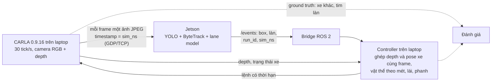

# Simulation cho hướng ADAS

Tóm tắt phần tìm hiểu ngày 2026-10-11: khi chưa có camera và chưa có xe, dùng
simulator nào để phát triển tiếp dự án theo hướng ADAS.

**Kết luận:** dùng CARLA nhánh 0.9.x. Autoware không phải simulator mà là một
stack lái tự động; chưa cần ở bước đầu. Việc cần làm trong source code nằm ở
mục 10.

## 1. Yêu cầu

Bài toán đặt ra: phát hiện vật thể ở khoảng cách tới 120 m, ổn định, 30 FPS,
trên chip 2 TOPS, kèm lane keeping.

Từ đó simulator cần có:

| # | Yêu cầu | Vì sao |
|---|---------|--------|
| 1 | Camera chỉnh được góc nhìn và độ phân giải | Bài toán 120 m do số pixel trên vật quyết định (mục 2) |
| 2 | Ground truth khung bao và khoảng cách của từng vật | Đo recall theo dải khoảng cách mà không phải gán nhãn tay |
| 3 | Ground truth làn đường | Làm đáp án cho model lane |
| 4 | Xe điều khiển được (ga, phanh, lái) | Thử lane keeping vòng kín |
| 5 | Bước thời gian cố định, lặp lại được | Chạy đúng 30 FPS và so sánh được trước/sau khi sửa |
| 6 | Thời tiết, ngày đêm | Các tình huống ADAS khó nhất |
| 7 | Đưa hình ra RTSP, GStreamer hoặc ROS 2 | Pipeline của dự án đọc sẵn ba nguồn này |
| 8 | Mã nguồn mở, chạy trên Ubuntu 22.04, ROS 2 Humble | Khớp môi trường đang dùng |
| 9 | Còn được bảo trì | Tránh công cụ đã dừng phát triển |

## 2. Vì sao camera ảo phải chỉnh được: bài toán pixel ở 120 m

Giả sử camera ngang 1920 px. Kích thước vật ở 120 m khi đưa vào mạng:

| Ống kính | Chiều ngang đưa vào mạng | Ô tô (1,8 m) | Người (0,5 × 1,7 m) |
|----------|--------------------------|--------------|---------------------|
| 52° | 640 px (cách dự án đang làm) | 9,8 px | 2,7 × 9,3 px |
| 52° | 1280 px | 19,7 px | 5,5 × 18,6 px |
| 52° | crop nguyên độ phân giải | 29,5 px | 8,2 × 27,9 px |
| 28° (tele) | 640 px | 19,3 px | 5,3 × 18,2 px |
| 100° (góc rộng) | crop nguyên độ phân giải | 12,1 px | 3,4 × 11,4 px |

Stride nhỏ nhất của YOLO là 8 px; theo kinh nghiệm chung vật cần khoảng 10–15 px
ở cạnh ngắn mới bắt ổn định. Simulator cho phép thử từng dòng của bảng này
trước khi mua camera.

Ngân sách tính toán ở 30 FPS (tính từ GFLOPs của model, chưa phải số đo trên
chip):

| Đầu vào | `yolov8n` | `yolo11s` |
|---------|-----------|-----------|
| 640×640 | 0,27 TOPS | 0,65 TOPS |
| 1280×736 cả khung | 0,61 TOPS | 1,50 TOPS |
| crop xa 960×384 + khung gần 640×384 | 0,40 TOPS | 0,98 TOPS |

## 3. Các lựa chọn đã xem

Tình trạng lấy từ GitHub ngày 2026-10-11.

| Tên | Là gì | Tình trạng | Hợp với bài toán? |
|-----|-------|------------|-------------------|
| CARLA | Simulator lái xe trên Unreal Engine, giấy phép MIT | Đang phát triển; bản mới nhất 0.9.16 (2025-09-16) | Có, nên chọn |
| Autoware | Stack lái tự động trên ROS 2: định vị, nhận thức, lập kế hoạch, điều khiển | Bản 1.9.0 (2026-07-16) | Tuỳ chọn, về sau |
| AWSIM (TIER IV) | Simulator trên Unity, làm riêng cho Autoware | Bản v2.0.1 (2025-10-31); asset chỉ cho phi thương mại | Chỉ khi đi theo Autoware |
| Isaac Sim | Simulator robot của NVIDIA, mã nguồn mở | Bản v6.1.0 (2026-09-10) | Không hợp: thiên về robot |
| MetaDrive | Simulator nhẹ, Apache 2.0 | Bản 0.4.3 (2024-12-06), repo vẫn hoạt động | Chỉ để thử vòng điều khiển; hình không giống thật |
| esmini | Trình chạy kịch bản OpenSCENARIO, đồ hoạ tối giản | Bản v3.9.0 (2026-10-06) | Bổ trợ khi cần kịch bản chuẩn |
| Gazebo | Simulator robot đa dụng | Đã cài sẵn trên laptop (Ignition, kèm ROS 2) | Chỉ để thử vòng điều khiển; hình không giống thật |

Không nên chọn:

- **LGSVL:** LG dừng phát triển từ 2022-01-01.
- **AWSIM Labs:** repo đã archived.
- **AirSim:** không có release nào từ 2022-07.

## 4. CARLA đối chiếu với yêu cầu

Các khả năng dưới đây là theo API của CARLA mà tôi biết; lần tìm hiểu này chỉ
kiểm tra lại phần phiên bản và cấu hình máy.

| # | Yêu cầu | CARLA |
|---|---------|-------|
| 1 | Camera chỉnh được | Đặt góc nhìn và độ phân giải tuỳ ý |
| 2 | Ground truth vật thể | Vị trí, khung bao, khoảng cách của mọi xe và người; có camera độ sâu và segmentation |
| 3 | Ground truth làn | Bản đồ OpenDRIVE cho tâm làn và loại vạch |
| 4 | Xe điều khiển được | Nhận lệnh ga, phanh, lái |
| 5 | Bước thời gian cố định | Chế độ đồng bộ với bước cố định |
| 6 | Thời tiết, ngày đêm | Chỉnh được |
| 7 | Đưa hình ra ngoài | ROS 2 có sẵn; RTSP/GStreamer cần một script cầu nối nhỏ |
| 8 | Mã nguồn mở, Ubuntu 22.04, Humble | MIT; Ubuntu 20.04 và 22.04 |
| 9 | Còn bảo trì | Có commit ngày 2026-10-10 |

### Chọn nhánh 0.9.x, không phải 0.10.0

- 0.9.16 (tháng 9/2025) mới hơn 0.10.0 (Unreal Engine 5, tháng 12/2024) và đang
  được GitHub đánh dấu là bản mới nhất.
- Nhẹ hơn nhiều (mục 6).
- Cầu nối chính thức của Autoware, `autoware_carla_interface`, viết cho
  Ubuntu 22.04, ROS 2 Humble và CARLA 0.9.15.

## 5. Autoware đặt ở đâu

Autoware sẽ thay pipeline của dự án chứ không kiểm thử nó. Hướng đó không còn là bước tiếp. Việc tiếp theo là vòng lái bỏ depth và pose hoàn hảo, trong `plans/261013-1025-honest-camera-control/`.

## 6. Cấu hình máy

| Phần mềm | Yêu cầu theo tài liệu |
|----------|-----------------------|
| CARLA 0.9.x | GPU cỡ RTX 2070 trở lên, từ 8 GB VRAM, khoảng 20 GB ổ đĩa, Ubuntu 20.04 hoặc 22.04 |
| CARLA 0.10.0 (UE5) | RTX 3000 trở lên với ít nhất 16 GB VRAM, Ubuntu 22.04, 130 GB ổ đĩa |
| Autoware (chạy kèm) | Tối thiểu CPU 8 nhân, 16 GB RAM, GPU NVIDIA 4 GB |
| Isaac Sim | Tối thiểu RTX 4080 |

Đề xuất cho máy mới: GPU từ 16 GB VRAM, RAM từ 32 GB, Ubuntu 22.04. Máy như vậy
chạy được cả hai nhánh CARLA và còn chỗ cho inference trên cùng máy.

Laptop hiện tại vừa đủ cho CARLA 0.9.x nhưng sát ngưỡng; chi tiết ở mục 11.

## 7. Ghép vào dự án

Giai đoạn 1 đã làm xong và chạy theo sơ đồ dưới đây. Cách chạy và số đo ở
[mục 14](#14-giai-đoạn-1-đã-làm-cách-chạy-và-kết-quả-đo).



- **Hình vào:** mỗi frame là một ảnh JPEG 1280×720 đi qua GStreamer
  (`appsrc ! gdppay ! tcpserversink` trên laptop, `tcpclientsrc ! gdpdepay !
  jpegdec` trên Jetson). Timestamp của buffer là thời gian mô phỏng của frame,
  tính bằng nano giây (`sim_ns`); pipeline đọc lại đúng số đó sau khi giải mã.
- **Định danh frame:** `(run_id, source, sim_ns)`. Không ghép theo thứ tự đến,
  bộ đếm cục bộ hay timestamp gần nhất. Mỗi lần chạy có `run_id` mới; Jetson
  được khởi động lại với `run_id` đó.
- **Depth không đi qua Jetson:** camera depth của CARLA ở lại laptop và được
  ghép với kết quả của đúng frame đó. Camera thật không có cảm biến này;
  xem mục 12.
- **Lệnh lái:** controller là một node ROS 2. Simulator chỉ áp lệnh khi lệnh
  còn hạn, đúng `run_id` và người vận hành đã ARM; ngoài ra nó phanh.
- **Đánh giá:** chỉ script đánh giá đọc vị trí thật của xe khác và tim làn
  của bản đồ. Controller không đọc các dữ liệu đó.

## 8. Sau detection: chuỗi perception của ADAS

2D detection chỉ là điểm bắt đầu. Giá trị của ADAS nằm ở chuỗi sau nó:
pixel → mét → quỹ đạo → vận tốc → thời gian tới va chạm. Chuỗi đó cần
calibration ở đầu và Kalman ở cuối.

| Mắt xích | Nghĩa là | Dự án hiện tại | Làm được trong CARLA? |
|----------|----------|----------------|-----------------------|
| ISP | Xử lý ảnh thô từ cảm biến: demosaic, cân bằng trắng, phơi sáng, khử nhiễu, HDR | Chưa có; nhận hình đã qua xử lý | Không: CARLA xuất thẳng ảnh RGB sạch |
| Calibration camera | Tìm intrinsics (tiêu cự, tâm ảnh, hệ số méo) và extrinsics (vị trí, góc gắn) | Chưa có | Được (mục 9) |
| LDC (lens distortion correction) | Nắn ảnh bị cong do ống kính | Chưa có | Một phần (mục 9) |
| Đầu vào mạng | RGB 640×640×3; ảnh ít kênh hơn thì tốn ít tính toán hơn | RGB 3 kênh, chưa thử ít kênh | Được |
| uv → XY | Đổi toạ độ pixel của khung bao sang mét trên mặt đường | Chưa có | Được, có khoảng cách thật để chấm |
| Tracking và động học | Theo dõi vật trong toạ độ mét, ước lượng vận tốc, gia tốc | Có tracking, nhưng trong toạ độ pixel và chưa có vận tốc | Được, có vận tốc thật để so |
| Mô hình tracking, tune Kalman | Chọn mô hình chuyển động, chỉnh nhiễu quá trình và nhiễu đo | Kalman của ByteTrack với tham số mặc định; box xuất ra vẫn là box thô | Được |

## 9. Calibration camera trong CARLA

CARLA cho biết chính xác thông số camera, nên có đáp án để chấm thuật toán
calibration. Phần nó không mô phỏng tốt là méo ống kính của camera thật. Các
chi tiết dưới đây là theo API CARLA 0.9.x mà tôi nhớ, chưa kiểm tra lại.

**Mô phỏng được**

| Thành phần | Trong CARLA |
|------------|-------------|
| Intrinsics | Suy ra chính xác từ góc nhìn và độ phân giải: `fx = W / (2·tan(fov/2))`, tâm ảnh ở `(W/2, H/2)` |
| Extrinsics | Vị trí và góc gắn camera trên xe là do mình đặt, nên biết chính xác |
| Sai lệch lắp đặt | Cố ý đặt lệch pitch, yaw hoặc độ cao, rồi xem thuật toán có tìm lại được không |
| Kiểm tra phép chiếu | Chiếu toạ độ 3D thật của xe khác lên ảnh và so với hình render |
| Calibration online | Ước lượng pitch từ điểm tụ của vạch làn khi xe chạy, rồi so với giá trị đã đặt |

Calibration online đáng làm nhất cho bài toán 120 m: ước lượng khoảng cách bằng
một camera rất nhạy với góc pitch, và trong simulator đo được sai 1° pitch làm
lệch bao nhiêu mét ở 120 m.

**Mô phỏng được một phần**

- Méo ống kính: camera RGB của CARLA có tham số méo, nhưng đó là hiệu ứng hậu
  kỳ, không phải mô hình hệ số `k1, k2, p1, p2` của OpenCV. Có ảnh méo để thử,
  không có đáp án đúng dạng để chấm kết quả `cv::calibrateCamera`.
- Bàn cờ calibration: tôi không nhớ CARLA có sẵn vật thể bàn cờ. Cách vòng là tự
  nhập một tấm bàn cờ vào bản đồ (cần Unreal Editor), hoặc dùng các điểm 3D đã
  biết (góc khung bao của xe, điểm trên vạch làn) rồi giải PnP.

**Không mô phỏng được**

- Dung sai chế tạo và độ lệch tâm của ống kính thật.
- Rolling shutter, mất nét, nhiệt độ làm trôi thông số.
- Rung và lệch dần của giá gắn camera theo thời gian.

## 10. Kế hoạch hai giai đoạn và việc cần làm trong source code

### Giai đoạn 1: kiểm thử pipeline hiện tại trên CARLA

Đã làm xong. Bảng dưới ghi mỗi việc nằm ở đâu trong source.

| Việc | Đã làm | Ở đâu |
|------|--------|-------|
| Nhận hình từ CARLA | JPEG qua GDP/TCP, timestamp của frame đi kèm; không dùng RTSP vì cần đúng timestamp từng frame | `simulation/video_analytics_simulation/simulator.py`, `src/capture/gst-capture.cpp` |
| Detect, track | Không đổi; kết quả có thêm `simulation` và `image` | `src/server/result-serializer.hpp` |
| Calibration và uv → XY | File thông số camera dùng chung cho Jetson và laptop; hàm đổi pixel sang mét trên mặt đường | `simulation/config/carla.yaml`, `calibration.py`, `src/analytics/lane-geometry.cpp` |
| Tracking trong toạ độ mét | Khoảng cách từ depth, Kalman theo từng track trong hệ toạ độ thế giới, xuất vận tốc và gia tốc | `metric_tracker.py` |
| Lane | Mạng UFLD ResNet-18 làm engine thứ hai, tiền xử lý và giải mã riêng. Lúc đầu dùng trọng số TuSimple của tác giả; từ 2026-10-13 train trên ảnh CARLA (mục 15) | `src/inference/lane-engine.cpp`, `scripts/train-lane-model.py`, `scripts/export-lane-model.py` |
| Xuất làn ra ngoài | Làn theo mét trong JSON và topic ROS 2 | `src/server/result-serializer.hpp`, `ros2/video_analytics_bridge` |
| Điều khiển lái và phanh | Pure pursuit theo tim làn, PI tốc độ, phanh khi có vật cản trong đường đi | `controller.py` |
| Đánh giá | Recall theo dải khoảng cách, sai số khoảng cách, vận tốc, gia tốc, làn, độ trễ, kết luận theo kỳ vọng của scenario | `simulation/evaluate.py` |
| Đồng bộ thời gian | CARLA chạy đồng bộ, bước 1/30 s, không chờ kết quả inference | `simulator.py` |
| Khởi chạy | Một script cho một scenario | `simulation/run.sh` |

ISP và LDC để dành cho lúc có camera thật.

### Giai đoạn 2: tích hợp Autoware

Autoware thay pipeline của dự án, nên phần này hầu như không đụng tới source
code hiện tại:

- Cài Autoware và `autoware_carla_interface` (Ubuntu 22.04, Humble,
  CARLA 0.9.15).
- Viết lại script đánh giá để đọc kết quả từ topic của Autoware.
- Muốn giữ vai trò cho dự án thì hướng khả thi là đưa detection của pipeline
  vào Autoware qua ROS 2 thay cho module nhận thức của nó.

Cầu nối Autoware viết cho CARLA 0.9.15, còn bản mới nhất là 0.9.16. Nếu chắc
chắn sẽ làm giai đoạn 2 thì cài 0.9.15 ngay từ đầu để khỏi cài lại.

## 11. Laptop hiện tại có chạy được không

Đo ngày 2026-10-11.

| Hạng mục | Laptop | CARLA 0.9.x cần | Kết luận |
|----------|--------|-----------------|----------|
| GPU | RTX 5060, 8 GB VRAM (đang dùng 1,5 GB) | cỡ RTX 2070, từ 8 GB VRAM | Đủ, không dư |
| RAM | 30 GB, còn trống 13 GB | tài liệu không nêu | Đủ cho CARLA; chật khi thêm Autoware (tối thiểu 16 GB) |
| Ổ đĩa | trống 121 GB | khoảng 20 GB | Đủ |
| Hệ điều hành | Ubuntu 22.04.5 | 20.04 hoặc 22.04 | Khớp |
| Python | 3.10.12 | 3.7 đến 3.12 | Khớp |
| ROS 2 | Humble | Humble (cho cầu nối Autoware) | Khớp |

- **Giai đoạn 1:** đã chạy. CARLA 0.9.16 chiếm khoảng 6 GB VRAM và render
  hai camera 1280×720 ở 29,7 tick/giây; inference chạy trên Jetson. Chạy cả
  CARLA lẫn `tensorrt-native` trên cùng RTX 5060 thì hai bên tranh 8 GB VRAM:
  ảnh render có lúc cháy sáng ngả đỏ, rồi TensorRT báo hết bộ nhớ. Chỉ dùng
  cách đó để thử nhanh, không dùng để đo.
- **Giai đoạn 2:** CARLA, Autoware và các model của Autoware cùng cần GPU và
  RAM; nên dùng máy mạnh hơn.
- **Ổ đĩa:** CARLA 0.9.16 chiếm khoảng 20 GB tại `~/opt/carla-0.9.16`.

## 12. Simulation không thay được gì

- **Dữ liệu thật để train.** Model train chỉ bằng hình render thường kém trên
  hình thật và ngược lại. Train bằng dataset thật (BDD100K, KITTI, nuScenes;
  CULane, TuSimple cho làn); dùng simulator để kiểm thử hệ thống và đo.
- **Camera thật:** ISP, nhiễu cảm biến, méo ống kính và LDC, nhoè chuyển động,
  calibration bằng bàn cờ.
- **Đo khoảng cách bằng một camera:** giai đoạn 1 lấy khoảng cách từ camera
  depth của CARLA, chính xác tới vài cm. Camera thật không có cảm biến đó;
  khoảng cách khi ấy phải suy từ đáy khung bao và mặt đường (hàm `uv_to_ground`
  đã có) hoặc từ cảm biến khác, và sai số sẽ lớn hơn nhiều.
- **Chip đích:** tốc độ trên chip 2 TOPS vẫn phải đo trên chính chip.
- **An toàn chức năng:** kết quả là prototype perception, không phải sản phẩm
  ADAS; chưa có ISO 26262 và chưa thử trên xe.

## 13. Chưa xác minh được

- Cấu hình máy của AWSIM: trang tài liệu trả lỗi 404.
- Model lane đã qua bước kiểm tra trên đường cao tốc Town04 ban ngày. Chưa
  thử ban đêm, mưa, giao lộ, đường không vạch.
- Điều khoản sử dụng của checkpoint lane: mã nguồn UFLD theo giấy phép MIT,
  còn checkpoint do tác giả đăng trên Google Drive không ghi điều khoản. Vì
  vậy checkpoint và file ONNX không nằm trong repository. Từ 2026-10-13 các
  lần chạy không dùng checkpoint đó nữa (mục 15).
- Tài liệu nêu yêu cầu cho CARLA 0.9.x đang viết cho bản 0.9.15, chưa cập nhật
  cho 0.9.16.
- Các tham số méo ống kính và việc thiếu vật thể bàn cờ trong CARLA là theo trí
  nhớ.
- Autoware nhận detection từ ngoài theo định dạng nào.
- Các chip lớp 2 TOPS (TI AM62A, NXP i.MX 8M Plus, Rockchip RV1126) là theo
  thông số nhà sản xuất mà tôi nhớ, chưa kiểm tra lại.

## 14. Giai đoạn 1: đã làm, cách chạy và kết quả đo

Đo ngày 2026-10-12. CARLA 0.9.16 trên laptop (RTX 5060), inference trên
Jetson Orin Nano Super 8GB (YOLO11s và lane model, cả hai FP16 qua
`tensorrt-native`). Hai máy nối qua VPN chuyển tiếp: ping 120 ms, thông lượng
khoảng 10 Mbit/s. Nguồn hình 1280×720, FOV ngang 52°, 30 FPS.

Các số trong mục này đo với camera chúc 2° và controller khóa phanh ở mọi
nghi ngờ. Từ mục 15, camera chúc 10° và phanh vì vật cản nhả được; bảng trạng
thái dưới đây là của code hiện tại.

### Cách chạy

Cài một lần trên laptop:

```bash
# CARLA 0.9.16 và client Python của nó
mkdir -p ~/opt/carla-0.9.16 && cd ~/opt/carla-0.9.16
curl -LO https://carla-releases.s3.us-east-005.backblazeb2.com/Linux/CARLA_0.9.16.tar.gz
tar -xzf CARLA_0.9.16.tar.gz
python3 -m venv --system-site-packages venv && venv/bin/pip install carla==0.9.16

# Lane model: train trên ảnh của chính simulator (lệnh đầu cần server CARLA,
# 8,5 phút; lệnh sau cần torch, khoảng 35 phút trên RTX 5060, CARLA phải tắt)
simulation/lane-dataset.py --out data/lanes/town04
scripts/train-lane-model.py --data data/lanes/town04 --output models/lane-town04.onnx

# Image cho Jetson (chỉ gửi image, không đụng tới stack đang chạy)
IMAGE_ONLY=1 scripts/deploy-jetson.sh machineai@100.85.110.98
```

Chạy một scenario:

```bash
simulation/run.sh --scenario brake_person --arm \
    --device machineai@100.85.110.98 --remote-dir hieule/carla-sim
```

- `--gui` mở một cửa sổ gộp cả lần chạy: ảnh nhìn từ sau xe, các camera của
  xe, ảnh nhìn từ trên và bản đồ ô đỗ. Server CARLA luôn chạy off-screen (từ 2026-10-14).
- Không có `--arm` thì xe đứng yên, phanh suốt lần chạy, dù mọi điều kiện đã
  đạt. Có `--arm` mà điều kiện chưa đạt thì controller từ chối.
- `--device local` (mặc định) chạy inference ngay trên laptop, bằng backend ghi
  trong config; `--device none` cho các scenario chỉ đo xe và cảm biến.
- Mã thoát của script là mã của `simulation/evaluate.py`: 0 khi mọi kỳ vọng
  đạt, 1 khi có kỳ vọng trượt, 2 khi thiếu file của lần chạy.
- Mọi thứ script đặt lên Jetson nằm trong `--remote-dir`: config, model,
  engine TensorRT, compose file.
- Mỗi lần chạy tạo thư mục `.cache/carla/<run_id>/` với sổ frame, trạng thái
  xe, depth nén không mất dữ liệu, ground truth, lệnh đã áp, kết quả nhận
  được, `metrics.json` và `summary.md`.
- Danh sách scenario và kỳ vọng của từng cái ở
  `simulation/config/carla-scenarios.yaml`. Thông số camera, ngân sách thời gian
  và tham số điều khiển ở `simulation/config/carla.yaml`, dùng chung cho cả hai
  máy.

### Trạng thái của controller

| Trạng thái | Xe làm gì | Ra khỏi bằng cách nào |
|------------|-----------|-----------------------|
| `WAIT_DATA` | Phanh | Lệnh ARM đúng `run_id` khi mọi điều kiện đạt: có 3 frame mới liên tiếp với làn hợp lệ, dữ liệu còn mới hơn 60 % giới hạn tuổi, xe đứng yên, config của Jetson không lọc mất class nào trong sáu class cần phanh. Không tự ARM. |
| `RUNNING` | Giữ làn ở 50 km/h (hoặc tốc độ scenario ghi, tối đa 60), phanh khi cần | Sang `HOLDING` hoặc `STOP_LATCHED`, tùy lý do |
| `HOLDING` | Phanh hết, vì một lý do có thể qua đi: có vật cản trong đường đi, hoặc mất làn trong một đến bốn kết quả liên tiếp | Về `RUNNING` khi làn hợp lệ trở lại; sau vật cản thì cần thêm 30 kết quả liên tiếp cho thấy đường trống tới hết quãng dừng của tốc độ hành trình. "Trống" gồm cả ảnh depth: không có gì cao 0,3 đến 2,5 m đứng trên đường đi, dù detector có thấy nó hay không |
| `STOP_LATCHED` | Phanh | Chỉ khi chạy lại với `run_id` mới. Vào đây khi dữ liệu quá cũ, pose hỏng, không còn làn ở điểm ngắm, hoặc mất làn năm kết quả liên tiếp |

Simulator kiểm tra độc lập với controller: lệnh sai `run_id`, sai kiểu, có
NaN, số thứ tự cũ, đến từ tương lai hoặc hết hạn đều bị từ chối và không kéo
dài thời hạn của lệnh trước. Không nhận được lệnh hợp lệ trong
`wall_lease_ms` thì simulator tự phanh, trong khi mô phỏng vẫn chạy tiếp.

### Kết quả

**Truyền hình và định danh frame**

| Hạng mục | Kết quả |
|----------|---------|
| Timestamp qua GDP và bộ giải mã JPEG | 310 frame thử trên laptop: 0 timestamp đổi, 0 frame lẫn pixel (`test_capture_timestamps`) |
| Kết quả mang timestamp không phải của frame đã gửi | 0 trong mọi lần chạy, kể cả lần 10 phút (17 976 kết quả) |
| Chạy 10 phút liên tục | 18 000 tick, 29,7 tick/giây; 99,9 % frame có kết quả quay về; 29,6 kết quả/giây |
| JPEG chất lượng 75 | 87 kB mỗi frame, 20 Mbit/s: chỉ 69 % frame có kết quả quay về |
| JPEG chất lượng 30 (đang dùng) | 35 đến 40 kB, 8 đến 9,5 Mbit/s: 99 % quay về |
| JPEG chất lượng 20 | 32 kB, nhưng recall xe ở 60–90 m rơi từ 0,99 xuống 0,35 |
| Độ trễ từ tick tới lúc có kết quả | trung vị 216 ms, P95 233 ms, lớn nhất 1 233 ms |
| Độ trễ từ tick tới lúc lệnh được áp | trung vị 237 ms, P95 273 ms, lớn nhất 472 ms |
| Cùng chuỗi đó khi cả hai chạy trên laptop | 64 ms tới kết quả, 100 ms tới lệnh |
| Jetson, hai model cùng chạy | detector 8,0 ms từ lúc nhận frame tới lúc có kết quả; lane 3,5 ms tiền xử lý, 3,9 ms inference, 0,3 ms giải mã; 29,6 kết quả/giây; 11,3 W; GPU 32 % |

**Detection theo khoảng cách** (YOLO11s, input 640, ảnh nguồn 1280×720 thu về
640; mỗi dải 135 mẫu, vật đứng một mình trên đường)

| Dải | Xe con | Người |
|-----|--------|-------|
| 0–30 m | 1,00 | 0,35 |
| 30–60 m | 0,99 | 0,34 |
| 60–90 m | 0,99 | 0,00 |
| 90–120 m | 0,00 | 0,00 |

Số trên tính trên các frame có kết quả quay về. Tính trên mọi frame camera
sinh ra, frame mất kết quả coi là trượt, thì dải 0–30 m của xe con còn 0,53
trong lần chạy đó vì 13 % frame đầu mất trên đường truyền. Bốn class còn lại
(xe tải, xe buýt, xe máy, xe đạp) ở 20 và 40 m: 0,33 và 0,41.

**Calibration và depth**

| Hạng mục | Kết quả |
|----------|---------|
| Depth của CARLA 0.9.16 đo theo | trục quang (Z), không phải theo tia: mặt đường dựng lại từ depth lệch 1,5 mm RMSE khi đọc theo trục quang, 94 mm khi đọc theo tia |
| Điểm đánh dấu ở vị trí 3D biết trước, chiếu lại lên ảnh | 108 điểm: trung vị 0,26 px, P95 0,75 px, lớn nhất 0,90 px |
| Khoảng cách tới đuôi xe ở 5, 10, 20 m (giữa và lệch trục) | sai lớn nhất 0,04 m |

**Tracking theo mét**

| Scenario | Vận tốc | Gia tốc |
|----------|---------|---------|
| Xe phía trước chạy đều 3 m/s, xe mình đứng | RMSE 0,07 m/s | 0,78 m/s² |
| Xe phía trước tăng tốc 1,5 m/s², xe mình đứng | 0,31 m/s | 0,28 m/s² |
| Xe đỗ ở làn bên, xe mình chạy qua | 0,49 m/s ở 0–30 m; 0,04 m/s ở 30–60 m | 0,54 m/s² |

Khi chạy ngang qua xe đỗ, bề mặt nhìn thấy đổi từ đuôi sang sườn xe nên điểm
đo dịch theo; sai số khoảng cách ở dải 0–30 m lúc đó là 0,30 m RMSE, lớn nhất
1,7 m.

**Lane**

| Hạng mục | Kết quả |
|----------|---------|
| Engine TensorRT FP16 trên Jetson so với ONNX Runtime FP32 trên CPU, 30 ảnh CARLA | 2 720 điểm làn: lệch trung vị 1 px, P95 3 px; 27 điểm chỉ một bên thấy |
| PyTorch so với ONNX Runtime | lệch lớn nhất 7·10⁻⁶ trên logits |
| Làn hợp lệ trên đường trống | 100 % frame |
| Tim làn so với bản đồ | RMSE 0,02 đến 0,05 m |
| Giữ làn 30 giây ở 9 km/h: thẳng (3 lần), cong trái (3 lần), cong phải (2 lần) | xe lệch tim làn 0,01 đến 0,05 m RMSE, lớn nhất 0,06 m; 0 va chạm |
| Xuất phát lệch 0,5 m và 2° | lệch lớn nhất 0,50 m rồi về tim làn |

**Phanh trước vật cản** (xe chạy 9 km/h, 12 lần chạy)

| Scenario | Khoảng cách còn lại khi dừng | Lý do dừng |
|----------|------------------------------|------------|
| Xe con đỗ cách 30, 40, 50 m | 4,3 đến 10,5 m | TTC (3 lần), mất làn (2 lần) |
| Xe con đỗ trên đoạn cong | 4,8 m | mất làn |
| Xe tải | 4,0 m | mất làn |
| Người đứng giữa làn và lệch 0,8 m | 3,9 đến 4,3 m | TTC (2 lần), khoảng cách (2 lần) |
| Xe từ làn bên cắt vào | 11,3 m | mất làn |
| 5 vật ở làn bên và lề đường | không phanh vì vật cản; xe chạy hết 30 giây | |

Không lần nào va chạm. "Mất làn" nghĩa là khi vật cản ở gần, lane model không
còn đủ vạch để dựng làn và quy tắc mất làn dừng xe trước quy tắc vật cản. Xe
vẫn dừng, nhưng những lần đó không chứng minh được quy tắc vật cản.

**Lỗi cố ý**

| Lỗi | Kết quả |
|-----|---------|
| Luồng hình ngừng khi xe đang chạy | phanh sau 500 ms mô phỏng (giới hạn 500 + 1 tick) |
| Depth ngừng | phanh sau 500 ms |
| Kill controller (SIGKILL) | simulator tự phanh sau 303 ms, mô phỏng vẫn chạy |
| Lệnh giả: sai `run_id`, thiếu trường, không phải object | bị từ chối cả ba, xe không nhúc nhích |
| Config Jetson chỉ giữ class `car` | controller không báo sẵn sàng, không ARM được |
| Xe khác đâm vào xe mình (đối chứng âm) | script đánh giá cho lần chạy đó trượt, đúng như phải thế |
| Chạy lại tracking chỉ từ file đã lưu | 346/346 frame, sai khác 0; thiếu file depth thì báo trượt |

**Đáp ứng của xe** (Tesla Model 3 của CARLA, điều khiển vòng hở)

| Hạng mục | Kết quả |
|----------|---------|
| `steer` dương | rẽ phải; góc bánh đạt 0,74 đến 1,10 lần giá trị danh định |
| Phanh hết từ 2,6 m/s | bắt đầu giảm tốc sau 0,1 s; 10,3 m/s²; dừng sau 0,67 m |

### Mục tiêu chưa đạt và giới hạn

- **200 ms từ frame tới lệnh.** Trên đường truyền hiện tại riêng vòng ping đã
  120 ms; độ trễ đo được là 237 ms trung vị. Ngân sách trong
  `simulation/config/carla.yaml` vì vậy là bản 2: tuổi dữ liệu tối đa 500 ms,
  thời hạn theo đồng hồ thật 600 ms, `tau` 0,6 s. Hai máy cùng mạng nội bộ thì
  100 ms, bản 1 (200 và 300 ms) dùng được.
- **30 FPS.** Laptop chạy mô phỏng ở 29,7 tick/giây, thiếu 1 %. Đường truyền
  có lúc nghẽn: 7 trong 33 lần chạy có ARM trên Jetson bị dừng hoặc không ARM
  được vì dữ liệu đến trễ quá giới hạn. Ba lần trong đó là do ARM khi tuổi dữ
  liệu đã sát giới hạn; từ khi thêm điều kiện 60 % thì 6 lần chạy có ARM tiếp
  theo đều chạy hết. Đoạn đường cong phải có nhiều chi tiết hơn,
  ảnh ở chất lượng 30 nặng 45 kB (10,7 Mbit/s), nên scenario trên đoạn đó
  dùng chất lượng 25.
- **120 m.** Xe con được phát hiện tới 90 m; ngoài 90 m recall bằng 0. Người
  chỉ được phát hiện tới 60 m và chỉ một phần ba số frame. Đây đúng là giới
  hạn pixel của mục 2: ở 100 m xe con cao khoảng 10 px sau khi thu ảnh về 640.
  Chưa làm crop vùng xa.
- **Phanh theo quy tắc vật cản.** Camera chỉ thấy mặt đường từ 5,5 m trước xe,
  nên khi vật cản vào gần thì làn mất trước. 7 trong 12 lần dừng là do quy tắc
  vật cản, 5 lần do mất làn.
- **Phạm vi đã thử:** ban ngày, đường phẳng có vạch, thẳng và cong nhẹ (bán
  kính khoảng 340 m), tối đa 9 km/h, bản đồ Town04. Vật thể được đặt theo kịch
  bản, không dùng vật lý, không che nhau.
- **Controller và simulator chạy cùng một máy.** Cơ chế thời hạn xử lý được
  việc controller chết, không xử lý được việc cả máy chết. Đây không phải
  watchdog của xe thật.
- **Chip 2 TOPS:** chưa đo; Jetson Orin Nano không phải chip đó.

## 15. Hai màn show: lái và đỗ

Làm ngày 2026-10-12 theo `plans/261012-1633-carla-drive-and-park-show`. Mọi
thứ chạy trên một máy: CARLA, inference (`tensorrt-native`, RTX 5060 8 GB) và
controller. Màn lái dùng YOLO11s và lane model (từ 2026-10-13 là bản train
trên ảnh CARLA, xem dưới). Màn đỗ được
làm lại ngày 2026-10-13: thêm camera sau và một model thứ ba nhận ô đỗ, để xe
tự tìm ô thay vì lùi vào toạ độ ghi sẵn.

### Cách chạy

```bash
simulation/run.sh --scenario show_drive --arm --gui
simulation/run.sh --scenario show_park --arm --gui
simulation/run.sh --scenario show_park_next --arm --gui
simulation/run.sh --scenario show_park_occupied --arm --gui
```

`--gui` mở một cửa sổ (`CARLA cameras`, từ 2026-10-14; trước đó là hai cửa
sổ, cửa sổ CARLA riêng):

- **Ảnh nhìn từ sau xe**, lớn, bên trái trên: một camera 1280x720 gắn sau xe
  8 m, cao 4 m. Không vẽ hộp hay vạch gì lên đó.
- **Các camera của xe** xếp một hàng bên dưới (trước, sau, trái, phải). Bên
  phải là **ảnh nhìn từ trên** và, ở màn đỗ, **bản đồ** bên dưới nó, mỗi panel
  450x450. Cả cửa sổ 1730x946, vừa màn 1920x1080.
- **Bản đồ** được vẽ ra, không phải ảnh camera: các ô controller theo dõi,
  quanh xe, đầu xe hướng lên, 20 m mỗi cạnh. Ô có xe vẽ hình xe xám; ô đích
  tô xanh. Chỉ vẽ ô đã được thấy cả ô ít nhất 10 lần (như
  `park.min_sightings`). Hai ô chồng nhau hơn 10% thì chỉ vẽ ô được thấy gần
  đây nhất: pose của controller trôi, một ô thấy lại xa chỗ cũ thành track
  thứ hai. Panel nhìn từ trên dùng cùng bộ lọc.
- **Xe thật thay khối**: lúc xe ổn định trước run, hai camera đặt thẳng trên
  xe 30 m (RGB và semantic, 12°) chụp một ảnh rồi bị gỡ; phần semantic là xe
  thành sprite có nền trong suốt (`<run>/vehicle-from-above.png`). Viewer dán
  nó vào chỗ xe trên ảnh nhìn từ trên và bản đồ; xe trong ô có người đỗ trên
  bản đồ là cùng sprite, màu xám.
- **Vùng đen của ảnh nhìn từ trên được lấp**: chỗ không camera nào thấy lúc
  này lấy từ ảnh trước, dời theo chuyển động thật của xe (pose của simulator).
  Chỉ cho người xem: ảnh thiết bị dựng và đưa cho model vẫn đen ở đó.
- Ảnh của cửa sổ được dựng ở một thread riêng: trên laptop, `show_park_bev`
  với `--gui` từ 9,9 lên 11 đến 12,4 tick/giây. Ảnh
  lấy thẳng từ simulator, vẽ đè những gì thiết bị tìm thấy. Camera trước: hộp
  detection, số track, và vạch làn. Ở màn đỗ không có vạch làn: bãi không có
  làn, nên thiết bị không chạy lane model ở đó. Camera sau (chỉ có ở màn
  đỗ): ô đỗ model thấy (xanh là trống, đỏ là có xe), đầu vạch chia ô (dấu
  cộng), các ô
  controller đang theo dõi (viền trắng) và ô nó chọn (viền vàng). Dòng dưới
  cùng ghi tick, trạng thái, pha đỗ, tốc độ và lệnh đang áp lên xe. Mỗi ảnh
  hiện cùng kết quả của chính frame đó, nên hình trễ bằng độ trễ của thiết bị
  (khoảng 0,1 giây). Bấm `q` để đóng cửa sổ; lần chạy vẫn tiếp tục.

`--web` bật thêm dashboard của thiết bị ở `http://127.0.0.1:9011` (trang web
với video từng camera, hộp, vạch làn, ô đỗ). Mặc định dashboard tắt: thiết bị
chỉ phát kết quả (`/events`), `/health` và `/metrics`; nó không vẽ và không
nén ảnh nào cho trình duyệt. Chạy app ngoài simulation thì dashboard vẫn bật
mặc định; tắt bằng `dashboard: false` trong config hoặc cờ `--no-dashboard`.

Bản config gửi cho thiết bị (`device.yaml` trong thư mục lần chạy) chỉ có thứ
scenario dùng: màn lái có lane model, không có camera sau và model ô đỗ; màn
đỗ thì ngược lại.

Cả cửa sổ camera lẫn dashboard đều không ghi số mét: khoảng cách chỉ có ở
controller, trong `commands.jsonl` và `stalls.jsonl`.

Model ô đỗ không nằm trong repo. Tạo lại bằng hai lệnh (cần server CARLA cho
lệnh đầu, khoảng 27 phút; lệnh sau khoảng 50 phút trên RTX 5060):

```bash
simulation/stall-dataset.py make --out data/stalls
scripts/train-stall-model.py --data data/stalls --output models/stall-town05.onnx
```

Lần chạy đầu sau khi server CARLA vừa mở, thiết bị có thể không nạp được model
vì thiếu bộ nhớ đồ họa; script tự khởi động lại thiết bị (tối đa 11 lần, cách
nhau 8 giây) trong lúc server nhả texture của map mặc định.

### Tốc độ: 50 km/h thay cho 9 km/h (2026-10-13)

Các số ở mục 14 đo ở 9 km/h. Từ 2026-10-13 tốc độ chung là 50 km/h
(`control.target_speed_kmh`), trần 60. Với `max_throttle` 0,5 xe không chạy
nhanh hơn 50 km/h; đặt mục tiêu 80 km/h thì nó vẫn dừng ở 13,9 m/s.

- **Phanh.** Phanh hết cỡ từ 12 m/s đo được 7,0 m/s² (đứng yên sau 10,8 m và
  1,4 giây). `a_min_mps2` tăng từ 2,5 lên 5,0; với 2,5 xe dừng cách vật cản
  28 m.
- **Lỗi tìm ra khi chạy nhanh.** Ở `brake_truck`, xe phanh và đứng cách xe tải
  11 m. Sau đó detector không còn thấy xe tải, 30 kết quả không có nó được
  coi là đường trống, và xe chạy tiếp tới 5,3 m/s; nó chỉ dừng lại cách 1,1 m
  nhờ lane model mất làn. Đã sửa: xem dòng `HOLDING` ở bảng trạng thái mục 14.
- **Đường cong.** Lane model TuSimple báo sai bề rộng làn ở mét thứ 302 (cong
  phải) và 193 (cong trái) kể từ điểm xuất phát, và xe dừng ở đó. Ở 9 km/h xe
  chưa bao giờ tới các điểm này. Hai scenario khi ấy được rút ngắn (600 và 400
  tick) để kết thúc trước đó. Hai điểm là cùng một chỗ trên road 23: nơi
  đường cong hết và một dốc cua bán kính khoảng 100 m bắt đầu. Lane model mới
  (mục kế) không còn hỏng ở đó.

Chạy lại 20 scenario lái và đỗ với cấu hình này, không cửa sổ, 19 đạt:

| Scenario | Kết quả |
|----------|---------|
| `lane_straight`, `lane_curve_right`, `lane_curve_left` | 13,3 đến 13,9 m/s; lệch tim làn RMSE 0,05 đến 0,07 m |
| `lane_offset_start` | RMSE 0,15 m |
| `brake_static_car`, `_30`, `_50`, `_curve` | đạt 6,9 đến 9,4 m/s trước khi phanh; dừng cách xe 10,1 đến 11,5 m |
| `brake_truck` | dừng cách 9,5 m và đứng yên tới hết |
| `brake_person`, `brake_person_offset` | dừng cách người 8,8 và 6,4 m |
| `brake_cut_in` | dừng cách xe tạt vào 10,1 m (xe đó tạt vào sớm hơn: tick 30 thay vì 240) |
| `negative_adjacent` | 13,9 m/s, không phanh |
| `fault_no_frames`, `fault_no_depth`, `fault_controller_killed` | từ 12,6 m/s, phanh đúng hạn |
| `show_park`, `show_park_next`, `show_park_occupied` | đạt như trước |
| `metric_parked_ego_moving` (giữ 9 km/h) | **trượt 2 trong 3 lần**: sai số tốc độ 0,46 đến 0,52 m/s, ngưỡng 0,50 |

Ở các scenario phanh, vật cản đứng cách 22 đến 50 m nên xe chưa kịp lên 50
km/h. `metric_parked_ego_moving` nằm sát ngưỡng từ trước (0,48 và 0,49 hôm
12/10); ở 50 km/h sai số là 0,77 m/s nên scenario này giữ 9 km/h.

### Lane model train trên ảnh CARLA (2026-10-13)

Lane model của giai đoạn 1 là trọng số TuSimple của tác giả UFLD: ảnh đường
cao tốc Mỹ, camera khác. Ở 50 km/h nó lộ hai giới hạn: báo sai bề rộng làn ở
chỗ đường cong chuyển sang dốc cua, và đặt sai vạch ngoài của làn mới khi
chuyển làn ở 30 km/h. Từ 2026-10-13 các lần chạy dùng
`models/lane-town04.onnx`: cùng mạng, cùng input và output, nên thiết bị và
C++ không đổi gì; khác ở chỗ nó được train trên ảnh của chính simulator, với
nhãn lấy từ bản đồ. Cách làm giống model ô đỗ.

- **Ảnh** (`simulation/lane-dataset.py`): camera trước đặt lên mọi làn xe
  chạy của map, cách nhau 2 m. Hai phần ba số ảnh xe ở gần tim làn và gần
  song song với làn; một phần ba xe nằm bất kỳ đâu ngang làn, lệch hướng tới
  8°, như lúc chuyển làn. Nửa số ảnh có 1 đến 4 xe phía trước. Ánh sáng: 40 %
  như lúc chạy (`ClearNoon`), 30 % mặt trời, mây, đường ướt khác, 15 % đêm
  (một nửa có đèn xe), 15 % mưa. 8 000 ảnh Town04 mất 8,5 phút.
- **Nhãn**: bốn vạch mà model có chỗ chứa: hai biên của làn xe đang ở, và
  biên xa của làn bên trái, bên phải. Bản đồ cho vị trí biên làn; script đi
  theo làn 100 m về phía trước (đi thẳng ở chỗ làn tách nhánh) và chiếu lên
  ảnh bằng pose của xe. Một vạch được gắn nhãn từ chỗ bản đồ bắt đầu có sơn
  tới chỗ hết sơn: xuyên qua khe của vạch đứt, qua đoạn hở không sơn và phía
  sau xe khác. Bản đồ chỉ dùng để gắn nhãn; controller không đọc nó.
- **Chia train và val** theo đoạn đường 50 m: một phần mười số đoạn vào val
  (845 ảnh), phần còn lại vào train (7 155 ảnh). Ảnh val vì vậy không phải
  cùng một chỗ với ảnh train nhìn từ xa hơn 2 m.
- **Train** (`scripts/train-lane-model.py`): từ trọng số ImageNet của
  torchvision cho ResNet-18, như tác giả đã làm, không từ checkpoint TuSimple.
  40 epoch, 35 phút. Ngoài lớp của từng ô, mạng còn được dạy vị trí mà bộ
  giải mã đọc ra từ ô đó (trung bình các cột), vì làn được đo từ số ấy.

Script train tự kiểm tra file ONNX theo cách thiết bị chạy (JPEG chất lượng
30, thu nhỏ cả ảnh về input, bộ giải mã tham chiếu) và so với nhãn;
`--check-only` làm việc đó cho model bất kỳ. "Có làn" nghĩa là
`lane.py` dựng được một làn hợp lệ, tính bằng mét, từ các vạch.

| Ảnh val | Hạng mục | TuSimple | Train trên CARLA |
|---------|----------|----------|------------------|
| Town04, 845 ảnh | Có làn, trên 744 ảnh mà nhãn cho một làn | 616 (83 %) | 720 (97 %) |
| | Tim làn lệch so với nhãn: trung vị / P90 / P99 | 0,048 / 0,169 / 0,871 m | 0,007 / 0,028 / 0,109 m |
| | Hàng có nhãn được tìm đúng trong 20 px | 64 % | 93 % |
| | Đêm không đèn xe: có làn trên 67 ảnh | 52 | 64 |
| | Mưa: có làn trên 108 ảnh | 64 | 104 |
| | Xe nằm ngang làn: có làn trên 138 ảnh | 87 | 129 |
| Town05, 197 ảnh (map không có trong tập train) | Có làn, trên 172 ảnh | 135 (78 %) | 155 (90 %) |
| | Tim làn lệch, trung vị | 0,045 m | 0,010 m |

Chạy scenario với cùng code, chỉ đổi model (không cửa sổ):

| Lần chạy | TuSimple | Train trên CARLA |
|----------|----------|------------------|
| `lane_ramp`: dốc cua bán kính khoảng 100 m, 30 km/h | dừng ở mét 115 vì `lane:width` | chạy hết; làn hợp lệ 758 / 758 frame; xe lệch tim làn nhiều nhất 0,19 m |
| `lane_curve_right` kéo dài 900 tick, 50 km/h | dừng ở mét 302 vì `lane:width` | làn hợp lệ 898 / 898 frame; xe đi hết 353 m |
| Chuyển làn sau xe chạy 30 km/h | chuyển xong thì dừng (`no_lookahead_support`) | chuyển xong ở tick 365 rồi lên 50 km/h |
| Tim làn so với bản đồ, RMSE, các scenario giữ làn và phanh | 0,03 đến 0,09 m | 0,003 đến 0,015 m |
| Xe lệch tim làn, `lane_straight`, RMSE | 0,04 đến 0,05 m | 0,005 m |
| Xe lệch tim làn, 600 tick đầu của `lane_curve_right`, RMSE | 0,07 m | 0,09 m |

Chạy lại 23 lần với model mới (giữ làn, phanh, lỗi, màn lái ba lần): 20 đạt.
Ba lần trượt không do làn: `brake_cut_in` (sửa bên dưới),
`metric_parked_ego_moving` (0,52 m/s, vẫn sát ngưỡng 0,50 như trước) và
`baseline` (tôi chạy nhầm với `--arm`; chạy lại không `--arm` thì đạt).

Scenario đổi theo:

- `lane_curve_right` và `lane_curve_left` chạy tới hết đường cong: 760 và 500
  tick (trước là 600 và 400).
- `lane_ramp` mới: xuất phát 65 m trước dốc cua và đi hết dốc ở 30 km/h.
- `show_drive` bám xe và chuyển làn ở 30 km/h (xem dưới).
- `brake_cut_in` còn 600 tick. Xe tạt vào vẫn đi 1 m/s, nên gần tick 800 xe
  ego đi tiếp rồi phanh lần nữa; lần chạy 900 tick đạt hay trượt tùy nó kết
  thúc sau hay trước lần phanh thứ hai.

Giới hạn của model này:

- **Nó chỉ biết đường của CARLA.** Ảnh train là Town04; trên Town05 nó vẫn
  hơn bản TuSimple, nhưng các số trên không nói gì về ảnh thật.
- **Trên dốc cua ở 50 km/h xe chạy lệch 0,62 đến 0,71 m ra phía ngoài**, đè
  vạch. Làn vẫn hợp lệ ở mọi frame và khớp bản đồ; phần lệch là của pure
  pursuit. Trên đường cong bán kính 340 m xe cũng lệch 0,08 m trung bình
  (0,18 m lớn nhất); với bản TuSimple con số đó nhỏ hơn (0,04 m) vì sai số
  của chính model bù một phần. Chưa sửa controller.
- **38 trên 101 ảnh val mà nhãn không cho làn, model vẫn cho một làn** (bản
  TuSimple: 37). Đó là những chỗ một biên làn không có sơn theo bản đồ, và
  model vẽ tiếp vạch.
- **Chưa chạy trên Jetson.** Input và output không đổi, `run.sh` tự gửi file
  model sang board; engine TensorRT của board chưa được dựng và đo.

### Thay đổi so với giai đoạn 1

| Hạng mục | Trước | Bây giờ |
|----------|-------|---------|
| Camera | chúc 2°, thấy mặt đường từ 5,5 m | chúc 10°, thấy mặt đường từ 3,2 m trước camera; vùng fit làn bắt đầu từ 3 m |
| Hình cho người xem | chấm tại từng điểm làn | đường nối các điểm của từng vạch |
| Phanh vì vật cản, hoặc mất làn một vài kết quả | khóa tới hết lần chạy | giữ phanh rồi đi tiếp (`HOLDING`) |
| Track bị detector bỏ sót | bị bỏ qua | vẫn là vật cản ở chỗ đo lần cuối, trong 0,5 giây |
| Vật ở xa hơn đoạn làn nhìn thấy | phanh nếu trong quãng dừng | so với làn kéo dài thêm tối đa 20 m khi làn gần như thẳng |
| Hộp detection chỉ chứa mặt đường | coi là vật cản không đo được | không phanh (bóng xe bị nhận nhầm thành người) |
| Tốc độ | cứng 10 km/h | `speed_cap_kmh` 30; mặc định vẫn 9, chỉ `show_drive` ghi 30 |
| Lệnh | ga, phanh, lái | thêm `reverse` và `hand_brake`, mặc định false |
| Camera sau | không có | 1280×720, FOV 120°, chỉ ở scenario đỗ xe; ảnh đi tới thiết bị thành nguồn `carla-rear` |
| Model trên thiết bị | YOLO11s, lane model | thêm model ô đỗ, chạy trên nguồn có `stall: true` |
| Server CARLA | nạp lại map mỗi lần chạy | giữ map đang có; đổi map thì nạp hai lần để nhả bộ nhớ |

Scenario đọc từ `manifest.json` của lần chạy, không bao giờ từ thiết bị:
`target_speed_kmh`, `follow_gap_m`, `overtake: true` và `park: true`.
Scenario nào không ghi thì chạy 50 km/h, không bám xe, không chuyển làn.
Scenario ghi xe được phép làm gì; không scenario nào ghi lúc nào, phía nào,
hay ô đỗ nằm ở đâu.

### Màn lái: `show_drive`

Đoạn thẳng của Town04, 1 400 tick (47 giây), tới 50 km/h:

| Tick | Xe làm gì |
|------|-----------|
| 0–300 | bám xe phía trước (30 km/h), cách 37 m |
| 300–365 | đã bám xe chậm hơn 10 giây: tự chuyển sang làn trái |
| 365–745 | tăng tốc lên 50 km/h, vượt xe đó ở khoảng tick 725 |
| 1051–1112 | một người bước ra băng qua làn: phanh, dừng cách người 13 m |
| 1106–1114 | người đã rời làn: đi tiếp |

Các tick trên là số đo, không phải số ghi trong scenario. Scenario chỉ ghi
`overtake: true`.

- **Bám xe.** Khi xe trước nằm trong đường đi, xa hơn quãng dừng và gần hơn
  `follow_gap_m` (45 m), tốc độ mục tiêu hạ dần về tốc độ của nó; ở 80 % của
  khoảng đó thì bằng. Gần hơn quãng dừng (14 m ở tốc độ 8,33 m/s của xe
  trước) thì phanh, không bám.
- **Vượt xe do controller tự quyết.** Bản đầu chuyển làn ở một tick và một
  phía ghi sẵn trong scenario (`lane_change: {at_tick: 420, side: left}`). Bản
  hiện tại (2026-10-13) bỏ hai số đó: khi xe đã bị một xe chậm hơn giữ dưới
  tốc độ mục tiêu liên tục 10 giây (`control.overtake.after_s`), nó tìm làn
  bên, thử bên trái trước rồi bên phải. Mất dấu xe trước hơn 1 giây thì đếm
  lại từ đầu.
- **Chuyển làn.** Chỉ bắt đầu khi trong pixel làn có vạch nằm ngoài vạch của
  làn mình, nên bề rộng làn bên là số đo, không giả định. Không có vạch, hoặc
  có xe trong làn đó, ở cả hai phía trong 30 tick, thì ghi
  `lane_change_skipped` và ở lại làn; skip làm màn show trượt.
- **Lúc đè vạch.** Lane model không dùng được trong khoảng một giây: thiết bị
  báo không có làn (vạch không nằm bên nào của xe), vị trí vạch nó báo lệch tới
  nửa mét, rồi nó đổi slot của vạch và trộn với vạch bên cạnh. Controller vì
  vậy mang vạch đang đè đi theo chuyển động của chính xe, từ kết quả cuối cùng
  còn coi vạch đó là biên làn, tối đa 2 giây. Xong khi thiết bị báo lại một
  làn có biên phía làn cũ đúng là vạch đó và bắt đầu đủ gần để lái theo.
- **Người đi ngang** là actor đặt vị trí từng tick, không có vật lý, đi từ lề
  trái sang lề phải. Người bắt đầu bước ra khi xe còn cách 82 m
  (`when_ego_within_m`), không theo tick cố định: lúc xe tới nơi giờ tùy vào
  lúc nó tự quyết định vượt, có lần lệch nhau 3 giây. Cảm biến va chạm không thấy actor loại này, nên script
  đánh giá so hộp của xe với hộp của người.

Đo ngày 2026-10-13 với lane model train trên ảnh CARLA, 4 lần chạy không cửa
sổ, bám xe và chuyển làn ở 30 km/h, hành trình 50 km/h, đều đạt:

| Hạng mục | Kết quả |
|----------|---------|
| Bám xe | 8,2 giây trong vòng 2 m/s so với xe trước; khoảng cách trung vị 37,1 đến 37,4 m |
| Quyết định vượt | tick 300 đến 303, sang trái |
| Chuyển làn xong | tick 364 đến 366 (2,1 giây sau khi bắt đầu) |
| Làn không hợp lệ trong cả lần chạy | 2 đến 4 frame trên 1 397, đều lúc đè vạch |
| Phanh trước người | giữ phanh từ tick 1051–1054 đến 1104–1112; khoảng cách nhỏ nhất tới người 12,6 đến 13,0 m |
| Đi tiếp | tick 1106 đến 1114 |
| Khoảng cách nhỏ nhất tới xe bị vượt | 23,5 đến 24,6 m |
| Tốc độ lớn nhất | 13,91 m/s (50,1 km/h) |
| Va chạm, hộp chồng nhau | 0 |
| Độ trễ tick tới lệnh được áp | trung vị 70 đến 74 ms, P95 107 đến 111 ms |
| Tốc độ mô phỏng | 29,5 đến 29,7 tick/giây |

Ba bản trước của màn này cũng đều đạt: chuyển làn ở tick 420 ghi sẵn, 30
km/h (7 lần có cửa sổ CARLA); controller tự quyết lúc vượt, 30 km/h (3 lần);
bám xe và chuyển làn ở 5 m/s rồi hành trình 50 km/h (3 lần).

Bản 5 m/s có là vì lane model TuSimple: với nó, chuyển làn sau xe chạy 30
km/h thì trượt. Chuyển làn xong, vạch ngoài của làn mới bị đặt lệch, bề rộng
làn ra hơn 4,6 m năm kết quả liên tiếp và xe dừng. Với lane model train trên
ảnh CARLA thì không còn, nên đoạn bám xe và chuyển làn giờ ở 30 km/h.

`show_drive_right` thêm một xe không physics ở làn trái để lần vượt phải sang phải. Cửa đạt là `lane_change: done` và `lane_id` của ego nhỏ hơn lúc xuất phát (OpenDRIVE: làn bên phải có id nhỏ hơn), không phải chữ phía trong debug. `lane_curve`, `lane_night` (`ClearNight`) và `lane_rain` (`HardRainNoon`) chỉ đòi `lane_report: safe`: đi hết trên làn hợp lệ, hoặc khóa dừng vì mất làn, hoặc không ARM và giữ phanh. Chưa chạy lại ba scenario đó trên CARLA trong phiên cài dead reckoning.

### Màn đỗ: `show_park`

Làm lại ngày 2026-10-13. Bản đầu (2026-10-12) lùi vào một ô có toạ độ ghi sẵn
trong scenario; bản này không còn dòng nào nói ô nằm ở đâu. Scenario chỉ ghi
`park: true` và điểm xuất phát.

Bãi đỗ của Town05, 2 700 tick (90 giây). Xe chạy dọc lối đi ở 2 m/s và nhìn
ra sau. Ô đầu tiên vừa trống, vừa đủ rộng, và có ô liền trước nó cũng trống,
là ô nó chọn. Sau đó xe lùi dọc lối đi tới điểm quay, lùi theo một cung tròn
vào trục ô, rồi lùi gần thẳng về tâm ô. Đỗ xong: phanh chân, phanh tay, số
tiến, mũi quay ra lối đi.

**Camera sau.** 1280×720, góc nhìn ngang 120°, đặt trên biển số (x −2,45 m,
cao 1,0 m), chúc 30°. Ảnh của nó đi tới thiết bị như ảnh camera trước, qua
cổng 5001, thành nguồn `carla-rear`. Chỉ scenario đỗ xe mới có camera này:
`run.sh` bỏ nguồn đó và model ô đỗ khỏi bản config của thiết bị ở các scenario
khác. Camera sau không có ảnh depth.

**Model ô đỗ** (`models/stall-town05.onnx`, YOLO11n-pose, đầu vào 960×544)
chạy trên thiết bị, cạnh YOLO11s và lane model. Nó có bốn lớp:

| Lớp | Là gì | Dùng để |
|-----|-------|---------|
| `empty`, `occupied` | một ô đỗ, kèm bốn góc | biết ô trống hay có xe |
| `mouth`, `back` | đầu một vạch chia ô: phía lối đi, hoặc chỗ gặp vạch đáy | đo ô nằm ở đâu |

Lý do tách hai việc: train để model ra thẳng bốn góc ô thì với ô ở gần, góc
lệch trung vị 19 đến 35 px (tập validation, sau 14 epoch). Ô là vật lớn, góc
nằm xa tâm ô. Đầu vạch là vật nhỏ, có vị trí rõ. Trên 440 ảnh validation,
chạy file ONNX đúng như thiết bị chạy (ảnh co về 960×544, cùng ngưỡng, cùng
NMS):

| Đối tượng | Tìm thấy | Sai lệch |
|-----------|----------|----------|
| Ô đỗ (2 608 nhãn) | 87 %, trong đó 99 % đúng lớp trống/có xe | không dùng góc của ô để đo |
| Đầu vạch cao 12 đến 50 px trong ảnh, cách camera khoảng 3 đến 9 m (1 070 nhãn) | 98 % | trung vị 1,8 px; 90 % dưới 4,4 px |
| Đầu vạch cao hơn 50 px, trong khoảng 3 m (344 nhãn) | 99 % | trung vị 4,8 px; 90 % dưới 14,8 px (ở tầm này một pixel là khoảng 1 cm) |
| Đầu vạch thấp hơn 12 px, xa hơn khoảng 9 m (1 381 nhãn) | 75 % | trung vị 1,4 px; controller không dùng đầu vạch xa hơn 10 m |

**Dữ liệu train sinh từ CARLA, tự gán nhãn.** `simulation/stall-dataset.py map`
đo 60 ô của bãi từ ảnh semantic chụp thẳng từ trên xuống (vạch chia ô và vạch
đáy), ghi vào `simulation/config/carla-stalls.yaml`. `stall-dataset.py make`
đặt xe với camera sau ở 4 400 tư thế quanh các ô (đi ngang hàng ô, đang quay
vào, đã ở trong ô, và ngẫu nhiên), thay xe đỗ trong các ô và ánh sáng, rồi
chiếu các ô và đầu vạch đã đo vào ảnh để ra nhãn. Góc hay đầu vạch bị che thì
không được gán nhãn: ảnh depth cùng frame cho biết điều đó.
`scripts/train-stall-model.py` train 50 epoch và xuất ONNX. File đo ô là số
thật: chỉ bộ sinh nhãn và script đánh giá đọc nó, controller không đọc.

**Từ pixel tới ô trên mặt đất** (`stalls.py`, chạy trên PC):

- Mỗi đầu vạch được chiếu xuống mặt đất bằng calibration của camera sau (mặt
  đất phẳng), rồi đưa về toạ độ thế giới bằng pose của xe ở đúng frame đó.
- Ở xa, một pixel là nhiều centimet mặt đất: 3 cm ở 3 m, 23 cm ở 9 m. Mỗi đầu
  vạch vì vậy là trung bình các lần thấy, lần nào gần hơn thì nặng hơn. Đầu
  vạch đã ra khỏi ảnh giữ nguyên vị trí học được lúc còn gần.
- Hai đầu vạch phía lối đi cách nhau một bề rộng ô (2,2 đến 3,6 m) là một ô.
  Hướng ô vuông góc với đường thẳng qua mọi đầu vạch của cả hàng. Chiều dài ô
  lấy từ hai đầu vạch phía đáy khi thấy được chúng, trước đó tạm coi là 5 m.
- Ô trống hay có xe do các hộp `empty`/`occupied` bỏ phiếu: mỗi hộp bỏ cho ô
  có hình chiếu trong ảnh trùng với nó nhất (IoU từ 0,5). So trong ảnh chứ
  không so trên mặt đất, vì góc xa của hộp chiếu xuống đất lệch tới vài mét.

**Controller chọn ô và lùi:**

| Pha | Xe làm gì | Sang pha sau khi |
|-----|-----------|------------------|
| `search` | tiến 2 m/s trên đường thẳng qua điểm được ARM, theo hướng lúc đó | có ô đạt: trống (ít nhất 10 phiếu, không quá 20 % là `occupied`), rộng hơn xe 0,4 m, vuông góc với lối đi, ô liền trước nó cũng trống, và trục sau đã qua trục ô hơn một bán kính quay cộng 0,5 m |
| `back` | lùi thẳng dọc lối đi | trục sau còn cách trục ô đúng một bán kính quay |
| `align` | lùi theo cung tròn kết thúc trên trục ô; bán kính tính lại mỗi tick từ vị trí ô đang thấy | hướng xe lệch hướng ô dưới 12° |
| `enter` | lùi gần thẳng, lái theo góc lệch và khoảng lệch khỏi trục ô | gốc xe tới tâm ô |
| `parked` | phanh chân, phanh tay, số tiến | |

- **Vì sao cần ô liền trước cũng trống.** Lúc quay vào, mũi xe quét ra ngoài
  qua miệng ô vừa đi qua. Ô phía bên kia không cần trống: thân xe không tới đó.
- **Hủy đỗ** (`park_abort:…`, phanh tới hết lần chạy): đi hết `search_m` (32 m)
  mà không có ô nào đạt (`no_free_stall`); ô đã chọn chuyển sang `occupied`
  trong hơn nửa số phiếu gần nhất (`stall_occupied`); không thấy đầu vạch nào
  của ô trong 3 giây khi còn ở ngoài ô (`stall_lost`); quay quá đà
  (`turn_overrun`); lệch khỏi ô (`off_the_stall`); phanh vì vật cản trên lối đi.
- **Camera sau im lặng** quá giới hạn tuổi (500 ms) lúc đang lùi: xe đứng lại,
  có kết quả mới thì lùi tiếp.
- **Số lùi và phanh tay trong lệnh.** Lệnh có một trong hai cờ được coi là
  lệnh lái dù ga bằng 0 và phanh bằng 1: phải đúng `run_id`, dựa trên frame
  còn mới, đã ARM, còn hạn. Mọi lần simulator tự phanh đều chỉ là phanh chân.
  Chuỗi `reason` không quyết định gì. Số lùi chỉ đổi khi xe chậm hơn 0,15 m/s.
- **Bán kính quay là số đo.** Lùi với `steer` +0,45 thì xe quay trái, trục sau
  đi trên đường tròn bán kính 5,7 m, bằng 0,88 lần góc bánh danh định
  (`vehicle_response`, khớp đường tròn vào quỹ đạo trục sau). Controller dùng
  hệ số đó để đổi bán kính cần có thành góc lái; ở lối đi này bán kính cần là
  5,7 m, ứng với khoảng 0,45 lần góc lái tối đa.

Script đánh giá chấm theo các ô đã đo trên vạch sơn (`truth.stalls` trong
manifest): xe phải đứng trong một ô vốn trống từ đầu, ô liền trước nó cũng
vốn trống, lệch hướng dưới 15°, phanh tay kéo, số lùi tắt. Nó cũng ghi ô mà
controller tin là ô đỗ lệch bao nhiêu so với ô thật.

Ba scenario:

| Scenario | Trong bãi | Phải xảy ra |
|----------|-----------|-------------|
| `show_park` | như bản đồ có sẵn: hai ô đầu của hàng có xe | đỗ vào ô thứ tư (ô thứ ba trống nhưng nằm cạnh xe) |
| `show_park_next` | thêm một xe ở ô thứ ba | ô thứ tư giờ nằm cạnh xe: đỗ vào ô thứ năm |
| `show_park_occupied` | thêm xe ở ô thứ ba, thứ năm, thứ bảy | không còn ô nào đạt: hủy ở cuối đoạn tìm, không lùi |

Đo ngày 2026-10-13 với model train đủ 50 epoch, 7 lần chạy không cửa sổ, tất
cả đạt:

| Hạng mục | Kết quả |
|----------|---------|
| `show_park`, 3 lần | cả ba lần chọn ô thứ tư của hàng; đứng yên từ tick 1 370 đến 1 384 (46 giây) |
| Vị trí cuối so với ô thật | 0,03 đến 0,04 m dọc trục và 0,07 đến 0,08 m ngang trục so với tâm ô; lệch hướng 1,2° |
| Ô theo model so với ô đo trên vạch sơn | tâm lệch 0,015 đến 0,018 m; hướng lệch 0,15°; hẹp hơn 0,02 đến 0,03 m; dài hơn 0,04 m |
| Thời gian | tiến 12,4 giây rồi dừng; lùi 997 đến 1 011 tick (33 giây), nhanh nhất 0,50 đến 0,53 m/s |
| `show_park_next`, 2 lần | cả hai lần đỗ vào ô thứ năm: 0,02 m dọc, 0,08 m ngang, lệch hướng 1,3° |
| `show_park_occupied`, 2 lần | hủy (`no_free_stall`) ở tick 517 và 518, sau 32 m; không lùi, không vào ô nào |
| Va chạm, hộp chồng nhau | 0 |
| Kết quả của camera sau | mỗi tick một kết quả; trung bình 5,8 ô và 6,6 đầu vạch mỗi ảnh |
| Độ trễ tick tới lệnh được áp | trung vị 107 đến 110 ms, P95 119 đến 130 ms |
| Tốc độ mô phỏng | 27,0 đến 27,1 tick/giây không cửa sổ; 19,8 và 21,5 tick/giây với `--gui` (hai lần `show_park`, đều đạt) |

Trước đó, với model mới train 16 epoch (đầu vạch lệch trung vị 3 px), bốn lần
chạy thử cũng đạt (ba lần đỗ, một lần hủy): lệch ngang 0,05 đến 0,06 m.

### Bird's-eye view cho màn đỗ (2026-10-13)

Màn đỗ có thêm một cách tìm ô: trong ảnh nhìn từ trên xuống, ghép từ camera
sau và hai camera dưới gương. Với cách này 10 lần chạy đều đạt, xe đỗ lệch tâm
ô 0,03 đến 0,15 m, kể cả khi controller tự tích phân vị trí.

Vì sao làm: camera sau chỉ thấy 10 % mặt đất trong 4 m quanh xe, và từ cuối cung
quay trở đi nó không còn thấy hai đầu vạch ở miệng ô, thứ tracker dùng để định
vị ô. Với controller dead reckoning (chưa commit), 4 lần chạy màn đỗ sáng
2026-10-13 kết thúc lệch 0,19 đến 0,56 m, 3 lần trượt cửa 0,40 m.

Cái được thêm:

| Phần | Làm gì | Ở đâu |
|------|--------|-------|
| Hai camera dưới gương | 1280×720, góc ngang 120°, chúc 45°, quay 15° về phía sau | `left_calibration`, `right_calibration` trong `simulation/config/carla.yaml` |
| Ghép ảnh trên thiết bị | Frame của camera sau, trái, phải và trước có cùng timestamp được chiếu xuống mặt đất thành một ảnh 800×800, 2,5 cm mỗi pixel, mũi xe hướng lên, gốc xe ở giữa. Mỗi pixel lấy từ camera gần chỗ đó nhất | `src/analytics/bev.cpp`, mục `bev` trong config |
| Model ô đỗ trên ảnh ghép | Cùng kiến trúc và bốn lớp như model cũ, train trên ảnh ghép. Kết quả ra thành một luồng riêng, `carla-bev` | `src/main.cpp`, `simulation/stall-dataset.py make --bev` |
| Controller | Kết quả camera sau và kết quả ảnh ghép của cùng frame được gộp làm một; tracker coi ảnh ghép là một camera (`BevRig`). Logic chọn ô và lùi không đổi | `bev.py`, hai chỗ trong `controller.py` |
| Cửa sổ `--gui` | Thêm panel thứ ba: ảnh nhìn từ trên, ô và đầu vạch vẽ đè | `viewer.py` |

Bản tham chiếu là `simulation/video_analytics_simulation/bev.py`; code C++ được
kiểm với nó qua `tests/fixtures/bev.json` (`test_bev`).

Bật theo scenario, mặc định tắt. Ba scenario đỗ cũ vẫn dùng camera sau:

```bash
simulation/run.sh --scenario show_park_bev --arm --gui
simulation/run.sh --scenario show_park_next_bev --arm --gui
simulation/run.sh --scenario show_park_occupied_bev --arm --gui
```

Model cho ảnh ghép (`models/stall-bev-town05.onnx`) không nằm trong repo. Tạo
lại bằng hai lệnh: lệnh đầu cần server CARLA, 20,6 phút cho 4 400 ảnh; lệnh sau
cần GPU, 38 phút cho 50 epoch, CARLA phải tắt:

```bash
simulation/stall-dataset.py make --bev --out data/stalls-bev
scripts/train-stall-model.py --data data/stalls-bev --input 800 800 \
    --work .cache/stall-bev-training --output models/stall-bev-town05.onnx
```

Model, trên 440 ảnh validation, chạy file ONNX như thiết bị chạy:

| Đối tượng | Model trên ảnh camera sau | Model trên ảnh ghép |
|-----------|---------------------------|---------------------|
| Ô đỗ tìm thấy | 87 % | 98 % (3 463 / 3 531) |
| ... trong đó đúng lớp trống/có xe | 99 % | 99 % |
| Đầu vạch tìm thấy | 98 % ở 3 đến 9 m, 75 % ở xa hơn | 95 % (5 689 / 6 014) |
| Đầu vạch lệch, trung vị / 90 % | 1,8 / 4,4 px (pixel là 3 đến 23 cm tùy tầm) | 1,3 / 3,3 px (pixel luôn là 2,5 cm) |

Chạy scenario ngày 2026-10-13, không cửa sổ. "Dead reckoning" là controller
trong working tree (chưa commit), tự tích phân vị trí sau ARM; "pose thật" là
code đã commit.

| Lần chạy | Dọc trục | Ngang trục | Lệch hướng | Kết quả |
|----------|----------|------------|------------|---------|
| `show_park_bev`, dead reckoning, 3 lần | 0,05 đến 0,06 m | 0,11 đến 0,14 m | 0,6 đến 1,6° | 3 / 3 đạt |
| `show_park` (camera sau), dead reckoning, 3 lần | 0,34 đến 0,57 m | 0,18 đến 0,21 m | 1,6 đến 2,0° | 2 / 3 đạt (cửa 0,40 m) |
| `show_park_next_bev`, dead reckoning, 2 lần | 0,04 và 0,07 m | 0,14 và 0,15 m | 0,1 và 0,4° | 2 / 2 đạt, ô thứ năm |
| `show_park_occupied_bev`, dead reckoning | | | | hủy `no_free_stall` ở tick 512, không lùi |
| `show_park_bev`, pose thật, 2 lần | 0,03 m | 0,06 m | 1,0° | 2 / 2 đạt |
| `show_park_next_bev`, pose thật | 0,03 m | 0,08 m | 1,1° | đạt |
| `show_park_occupied_bev`, pose thật | | | | hủy ở tick 521 |

| Hạng mục | Camera sau | Ảnh ghép |
|----------|------------|----------|
| Ảnh ghép được trên số thời điểm | | 2 704 / 2 704 ở mọi lần chạy, không thời điểm nào thiếu frame |
| Tốc độ mô phỏng | 27,3 đến 27,5 tick/giây | 17,1 đến 17,3 tick/giây |
| Độ trễ tick tới lệnh được áp, trung vị / P95 | 74 / 108 đến 110 ms | 117 / 129 đến 174 ms |

Hai thay đổi sau các lần chạy trên (tối 2026-10-13); các bảng ở trên là của
bản ba camera, tốc độ cũ:

- **Ảnh ghép có thêm camera trước**, tức bốn camera. Đó là camera trước sẵn
  có của mọi scenario (góc 52°), nên không tốn thêm camera nào để render; nó
  thêm vào ảnh ghép một nêm mặt đất từ 3,6 m trước xe. Model train lại trên
  4 400 ảnh mới (sinh mất 32,8 phút): tìm được 98 % ô (3 911 / 3 978), 99 %
  đúng lớp, 96 % đầu vạch, lệch trung vị 1,3 px.
- **Xe đỗ nhanh hơn**: tìm ô ở 4 m/s (lúc đầu 2), lùi tối đa 2,0 m/s (lúc đầu
  0,5; xe lùi thực tế 1,4 m/s, 5 km/h). Một lần đỗ mất 18 giây mô phỏng thay
  vì 45.

Với cả hai thay đổi, không cửa sổ, 9 lần chạy, 8 đạt:

| Lần chạy | Dọc trục | Ngang trục | Lệch hướng | Kết quả |
|----------|----------|------------|------------|---------|
| `show_park_bev`, dead reckoning, 3 lần | 0,12 và 0,16 m | 0,16 và 0,22 m | 2,0 và 2,2° | 2 / 3: một lần hủy `stall_lost` |
| `show_park_next_bev`, dead reckoning | 0,13 m | 0,25 m | 1,8° | đạt |
| `show_park_occupied_bev`, dead reckoning | | | | hủy `no_free_stall` ở tick 281 |
| `show_park` (camera sau), dead reckoning | 0,13 m | 0,18 m | 3,5° | đạt |
| `show_park_bev`, pose thật | 0,13 m | 0,06 m | 1,0° | đạt |
| `show_park_next_bev`, pose thật | 0,16 m | 0,07 m | 1,2° | đạt |
| `show_park`, pose thật | 0,15 m | 0,07 m | 1,1° | đạt |

**Dead reckoning tính ở trục sau (2026-10-14).** Lần hủy `stall_lost` ở trên
xảy ra 5 / 28 lần `show_park_bev` trong ngày, lần nào cũng lúc `align`: hai
đầu vạch ở miệng ô đích cách nhau quá 3,6 m nên track bị xóa. Một đầu được
thấy lại trong khúc lùi quay vào ô, lúc pose dead reckoning sai thêm 1,3 m
trong 3 m: `ego_motion.py` coi gốc xe chạy theo hướng đầu xe, nhưng khi quay,
gốc xe (trước trục sau nửa chiều dài cơ sở) trượt ngang, vận tốc lệch 17,6°.
Nay nó tích phân trục sau rồi suy ra gốc xe. Phát lại `ego.jsonl` của hai lần
chạy: sai số vị trí cuối từ 1,60 và 2,66 m còn 0,09 và 0,32 m. Sau đó, không
cửa sổ, 6 / 6 đạt:

| Lần chạy | Dọc trục | Ngang trục | Lệch hướng | Kết quả |
|----------|----------|------------|------------|---------|
| `show_park_bev`, 5 lần | 0,13 đến 0,19 m | 0,04 đến 0,06 m | 0,0 đến 1,3° | 5 / 5 đạt |
| `show_park` (camera sau) | 0,08 m | 0,01 m | 2,0° | đạt |

Nới cửa rộng của track (giữ tới 4,0 m) đã được thử trước và bỏ: track sống
sót nhưng ô bị méo theo đầu vạch sai, xe lùi xiên 31° và bị phanh vì
`rear_obstacle`.

Lần hủy là lần chạy đầu tiên sau khi server CARLA vừa mở: mô phỏng chỉ đạt
8,5 tick/giây và lệnh được áp trễ 238 ms sau tick (bình thường 117 ms). Xe
dừng lại, không va. Ở tốc độ lùi mới, độ trễ gấp đôi là đủ để mất ô. Xe cũng
dừng sâu hơn tâm ô 0,12 đến 0,16 m: lùi nhanh hơn thì phanh trễ hơn.

`simulation/run.sh --view` mở cửa sổ đó mà không có ảnh nhìn từ sau xe.

Trong cửa sổ `--gui`, panel nhìn từ trên vẽ thân xe ở giữa (không camera nào
thấy nó), và các ô controller theo dõi được vẽ từ pose mà chính controller
tin. Trước đó chúng được vẽ bằng pose thật của simulator, nên với dead
reckoning ô vàng nằm lệch khỏi vạch dù controller lái đúng.

Về tầm nhìn, đo trên bãi Town05:

| Hạng mục | Camera sau | Thêm hai camera gương |
|----------|------------|-----------------------|
| Mặt đất trong 4 m quanh xe, không tính dưới thân xe | 10 % | 76 % |
| ... riêng phần từ 1 m trước gốc xe trở về sau | chưa tính | 93 % |
| Đầu vạch miệng ô đích lúc tìm ô, ô còn phía trước | không thấy | một đầu, 2,8 cm mỗi pixel |
| ... ô ngang hông | không thấy | cả hai, 3,1 và 4,7 cm |
| ... giữa cung quay | cả hai, 1,1 và 3,1 cm | không thêm gì |
| ... cuối cung quay | không thấy | cả hai, 0,6 và 0,8 cm |
| ... đang vào ô, còn 2 m | không thấy | cả hai, 0,2 và 0,3 cm |
| Tốc độ mô phỏng (chỉ render, không cửa sổ) | 28,6 tick/giây | 17,6 tick/giây |

Miệng ô còn trong ảnh ghép tới khi xe cách chỗ đứng 0,9 m. Mỗi camera thêm tốn
khoảng 11 ms mỗi tick, gần như không phụ thuộc độ phân giải.

Thiết bị không theo kịp thì gần như không ghép được ảnh nào: ở backend `cpu`
(thử lúc CUDA hỏng vì một lỗi driver, trước khi reboot) nó ghép được 1 ảnh trên
47 thời điểm, vì mỗi camera rớt những frame khác nhau.

Chưa làm:

- **Chạy có `--gui`**, và ba scenario `_bev` mới chạy 1 đến 5 lần mỗi cái.
- **Jetson.** Màn đỗ gửi bốn luồng ảnh; đường truyền hiện tại không đủ cho hai.

Giới hạn đã biết của cách làm này:

- **Ghép theo timestamp bằng nhau.** Camera của simulator có chung timestamp;
  camera thật thì cần một khoảng dung sai. Thiết bị quá tải thì gần như không
  ghép được ảnh nào (xem lần thử trên); nó in số ảnh ghép và số thời điểm bị
  bỏ khi dừng.
- **Vật đứng trên mặt đất bị kéo dài** theo hướng nhìn, ra xa camera; chỉ chân
  của nó nằm đúng chỗ. Xe đỗ vì vậy phủ sang phần sau của ô bên cạnh trong ảnh.
- **Mặt đất coi là phẳng**, như trước.
- **Phía trước xe không có trong ảnh ghép**, và 7 % mặt đất trong 4 m, tính từ
  1 m trước gốc xe trở về sau, là góc mù.
- **Detector vẫn chạy trên hai camera gương** nhưng controller chưa dùng kết
  quả đó.

### Khác với plan

Plan viết cho bản đầu của màn đỗ. Ba điểm của bản đầu vẫn đúng với bản hiện
tại; hai điểm đã thay đổi.

- **Ô hẹp hơn plan đòi.** Plan đòi ô rộng hơn xe 1 m. Không ô nào của bãi đạt:
  ô rộng 2,67 đến 2,93 m, hộp của xe rộng 2,16 m. Controller nhận ô rộng hơn xe
  từ 0,4 m (`min_margin_m`), nên ô nào của bãi cũng đủ rộng.
- **Không giữ làn được tới điểm quay.** Bãi là một sân lát cao hơn mặt phố
  0,16 m, có lề và hàng rào quanh: không làn nào dẫn vào, lối đi không có vạch.
  Cả đoạn tiến chạy theo pose của xe, không quá 2 m/s, trên đường thẳng qua
  điểm được ARM.
- **Lùi tới 0,5 m/s, không phải 0,2.** Xe của CARLA không giữ được 0,2 m/s:
  ga tới 0,25 thì xe bò ở 0,07 m/s, cũng mức ga đó khi xe đã lăn cho 0,5 m/s.
  Ép ở 0,2 thì xe đi từng nhịp, có lúc tới 0,48 m/s, trung bình 0,09 m/s.
- **Đã bỏ: ô đỗ và điểm bàn giao ghi trong scenario.** Plan cho phép đo ô một
  lần rồi ghi toạ độ vào scenario, và cấm thêm model. Bản đầu làm đúng như
  vậy; kết quả là xe lùi theo một đường đã biết trước chứ không nhìn thấy ô.
  Bản hiện tại thêm camera sau và model ô đỗ, bỏ `stall`, `handover` và
  `probe-stall.py`.
- **Đã bỏ: camera trước quyết định ô có trống không.** Việc đó giờ do model ô
  đỗ trên camera sau làm. Camera trước chỉ còn phát hiện vật cản lúc tiến.

### Giới hạn

- **Lane model chỉ biết đường của CARLA**, và trên dốc cua ở 50 km/h xe chạy
  lệch tới 0,7 m: xem mục lane model ở trên.
- **Model ô đỗ chỉ biết một bãi.** Ảnh train và ảnh lúc chạy là cùng bãi đỗ
  của Town05, cùng kiểu vạch sơn. Các số đo cho biết model thuộc bãi này tới
  đâu; chúng không nói gì về bãi khác, vạch khác, hay ảnh thật.
- **Sau ARM, controller tích phân tốc độ và vận tốc góc.** Pose thật của
  CARLA vẫn nằm trong `truth.jsonl` để chấm. Message ego vẫn có pose cho lúc
  xe chưa ARM. Nhiễu cố định nằm ở `control.odometry`. Evaluator chỉ báo độ
  trôi, không dùng nó để kết luận đỗ hay làn.
- **Lúc lùi, hộp hazard của camera sau trong hành lang sau cản làm xe phanh.**
  Không có depth. Cạnh gần là điểm sát cản hơn, không phải góc xa. Người đứng
  bên hông cung quay lúc `align` vẫn có thể không bị thấy. Xe trong ô bên,
  tâm đáy ngoài hành lang, không hủy đỗ.
- **Phiếu trống/có xe của ô ở xa không đáng tin.** Trong một lần chạy, ô có xe
  pickup cách hai ô nhận 53 % phiếu `empty` (trong 174 phiếu) lúc xe đang lùi
  vào ô của mình.
  Controller chỉ đọc phiếu của ô nó chọn và ô liền trước, vào lúc đi ngang
  qua, khi các ô đó ở gần.
- **Một hàng ô, một lối đi, ô vuông góc.** Trên CARLA mới thử hàng ô nằm bên
  trái xe; hàng ô bên phải chỉ có trong unit test. Chưa thử ô chéo, ô song
  song, hay lối đi hẹp hơn: bán kính quay tính ra phải ứng với 0,30 đến 0,65
  lần góc lái tối đa, ngoài khoảng đó ô bị bỏ qua.
- **Mặt đất coi là phẳng.** Đầu vạch được chiếu xuống mặt phẳng z = 0 của xe.
  Bãi của Town05 phẳng; trên dốc thì vị trí sẽ lệch.
- **Bộ nhớ đồ họa 8 GB là sát nút.** Server CARLA vừa mở chiếm khoảng 6 GB và
  nhả dần khi render; hai engine TensorRT của màn lái cần 0,5 GB, engine của
  model ô đỗ chưa đo riêng. Backend `cpu` chỉ cho 0,8 kết quả/giây cạnh CARLA.
- **Mô phỏng không đạt 30 tick/giây.** Màn lái có cửa sổ CARLA: 22,9 đến 29,3
  tick/giây. Màn đỗ render thêm một camera: 27,0 đến 27,1 tick/giây không cửa
  sổ, 19,8 và 21,5 có cửa sổ. Mọi thời hạn tính theo thời gian mô phỏng nên kết
  quả không đổi.
- **Chuyển làn chỉ thử trên đoạn thẳng, ở 5 m/s, sang trái.** Trước lần sửa
  cuối, 3 trong 6 lần chạy có cửa sổ CARLA trượt vì thiết bị báo một làn mới
  chỉ thấy từ 19 m; sau khi sửa, 7 lần liên tiếp đều đạt. Đó là 7 lần, không
  phải bằng chứng cho mọi điều kiện.
- **Người đi ngang không có vật lý** và xuất hiện theo tick định sẵn, không
  phản ứng với xe.
- **Nắp capô nằm trong ảnh** ở vài hàng pixel dưới cùng (camera chúc 10°).
  Script đánh giá đã bỏ vùng đó khi kiểm depth của mặt đường; một hộp
  detection phủ đúng vùng đó sẽ đo ra một vật ở rất gần.
- **Thiết bị crash (segmentation fault) khi không nạp được model** thay vì
  thoát gọn. Trường hợp CUDA không khởi động được đã sửa ngày 2026-10-13:
  thiết bị báo `CUDA cannot start` và thoát mã 255. Trường hợp thiếu bộ nhớ đồ
  họa chưa tái hiện lại được nên chưa sửa.
- **Jetson chưa chạy màn đỗ.** Image trên board có trước model ô đỗ và camera
  sau. Màn đỗ gửi hai luồng ảnh; đường truyền tới board (khoảng 10 Mbit/s) đã
  không đủ cho một luồng ở chất lượng JPEG 75.

### Tốc độ trên laptop và đồ họa CARLA (2026-10-14)

`show_park_bev` trên laptop (RTX 5060), mỗi số một lần chạy, đều đạt: 16,7
tick/giây không cửa sổ, 10,0 với `--gui`. Lần chạy đầu sau khi CARLA vừa khởi
động chậm gần gấp đôi (8,7 và 9,5), nên CARLA được để chạy tiếp. Cửa sổ vẽ
tối đa 10 lần mỗi giây: vẽ mỗi tick tốn khoảng 28 ms của tick.

**Hạ đồ họa CARLA: chưa có cách dùng được.** `-quality-level=Low` làm server
0.9.16 crash (segfault): ngay ở `reload_world()`, và sau khoảng 1100 khung
hình khi đã bỏ bước đó. Tắt bóng đổ, hậu kỳ, hiệu ứng bằng
`-ExecCmds=sg.ShadowQuality 0, ...` không đổi ảnh và không nhanh hơn. Muốn
nhẹ hơn: dùng `--view` thay `--gui` (bớt camera sau xe), hoặc màn đỗ chỉ có
camera sau (`show_park`) thay màn `_bev` (bốn camera).

## Nguồn

- [CARLA releases](https://github.com/carla-simulator/carla/releases)
- [CARLA quick start (0.9.x)](https://carla.readthedocs.io/en/latest/start_quickstart/)
- [CARLA UE5 quick start](https://carla-ue5.readthedocs.io/en/latest/start_quickstart/)
- [CARLA 0.10.0 release](https://carla.org/2024/12/19/release-0.10.0)
- [Autoware installation](https://docs.autoware.org/main/installation/)
- [autoware_carla_interface](https://github.com/autowarefoundation/autoware_universe/tree/main/simulator/autoware_carla_interface)
- [AWSIM](https://github.com/tier4/AWSIM)
- [Isaac Sim](https://github.com/isaac-sim/IsaacSim)
- [MetaDrive](https://github.com/metadriverse/metadrive)
- [SVL Simulator (LGSVL)](https://github.com/lgsvl/simulator)
